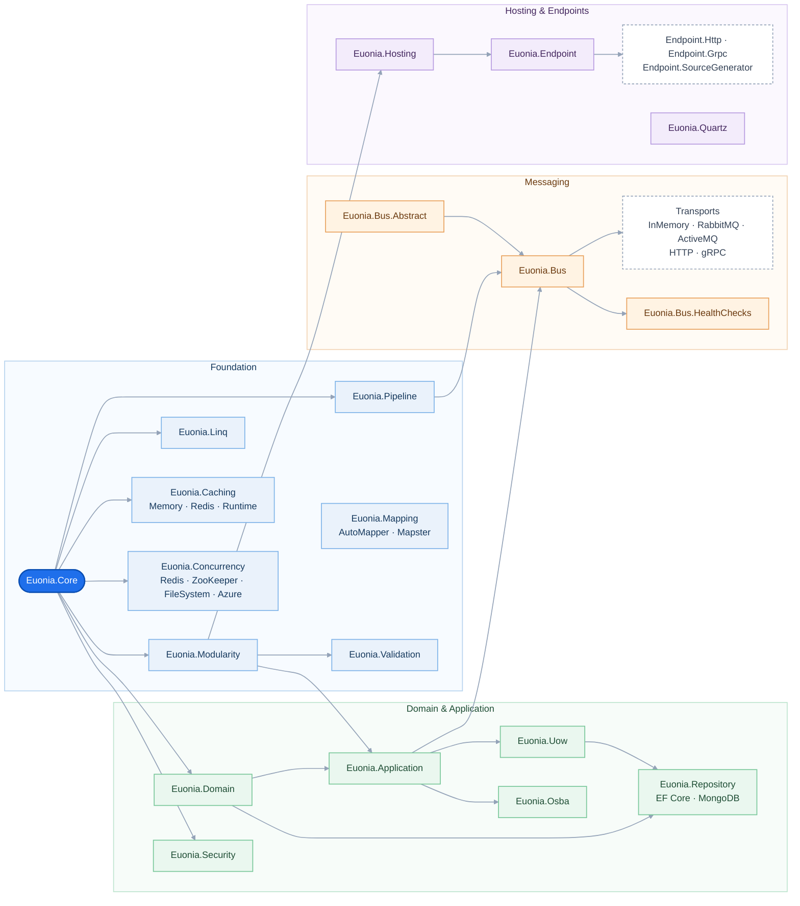

# Euonia (.NET)

> *Eunoia* — from Greek *εὔνοια*: beautiful thinking, goodwill, a well-disposed mind.

Euonia is a development framework for building enterprise-grade .NET applications and services. It combines **Object-Oriented Scalable Business Architecture (OSBA)** with **Domain-Driven Design (DDD)** and provides complete infrastructure: from base primitives, modular hosting, domain modeling, business objects, permission policies, and the message bus, all the way to repositories, caching, distributed synchronization, and dynamic HTTP/gRPC endpoints.

- **Current version**: 2026.4.7 (see [project.props](project.props))
- **Target frameworks**: .NET 10 / .NET 11; test and sample projects target .NET 11, and the Endpoint Source Generator ships as a `netstandard2.0` analyzer
- **Package scale**: 39 packable projects under Source, each with its own README
- **Tests**: 27 test/fixture projects with 1,100+ test cases; plus 2 BenchmarkDotNet benchmark projects
- **License**: GPL-3.0 (see [LICENSE](LICENSE))

Euonia is also available for **[Java](https://github.com/euonia-project/euonia-java)**; this repository is the **.NET edition**.

## Table of Contents

- [Modules Overview](#modules-overview)
- [Package Overview](#package-overview)
- [Core Layer](#core-layer)
- [Domain and Application Layer](#domain-and-application-layer)
- [Message Bus](#message-bus)
- [Hosting and Endpoints](#hosting-and-endpoints)
- [Sample Application](#sample-application)
- [Getting Started](#getting-started)
- [Build, Test, and Benchmarks](#build-test-and-benchmarks)
- [Project Structure](#project-structure)
- [Versioning and Compatibility](#versioning-and-compatibility)
- [Documentation and Links](#documentation-and-links)

## Modules Overview

Euonia follows a layered design: the lower layers are capability packages that have no business dependencies, and the upper layers are composed into applications through the module system. Dependencies between packages stay unidirectional, and the business object runtime and the permission engine can be used independently.



> Dashed boxes group adapter/provider packages. Arrows indicate the main dependency or composition relationships and do not cover every project reference; the complete dependency set is defined by each project's `.csproj`.

### Design Orientation

- **Not tied to a single architecture**: DDD, CQRS, MVVM, CRUD, and low-code can all be composed on the same set of primitives; Osba does not depend on `Euonia.Domain`, and Domain is only an optional higher-level modeling approach.
- **Secure by default**: permission decisions are fail-closed, Endpoint HTTP/gRPC requires authorization by default, and message bus remote endpoints require authorization by default.
- **Authorization values are never frozen**: permission codes and row-level grants are resolved live from application data, so revocation takes effect immediately without reissuing tokens.
- **Stable contracts**: public APIs aim to remain source-compatible; breaking changes are collected in [CHANGELOG.md](CHANGELOG.md).
- **Observable**: modules such as Bus and Osba expose runtime state through `ActivitySource`, `Meter`, and structured logging, and can be wired into OpenTelemetry directly.

## Package Overview

### Foundation and Cross-Cutting Capabilities

| Package | Target framework | Description |
|---|---|---|
| [Euonia.Core](Source/Euonia.Core/README.md) | net10.0 / net11.0 | Base primitives: ID generation, collections, reflection, async coordination, disposal patterns, HTTP exceptions, permission contracts, and extension methods |
| [Euonia.Modularity](Source/Euonia.Modularity/README.md) | net10.0 / net11.0 | Module system, dependency graph, conventional service registration, sync/async lifecycle, plugin modules, and accessors |
| [Euonia.Pipeline](Source/Euonia.Pipeline/README.md) | net10.0 / net11.0 | Typed middleware pipeline inspired by ASP.NET Core, with priority ordering, DI, and automatic behavior discovery |
| [Euonia.Linq](Source/Euonia.Linq/README.md) | net10.0 / net11.0 | Specification pattern, predicate/expression builders, paging and sorting, and `IQueryable` extensions |
| [Euonia.Mapping](Source/Euonia.Mapping/README.md) | net10.0 / net11.0 | `ITypeAdapter` abstraction decoupled from mapping libraries, plus the `ProjectedAs` facade |
| [Euonia.Mapping.Automapper](Source/Euonia.Mapping.Automapper/README.md) | net10.0 / net11.0 | AutoMapper backend and module registration |
| [Euonia.Mapping.Mapster](Source/Euonia.Mapping.Mapster/README.md) | net10.0 / net11.0 | Mapster backend and module registration |
| [Euonia.Validation](Source/Euonia.Validation/README.md) | net10.0 / net11.0 | FluentValidation integration, generic/range/regex validators, and bindable validatable objects |
| [Euonia.Caching](Source/Euonia.Caching/README.md) | net10.0 / net11.0 | Multi-level caching framework: layered cache handles, cache manager, backplane synchronization, and fluent configuration |
| [Euonia.Caching.Memory](Source/Euonia.Caching.Memory/README.md) | net10.0 / net11.0 | `Microsoft.Extensions.Caching.Memory` provider and `ICacheService` implementation |
| [Euonia.Caching.Redis](Source/Euonia.Caching.Redis/README.md) | net10.0 / net11.0 | Redis distributed cache handle, backplane, and `ICacheService` implementation |
| [Euonia.Caching.Runtime](Source/Euonia.Caching.Runtime/README.md) | net10.0 / net11.0 | `System.Runtime.Caching` provider and `ICacheService` implementation |
| [Euonia.Concurrency](Source/Euonia.Concurrency/README.md) | net10.0 / net11.0 | Distributed lock and semaphore abstractions: timeouts, cancellation, async acquisition, and handle-loss monitoring |
| [Euonia.Concurrency.Redis](Source/Euonia.Concurrency.Redis/README.md) | net10.0 / net11.0 | Lock and semaphore implementations built on StackExchange.Redis, with lease renewal |
| [Euonia.Concurrency.ZooKeeper](Source/Euonia.Concurrency.ZooKeeper/README.md) | net10.0 / net11.0 | Lock and semaphore implementations based on ZooKeeper ephemeral sequential nodes |
| [Euonia.Concurrency.FileSystem](Source/Euonia.Concurrency.FileSystem/README.md) | net10.0 / net11.0 | Cross-process mutual exclusion based on lock files, for single machines or shared volumes |
| [Euonia.Concurrency.Azure](Source/Euonia.Concurrency.Azure/README.md) | net10.0 / net11.0 | Distributed locks based on Azure Blob leases |

### Domain, Application, and Permissions

| Package | Target framework | Description |
|---|---|---|
| [Euonia.Domain](Source/Euonia.Domain/README.md) | net10.0 / net11.0 | DDD building blocks: entities, aggregate roots, value objects, domain events, commands, auditing, and entity cache contracts |
| [Euonia.Application](Source/Euonia.Application/README.md) | net10.0 / net11.0 | Use cases, application services, Castle interceptors, and message pipeline behaviors |
| [Euonia.Uow](Source/Euonia.Uow/README.md) | net10.0 / net11.0 | Unit of work, transaction boundaries, ambient context, and the `[UnitOfWork]` interceptor |
| [Euonia.Repository](Source/Euonia.Repository/README.md) | net10.0 / net11.0 | Persistence-agnostic repository abstractions, context providers, entity contracts, and paging/sorting extensions |
| [Euonia.Repository.EfCore](Source/Euonia.Repository.EfCore/README.md) | net10.0 / net11.0 | EF Core context base classes, repository implementation, value converters, and ID value generators |
| [Euonia.Repository.Mongo](Source/Euonia.Repository.Mongo/README.md) | net10.0 / net11.0 | MongoDB context, repository, model configuration, and transaction support |
| [Euonia.Osba](Source/Euonia.Osba/README.md) | net10.0 / net11.0 | Object-Oriented Scalable Business Architecture: rich business object runtime, rules, factories, actuators, lifecycle, and permission boundaries |
| [Euonia.Security](Source/Euonia.Security/README.md) | net10.0 / net11.0 | Policy engine for operation permissions and row-level data permissions, usable standalone without Osba |

### Message Bus

| Package | Target framework | Description |
|---|---|---|
| [Euonia.Bus.Abstract](Source/Euonia.Bus.Abstract/README.md) | net10.0 / net11.0 | Envelope/context, message conventions, transport strategies, reliability stores, recipients, and event contracts |
| [Euonia.Bus](Source/Euonia.Bus/README.md) | net10.0 / net11.0 | Bus engine: handler discovery, dispatch, serialization, outbox/inbox/dead letters, and telemetry |
| [Euonia.Bus.InMemory](Source/Euonia.Bus.InMemory/README.md) | net10.0 / net11.0 | In-process transport, suitable for development, testing, and single-process scenarios |
| [Euonia.Bus.RabbitMq](Source/Euonia.Bus.RabbitMq/README.md) | net10.0 / net11.0 | RabbitMQ transport: fanout exchanges, direct queues, priority, dead lettering, and Polly retries |
| [Euonia.Bus.ActiveMq](Source/Euonia.Bus.ActiveMq/README.md) | net10.0 / net11.0 | ActiveMQ transport: topics/queues, temporary reply queues, and correlation IDs |
| [Euonia.Bus.Http](Source/Euonia.Bus.Http/README.md) | net10.0 / net11.0 | HTTP remote-call transport (`CallAsync`), sharing the `RemoteReply` protocol with gRPC |
| [Euonia.Bus.Grpc](Source/Euonia.Bus.Grpc/README.md) | net10.0 / net11.0 | gRPC generic invocation, server-side receiving, interceptors, health checks, and auto-discovery |
| [Euonia.Bus.HealthChecks](Source/Euonia.Bus.HealthChecks/README.md) | net10.0 / net11.0 | Health checks for transporters, the outbox, the inbox, and dead-letter backlog |

### Hosting, Endpoints, and Scheduling

| Package | Target framework | Description |
|---|---|---|
| [Euonia.Hosting](Source/Euonia.Hosting/README.md) | net10.0 / net11.0 | ASP.NET Core host bootstrap, request context, exception/tracing middleware, JWT/introspection authentication, and authorization extensions |
| [Euonia.Endpoint](Source/Euonia.Endpoint/README.md) | net10.0 / net11.0 | `[ExposeWebApi]` / `[ExposeGrpc]` contracts and shared data contracts; does not depend on ASP.NET Core |
| [Euonia.Endpoint.Http](Source/Euonia.Endpoint.Http/README.md) | net10.0 / net11.0 | Maps marked service methods to Minimal APIs, generation first with a runtime fallback |
| [Euonia.Endpoint.Grpc](Source/Euonia.Endpoint.Grpc/README.md) | net10.0 / net11.0 | Code-first gRPC runtime based on protobuf-net.Grpc, with method-level authorization and proto export |
| [Euonia.Endpoint.SourceGenerator](Source/Euonia.Endpoint.SourceGenerator/README.md) | netstandard2.0 analyzer | Generates HTTP lambdas, gRPC contracts/adapters, and registration markers at build time |
| [Euonia.Quartz](Source/Euonia.Quartz/README.md) | net10.0 / net11.0 | Quartz.NET 4 integration: attributed jobs, four trigger types, and fluent configuration |

## Core Layer

### Core (`Euonia.Core`)

> The foundation library reused by every other package.

| Namespace | Contents |
|---|---|
| `Nerosoft.Euonia` | `ObjectId` (Snowflake / UUID / ULID / Random), `ShortUniqueId`, `GuidGenerator`, `UlidGenerator`, `SnowflakeId`, `Singleton<T>`, `Clock`, `Check`, `Optional<T>`, `Unit`, `Weak<T>`, `ObjectPool<T>` |
| `Nerosoft.Euonia.Collections` | `DequeCollection<T>`, `PageableCollection<T>`, `TreeView<T>`, `TypeList<T>`, `ObservableGroup<TKey,TValue>`, `ObservableGroupedCollection<T>`, `ViewCollection<T>` |
| `Nerosoft.Euonia.Disposing` | Synchronous/asynchronous exactly-once disposal primitives: `SingleDisposable<T>`, `AsyncSingleDisposable<T>`, `CollectionDisposable`, `NoopDisposable` |
| `Nerosoft.Euonia.Reflection` | `AssemblyHelper`, `AssemblyLoadContextManager`, `TypeHelper`, `Reflect` / `Reflect<T>`, `EnumHelper`, `EnumParser<T>`, `PropertyAccessorCache<T>`, `MethodInvokerBuilder` |
| `Nerosoft.Euonia.Threading` | `AsyncLock`, `AsyncSemaphore`, `AsyncManualResetEvent`, `AsyncAutoResetEvent`, `AsyncConditionVariable`, `AsyncMonitor`, `AsyncCountdownEvent`, `AsyncLazy<T>`, `AsyncProducerConsumerQueue<T>`, `AsyncCollection<T>`, `AsyncContext`, `PauseToken`, `StatefulMutex` |
| `Nerosoft.Euonia.Security` | `UserPrincipal`, `UserClaimTypes`, `BusinessOperation`, `PermissionAttribute`, `IPermissionChecker`, `IPermissionCodeSource`, `IObjectScopeAuthorizer`, `IObjectOperationResolver`, and other permission contracts |
| `System` (exceptions) | `BadRequestException`, `ForbiddenException`, `NotFoundException`, `ConflictException`, `InternalServerErrorException`, `BadGatewayException`, `GatewayTimeoutException`, `MethodNotAllowedException`, `RequestTimeoutException`, `TooManyRequestsException`, `ServiceUnavailableException`, `UpgradeRequiredException`, `BusinessException`, `ConfigurationException`, `InvalidValueException` |

Common extension methods cover string casing/validation/masking, collection topological sorting and paging, types and assemblies, claims, events, task coordination, and more. Exception types are uniformly mapped to HTTP status codes through `[HttpStatusCode]` and `HttpStatusException`.

> `Euonia.Core` only defines the permission **contracts**; policy compilation and evaluation live in `Euonia.Security`, and the two can be used independently.

### Modularity (`Euonia.Modularity`)

> Split an application into composable modules, load them along the dependency graph, and manage service registration and lifecycle in one place.

| Capability | Description |
|---|---|
| Modules and dependencies | `ModuleContextBase`, `[DependsOn]`; the load phase validates circular dependencies, self-dependencies, and invalid module types, and the dependency snapshot is immutable |
| Application factory | `ApplicationFactory.Create/CreateAsync<TStartupModule>`, `AddModularityApplication<TStartupModule>`; `Initialize` / `Shutdown` / `Dispose` are idempotent and thread-safe |
| Lifecycle | `AheadConfigureServices` → `ConfigureServices` → `AfterConfigureServices` → `OnApplicationInitialization` → `OnApplicationShutdown`, each with an asynchronous version; when an async method is not overridden it falls back to the synchronous implementation |
| Plugin modules | `IModuleSource`, `DelegateModuleSource`, `FileModuleSource`, `FolderModuleSource`; `ApplicationCreationOptions.AddModuleSource/AddModuleFolder/AddModuleFiles` |
| Automatic registration | `ITransientDependency` / `IScopedDependency` / `ISingletonDependency`, `[ExposeServices]`, `[ExportService]` (may appear multiple times), `[DisableAutomaticRegistration]`; `AddAssemblyOf(Type)`, `AddTypes(...)` |
| Accessors | Scoped `IServiceAccessor`, `IRequestContextAccessor`, `IObjectAccessor<T>`, `ILazyServiceProvider` (including keyed resolution) |
| Named services | `GetNamedService<T>(name)`; the named registry is isolated per `IServiceCollection` to avoid name collisions across containers |
| Configuration | An explicit `IConfiguration` is no longer ignored; when no environment name is specified it falls back to `DOTNET_ENVIRONMENT` / `ASPNETCORE_ENVIRONMENT`; `ReloadOnChange` is supported |

Plugin module example:

```csharp
var application = await ApplicationFactory.CreateAsync<HostModule>(
    services,
    configuration,
    options =>
    {
        options.AddModuleFolder("plugins", SearchOption.AllDirectories);
        options.AddModuleFiles("extensions/Reporting.dll");
    });
```

### Pipeline (`Euonia.Pipeline`)

> A typed middleware pipeline where `IPipeline<TRequest, TResponse>` uniformly covers both fire-and-forget and request/response scenarios.

| Type | Purpose |
|---|---|
| `IPipeline<TRequest, TResponse>` | Pipeline contract: `Use`, `Build`, `RunAsync` |
| `IPipelineBehavior<TRequest, TResponse>` | Behavior that wraps the inner handler: `HandleAsync(request, next)` |
| `PipelineBase<TRequest, TResponse>` | Base implementation that builds the chain in reverse, so the innermost handler executes first |
| `DefaultPipelineProvider<TRequest, TResponse>` | Resolves behaviors from `IServiceProvider` and compiles the delegate |
| `PipelineBehaviorAttribute` | Declares behaviors and their priority on the request type |
| `AddPipeline()` | Registers the pipeline infrastructure services |

```csharp
var pipeline = new DefaultPipelineProvider<OrderContext, OrderResult>(serviceProvider)
    .Use<LoggingBehavior>()
    .Use(async (context, next) =>
    {
        var result = await next(context);
        return result;
    });

var result = await pipeline.RunAsync(new OrderContext(42));
```

### Linq (`Euonia.Linq`)

> Model query conditions as composable, reusable objects.

- **Specifications**: `Specification<T>` supports `&`, `|`, and `!`, and `ISpecification<T>` can be passed directly to repositories / `IQueryable`.
- **Expression building**: `PredicateBuilder`, `Lambda.ParsePredicate`, `PredicateExpressionBuilder<T>`.
- **Range specifications**: `SegmentSpecification` for integers, longs, floating point, decimal, date, time, and time span.
- **Query builder**: `QueryHandler<T>` composes filtering, paging, and sorting, and also provides `GetCount`.
- **Extensions**: `Where(specification)`, `WhereIf`, `WhereIfNotEmpty`, `Between`, `OrderBy(propertyName, sortType)`.

### Mapping (`Euonia.Mapping`)

> Business code depends only on the abstraction, so the concrete mapping library can be replaced.

| Package | Entry points |
|---|---|
| `Euonia.Mapping` | `ITypeAdapter`, `ITypeAdapterFactory`, `TypeAdapter.ProjectedAs<T>()`, `ProjectedAsCollection<T>()` |
| `Euonia.Mapping.Automapper` | `AutomapperModule`, `AutomapperOptions`, `AutomapperTypeAdapterFactory` |
| `Euonia.Mapping.Mapster` | `MapsterModule`, `MapsterOptions`, `MapsterTypeAdapterFactory` |

### Validation (`Euonia.Validation`)

- **Single entry point**: `Validator.Validate<T>` / `ValidateAsync<T>`; a failure throws `ValidationException`.
- **FluentValidation integration**: `AddValidator(types)`, and `ValidationModule` automatically registers `IValidator<T>`.
- **Bindable objects**: `ValidatableObject<T>` supports validation as values change and exposes an error collection.
- **Lightweight rules**: `GenericValidator<T>`, `RegularValidator`, `RangeValidator<T>`.
- **Result model**: `ValidationResult`, `ValidationException`.

### Caching (`Euonia.Caching`)

> Organize memory and distributed caches into layers through cache handles, orchestrated by `ICacheManager<T>`.

| Package | Providers |
|---|---|
| `Euonia.Caching` | Multi-level orchestration, `CacheFactory`, `ConfigurationBuilder`, `DictionaryCacheHandle<T>`, `CacheBackplane`, `ICacheService` / `BaseCacheService` |
| `Euonia.Caching.Memory` | `MemoryCacheHandle<T>`, `MemoryCacheService`, `WithMemoryCacheHandle(...)` |
| `Euonia.Caching.Redis` | `RedisCacheHandle<T>`, `RedisCacheService`, Redis backplane, `WithRedisCacheHandle(...)` |
| `Euonia.Caching.Runtime` | `RuntimeCacheHandle<T>`, `RuntimeCacheService`, `WithRuntimeCacheHandle(...)` |

```csharp
var cache = CacheFactory.Build<string>("app", settings =>
{
    settings.WithUpdateMode(CacheUpdateMode.Up)
            .WithMemoryCacheHandle("memory");
});

cache.Add("greeting", "hello");
var value = cache.GetOrAdd("user:1", _ => LoadUserName(1));
```

### Concurrency (`Euonia.Concurrency`)

> A unified contract for distributed locks and semaphores. Handle acquisition supports synchronous and asynchronous modes, timeouts, and cancellation, and notifies the caller through `HandleCancellationToken` when the connection or lease is lost.

| Package | Capabilities |
|---|---|
| `Euonia.Concurrency` | `ILockFactory`, `ILockProvider`, `ISemaphoreFactory`, `ISemaphoreProvider`, `ISynchronizationHandle`, and convenience extensions |
| `Euonia.Concurrency.Redis` | Redis locks/semaphores, lease renewal, `MinValidityTime`, busy-wait backoff |
| `Euonia.Concurrency.ZooKeeper` | Ephemeral sequential node locks/semaphores, session and connection timeouts, authentication, and ACLs |
| `Euonia.Concurrency.FileSystem` | Cross-process mutual exclusion via lock files, for single machines or shared volumes |
| `Euonia.Concurrency.Azure` | Blob lease locks, automatic renewal, lease duration, and backoff configuration |

```csharp
var locker = lockFactory.Create($"inventory:{sku}");
await using var handle = await locker.AcquireAsync(
    TimeSpan.FromSeconds(10),
    cancellationToken);

// critical section
```

## Domain and Application Layer

### Domain (`Euonia.Domain`)

> Persistence-agnostic DDD building blocks.

| Type | Purpose |
|---|---|
| `Entity` / `Entity<TKey>` | Typed identity, transient detection, and identity-based equality |
| `Aggregate<TKey>` | Aggregate root and domain event management: `RaiseEvent`, `GetEvents`, `GetAndClearEvents`, `LoadFromHistory` |
| `ValueObject<T>` | Reflection-based immutable value object that automatically implements `Equals`, `GetHashCode`, and `==` / `!=` |
| `DomainEvent` / `ApplicationEvent` | Domain events and application-layer integration events; can produce an `EventAggregate` snapshot carrying sequence number, intent, and origin |
| `EventAggregate` | Event persistence snapshot: Id, EventId, Timestamp, TypeName, EventPayload, EventSequence |
| `Command` / `Command<TData>` | Automatically generates `CommandId`; extensible `Properties` dictionary |
| `CommandResponse` / `CommandStatus` | Command execution result and status (`Succeed` / `Failure` / `Canceled`) |
| `IAggregateRoot<TKey>` / `IHasDomainEvents` / `IDomainService` | Contracts for aggregate roots, event carriers, and domain services |
| `AuditedAttribute` / `AuditingRecord` / `IAuditingStore` / `AuditingOptions` | Change auditing |
| `EntityCacheAttribute` / `IEntityCache` | Entity cache contracts |

### Application (`Euonia.Application`)

> Application-layer building blocks: use cases, application services, Castle interceptors, and bus pipeline behaviors.

**Core types**

| Type | Purpose |
|---|---|
| `IServiceContext` / `ServiceContextBase` | Describe assemblies, lifetime, and the automatic registration switch; `services.Register<TContext>()` scans and registers application services and pipeline behaviors |
| `IApplicationService` / `BaseApplicationService` | Application service contract and base class; lazily loads `IBus`, `UserPrincipal`, the request context, logging, and the use case executor through `ILazyServiceProvider` |
| `IUseCase<TInput,TOutput>` / `IUseCaseExecutor` | Typed use cases and executor; results are dispatched to a presenter |
| `IUseCasePresenter<TOutput>` / `DefaultUseCasePresenter<TOutput>` | Presentation of success/failure/cancellation results |
| `ApplicationModule` | Registers all interceptors, pipeline behaviors, presenters, and the use case executor |

**Interceptors (11)**

| Interceptor | Trigger | Purpose |
|---|---|---|
| `LoggingInterceptor` | All application service methods | Logs arguments at Debug level (sensitive arguments masked); logs exceptions and rethrows them unchanged |
| `AuthorizationInterceptor` | `[Authorize]` | Validates sign-in state and roles |
| `ValidationInterceptor` | `[NotNull]` / `[Validation]` | Validates arguments through `Validator` |
| `TracingInterceptor` | All methods (when Debug is enabled) | Records the call chain, `X-Request-Trace-Id`, and `X-Correlation-ID` |
| `LockInterceptor` | `[Lock]` / `[DistributedLock]` / `[SemaphoreLock]` | In-process semaphore, distributed lock, or distributed semaphore |
| `TimingInterceptor` | `[Timing]` | Records elapsed time and warns when the threshold is exceeded |
| `CacheInterceptor` | `[Cache]` | Caches method results |
| `CacheEvictionInterceptor` | `[CacheEvict]` | Evicts cached entries by group/key |
| `IdempotentInterceptor` | `[Idempotent]` | Executes the same fingerprint only once within the idempotency window |
| `RetryInterceptor` | `[Retry]` | Fixed/linear/exponential backoff retries |
| `CircuitBreakerInterceptor` | `[CircuitBreaker]` | Short-circuits once the failure rate exceeds the threshold |

**Pipeline behaviors (3)**

| Behavior | Purpose |
|---|---|
| `ValidationBehavior` | Performs validation before the message is handled |
| `UserContextBehavior` | Writes the current user identity into message metadata |
| `CorrelationIdBehavior` | Ensures the message carries a correlation ID |

```csharp
internal sealed class SalesServiceContext : ServiceContextBase
{
    public override void ConfigureServices(IServiceCollection services)
    {
        // Additional services
    }
}

builder.Services.Register<SalesServiceContext>();

public sealed class OrderApplicationService : BaseApplicationService, IApplicationService
{
    [Cache(Key = "order:{0}", TimeoutSeconds = 60, Groups = new[] { "orders" })]
    public Task<OrderDto?> GetAsync(long id, CancellationToken cancellationToken)
        => throw new NotImplementedException();

    [Retry(MaxRetries = 3, DelayMs = 200, Backoff = RetryBackoffMode.Exponential)]
    [DistributedLock("order:{id}")]
    public Task SubmitAsync(long id, CancellationToken cancellationToken)
        => throw new NotImplementedException();
}
```

> The message logging behavior `MessageLoggingBehavior` belongs to `Euonia.Bus` and is registered by `MessageBusModule`; it is not part of `ApplicationModule`.

### UoW (`Euonia.Uow`)

> Defines transaction boundaries, the commit/rollback lifecycle, and the ambient unit of work.

| Type | Purpose |
|---|---|
| `IUnitOfWork` | `SaveChangesAsync`, `RollbackAsync`, `CompleteAsync`, the `Items` dictionary, and the nested `Outer` |
| `IUnitOfWorkManager` | Creates/manages unit-of-work scopes: `Begin(options, requiresNew)` |
| `IUnitOfWorkAccessor` | Accesses the current ambient unit of work (`AsyncLocal`) |
| `UnitOfWork` / `ChildUnitOfWork` | Full implementation and nested lightweight proxy (`CompleteAsync` delegates to the parent) |
| `UnitOfWorkInterceptor` | Castle interceptor that automatically wraps `[UnitOfWork]` / `IUnitOfWorkEnabled` methods |
| `UnitOfWorkOptions` | `IsTransactional`, `IsolationLevel`, `Timeout` |
| `UnitOfWorkModule` / `AddUnitOfWork()` | Registers the UoW infrastructure and interceptor |

With `IsTransactional = true` a real database transaction is opened: `CompleteAsync` commits, and disposing without completion rolls back. `[UnitOfWork]` supports `Task`, `Task<T>`, `ValueTask`, and `ValueTask<T>`, and never commits early.

### Repository (`Euonia.Repository`)

> Persistence-agnostic repository abstractions, with implementations provided by EF Core and MongoDB.

| Type | Purpose |
|---|---|
| `IRepository<TEntity>` | Query, CRUD, and paging; every write operation supports `autoSave` |
| `IRepository<TEntity,TKey>` / `IRepository<TContext,TEntity,TKey>` | Key-based queries / context-bound repositories |
| `IRepositoryContext` | `SetOf<T>()`, `SaveChangesAsync`, transactions, commit/rollback |
| `IContextProvider` / `IContextFactory` | Resolves contexts through an ordered factory chain |
| `IConnectionStringResolver` / `[ConnectionString]` | Connection string resolution |
| Entity contracts | `IEntity`, `IAuditable`, `IHasCreateTime`, `IHasUpdateTime`, `IHasDeleteTime`, `IHasSnowflakeId`, `ITombstone`, `IConcurrentEntity` |
| `RepositoryExtensions` | `Paginate`, `Sort`, `GetPagedCollectionAsync` |

**EF Core**

- `DataContextBase<TContext>` implements `IRepositoryContext` and automatically applies configurations, soft-delete query filters, and audit fields.
- `AddEfCoreRepository<TContext>(options, lifetime)` registers the `DbContext`, the open-generic repository, and the unit of work; `AddDataContextFactory<TContext>(lifetime)` registers `IDbContextFactory`.
- Value generators: `SnowflakeIdValueGenerator`, `UlidValueGenerator`, `ShortUniqueIdValueGenerator`, `SequentialGuidValueGenerator`, `GuidVersion7ValueGenerator`, `RowVersionValueGenerator`, `UtcTimeValueGenerator`.
- Value converters: `UniversalTimeConverter`; connection configuration: `ConnectionConfigurator`.

**MongoDB**

- `DataContextBase<TContext>` is based on `MongoDbContext` and supports client sessions and typed collection access.
- `AddMongoRepository<TContext>(options, lifetime)` registers the context, the repository, and the unit-of-work factory.
- `MongoDbOptions.UseConnection(...)` / `UseDatabase(...)`; `ModelProfile<T>` / `ModelBuilder` configure collection mappings.
- Replica-set environments support `BeginTransactionAsync` / `CommitAsync` / `RollbackAsync`.

```csharp
services.AddEfCoreRepository<AppDbContext>(options =>
{
    options.UseSqlite(configuration.GetConnectionString("Default"));
});

public sealed class OrderService(IRepository<AppDbContext, Order, long> repository)
{
    public Task<Order?> GetAsync(long id, CancellationToken cancellationToken)
        => repository.GetAsync(id, cancellationToken);

    public async Task<Order> CreateAsync(Order order, CancellationToken cancellationToken)
        => await repository.InsertAsync(order, autoSave: true, cancellationToken);
}
```

### OSBA (`Euonia.Osba`)

> **Object-Oriented Scalable Business Architecture**: models "one business operation" as an object, and the framework performs property storage, change tracking, rule validation, factory dispatch, actuator orchestration, and permission adjudication at the right moments.

Osba is neither an ORM nor a DDD-only framework; it is a **business model runtime**. It does not depend on `Euonia.Domain`, EF Core, or `Euonia.Security`; DDD and a concrete authorization engine are both optional upper-layer compositions.

#### Object Hierarchy

```text
ObjectBase                         —— Common root: properties, rules, context, lifecycle, permissions
└── ObjectBase<T>                  —— Property registration (RegisterProperty)
     ├── BusinessObject<T>         —— Change tracking (ChangedProperties / AcceptChanges)
     │    ├── ObservableObject<T>  —— NEW / CHANGED / DELETED state
     │    │    └── EditableObject<T> —— Async rule validation and saving
     │    └── ReadOnlyObject<T>    —— Read-only object (populatable within a factory-load scope)
     └── ServiceObject<T>          —— Standalone business operation; has properties and rules, no change tracking
```

> `IServiceObject` only composes `IOsbaObject` and `IHasRuleCheck` and does not extend `IBusinessObject`; only `IBusinessObject` promises editable-object contracts such as `INotifyPropertyChanged` / `INotifyPropertyChanging`.

#### Capability List

- **Property system**: type-level metadata cache, per-instance field array, ring-buffer undo history, observable values, and parent/child object graphs.
- **Change tracking**: `ChangedProperties`, `HasChangedProperties`, `AcceptChanges`, `MarkAsClean`; a property changed back to its baseline value is automatically removed from the changed set.
- **Domain object control**: `GetOriginalValue`, `GetOriginalValues`, `GetChangedValues`, `RejectChanges`, and overridable `CanTransitionTo` / `StateChanged`.
- **Rule system**: object-level `ObjectRuleBase` / `IObjectRule`, property-level `PropertyRuleBase` / `IPropertyRule`, `CommonRule.Required/Regular/Lambda`, `DataAnnotationRule`, `ExecuteOnStateAttribute`; supports priority, severity, and per-operation bypass.
- **Factories**: lookup over two channels, conventional name plus attribute; supports optional parameters, `params`, `Task` / `ValueTask`; the public operations of `BusinessObjectFactory` can be overridden by derived types.
- **Actuators**: `IActuator.For<T>().Fetch/Create/Update/Delete/Execute(...)` chains "fetch object → Handle → finalize" into a pipeline and can attach `IActuatorBehavior<T>`.
- **Lifecycle callbacks**: `IObjectLifecycle` provides `OnSavingAsync` / `OnSavedAsync` / `OnExecutingAsync` / `OnExecutedAsync`.
- **Permission boundary**: type-level/method-level `[Permission]` and row-level data permissions; the contracts live in `Euonia.Core`, and Osba implements only its own half without referencing `Euonia.Security`.
- **Diagnostics**: `ActivitySource("Euonia.Osba")`, `Meter("Euonia.Osba")`, and the host's `ILoggerFactory`.
- **Startup validation**: `OsbaOptions.ValidateOnStartup` checks factory signatures, `[Inject]` resolvability, property metadata, and missing persistence methods.

#### Wiring

```csharp
services.AddBusinessObject(options =>
{
    options.ValidateOnStartup = true;      // recommended for production hosts
    options.StrictFactoryMethods = true;   // saving fails immediately when Insert/Update/Delete are missing
    options.EnableDiagnostics = true;      // ActivitySource / Meter
}, typeof(Order).Assembly);
```

`BusinessContextAccessor` no longer writes the ambient context automatically on resolve; ASP.NET middleware or manual scopes should call `SetCurrent(...)` explicitly and `Clear()` in a `finally` block.

#### Rules

```csharp
protected override void AddRules()
{
    // Object-level: parameterless ctor ⇒ Property == null, runs on save
    Rules.AddRule<PasswordStrengthRule>();

    // Property-level: pass the registered PropertyInfo<T>
    Rules.AddRule<CommonRule.Required>(NameProperty);
    Rules.AddRule(new CommonRule.Regular(EmailProperty, @"^[\w-\.]+@([\w-]+\.)+[\w-]{2,4}$"));

    // Convenience lambda overload
    Rules.AddRule<Order>(AmountProperty, order => order.Amount > 0, "Amount must be greater than 0");
}
```

Rule instances are **type-level shared singletons** and must not hold per-instance or per-request state; when dependencies are needed, obtain them from `IRuleContext.ServiceProvider` or `context.Target → BusinessContext`.

#### Permissions

How Osba and the permission engine divide the work:

| | Operation permission | Data permission |
|---|---|---|
| Answers | **Whether the current user can perform an operation** | **Which data rows the current user can see/act on** |
| Granularity | Type-level `[Permission]` + row-level (policies declared by authorization identifier) | Row-level |
| Enforcement point | `BusinessObjectFactory` call boundary | Query pushdown + factory save boundary |
| Failure mode | `SecurityException` | The row is excluded from queries / saving throws `SecurityException` |

The two are not an adapter relationship: Osba only faces the Core permission contracts, and a host wires them together with two lines, `AddBusinessObject(asm)` + `AddPermission(...)`, or it can register only its own implementations. For complete wiring and multi-scenario examples, see [`Source/Euonia.Osba/PERMISSION.md`](Source/Euonia.Osba/PERMISSION.md), [`PERMISSION-SAMPLE.md`](Source/Euonia.Osba/PERMISSION-SAMPLE.md), and [`PERMISSION-DESIGN.md`](Source/Euonia.Osba/PERMISSION-DESIGN.md).

#### Reading Entry Points

- Architecture, usage, and file-by-file structure: [`Source/Euonia.Osba/README.md`](Source/Euonia.Osba/README.md)
- Design trade-offs: [`DESIGN.md`](Source/Euonia.Osba/DESIGN.md)
- End-to-end example: [`SAMPLE.md`](Source/Euonia.Osba/SAMPLE.md)

### Security (`Euonia.Security`)

> A standalone permission policy engine for operation permissions and row-level data permissions, with no dependency on any object model, user model, or application framework.

#### The Two Tracks

| | Operation permission | Data permission |
|---|---|---|
| Answers | **Whether the current user can perform an operation** | **Which data rows the current user can see/act on** |
| Output | `IPermissionChecker` | `IScopeGuard` |
| Basis | `[Permission]` permission code/role, or a host-defined decision | Resource dimension × authorization set resolved live from application data |
| Failure | Assertion failure, adjudicated by the caller | Evaluated as inaccessible |

#### Wiring

```csharp
services.AddPermission(permission => permission
    .Scan(typeof(Order).Assembly)
    .OnAttributeOrName(BusinessOperation.Read,   "Order", typeof(FetchAttribute))
    .OnAttributeOrName(BusinessOperation.Create, "Order", typeof(CreateAttribute)));

services.AddScoped<IScopeSubjectResolver, MySubjectResolver>();
services.AddUserPrincipal();   // ASP.NET Core hosts; non-web hosts must register the current principal themselves
```

- Rules must be stated explicitly; when there is no method-level permission code, use `p.NoOperationCodes()` to assert so explicitly rather than silently allowing access by "forgetting to configure".
- `AddPermission` can be called multiple times; the scanned assemblies, permission code sources, and operation rules of each module are merged as a union.
- There is no default `IScopeSubjectResolver`: authorization values are resolved live from data by the application, so revocation takes effect immediately.

#### Evaluation

```csharp
var guard = provider.GetRequiredService<IScopeGuard>();
await guard.EnsureResolvedAsync();              // warm up before synchronous evaluation
var visible = guard.Apply(dbContext.Orders);    // pushed down to the database
guard.Allows(order, BusinessOperation.Read);    // single-row evaluation
guard.Explain(order, BusinessOperation.Read);   // audit: which policy matched
```

Core invariant: a policy compiles into a pair of `Allow` / `Deny` expressions, and **read-side pushdown and single-row evaluation share the same compiled result**; the final verdict is `Allow && !Deny`, and `Deny` always takes precedence. The data permission model and policy are declared in the same `ScopeModel<T>` declaration, fully validated at startup, and configuration errors fail fast.

For more, see [`Source/Euonia.Security/README.md`](Source/Euonia.Security/README.md) and [`DESIGN.md`](Source/Euonia.Security/DESIGN.md).

## Message Bus

### Bus Abstract (`Euonia.Bus.Abstract`)

> The extension foundation for all bus transports and the `Euonia.Bus` engine.

- **Message classification**: `IUnicast`, `IMulticast`, `IRequest<TResponse>`, or the `[Unicast]`, `[Multicast]`, `[Request]` attributes.
- **Envelope and context**: `IMessageEnvelope<T>` carries MessageId, CorrelationId, ConversationId, RequestTraceId, Channel, Authorization, User, Metadata, and Payload; `IMessageContext` provides `Response` / `Failure` / `Complete`.
- **Transport contract**: `ITransporter` defines `PublishAsync`, `SendAsync<TMessage,TResponse>`, and `CallAsync<TRequest,TResponse>`.
- **Conventions and strategies**: `IMessageConvention` classifies messages; `ITransportStrategy` decides whether to use local or distributed transport.
- **Reliability**: `IOutboxStore`, `IInboxStore`, `IDeadLetterStore`, `IDeadLetterService`, and the corresponding entry types.
- **Recipients**: `IRecipientRegistrar`, `IRecipient`, `IConsumer`, `ISubscriber`, `IExecutor`.
- **Execution environment**: `MessageExecutionDescriptor` describes where the service provider and request context come from (new scope, borrowing the caller's scope, envelope override, etc.).
- **Annotations**: `[Channel]`, `[Subscribe]`, `[Enqueue]`, `[LocalMessage]`, `[DistributedMessage]`, `[DispatchIn]`, `[ReceiveIn]`, etc.

### Bus (`Euonia.Bus`)

> The runtime for handler discovery, registration, dispatch, serialization, reliability stores, and telemetry.

| Type | Purpose |
|---|---|
| `IBus` | Top-level API: `PublishAsync` (multicast), `SendAsync` (unicast, with an optional `Subject<T>` callback), `CallAsync` (request-response) |
| `MessageBus` | Orchestration engine: type validation → context resolution → envelope construction → pipeline execution → dispatch decision → transport delivery |
| `IHandler<TMessage>` / `IHandler<TMessage,TResponse>` | Typed handler contracts |
| `[Subscribe("channel")]` | Declares a handler method |
| `IDispatcher` / `StrategicDispatcher` | Strategy matching, cardinality validation, and a transporter-list cache invalidated by configuration version changes |
| `IHandlerContext` / `DefaultHandlerContext` | Manages handlers per channel; unicast executes the first handler, while multicast fans out in parallel to all implementations |
| `MessageHandlerFinder` / `ChannelRegistrar` | Automatically discovers `[Subscribe]` and `IHandler<,>`; idempotent de-duplication |
| `DefaultConfigurator` / `ConfiguratorBuilder` | Conventions, strategies, channel registration, and channel resolvers |
| `ServiceActivator` | Performs automatic assembly and starts transport recipients at startup, and disposes registrars at shutdown |

**Execution scopes**

- In-process `SendAsync` / `CallAsync` reuse the caller's scope, so handlers can share scoped services such as `DbContext` and transactions.
- `PublishAsync` is fire-and-forget and uses a dedicated message scope, while preserving the publisher's request context.
- HTTP/gRPC inbound processing reuses the request scope; cross-process consumption, dead-letter replay, and inbox re-execution use the identity from the envelope.
- Background schedulers uniformly start through `BackgroundExecution.Run` under `ExecutionContext.SuppressFlow()`.

**Three kinds of operations**

| Operation | Method | Message type | Transport strategy | Return value |
|---|---|---|---|---|
| Publish | `PublishAsync` | Multicast | Sent in parallel to all matching transports | `Task` |
| Send | `SendAsync` | Unicast | A single transport | `Task` (or a `Subject<T>` callback) |
| Call | `CallAsync` | Request | A single transport | `Task<TResponse>` |

**Fluent options and delivery properties**

- `PublishOptions` / `SendOptions` / `CallOptions` and the corresponding builders: `WithChannel`, `WithQueue`, `WithPriority`, `WithDelay`, `WithTimeout`, `WithMetadata`, `WithPipeline`.
- `Queue`: overrides the `Send` / `Call` target queue for RabbitMQ / ActiveMQ; ignored when publishing goes through an exchange/topic.
- `Priority`: RabbitMQ writes it into the message properties and clamps it to `[0, min(MaxPriority, 9)]` (the queue must be declared with `x-max-priority`); ActiveMQ maps it to `MsgPriority`.
- `Delay`: an in-process delay **before dispatch** (in milliseconds) that applies uniformly to all built-in transports; a process exit loses messages that are still delayed, so use the outbox or the transport's own delay capability when durable delay is required.

**Reliability: outbox / inbox / dead letters**

| Type | Purpose |
|---|---|
| `InMemoryOutboxStore` / `InMemoryInboxStore` | In-memory implementations (development/reference only); the cache is isolated per store instance |
| `InMemoryDeadLetterStore` | In-memory dead-letter store |
| `OutboxDispatcher` / `InboxDispatcher` | Poll failed records and redeliver/re-execute them; exhausted retries move to the terminal dead-letter state; each round applies the retention policy |
| `DeadLetterService` | Query, replay (redelivery or re-execution depending on the source), and discard |

| Option | Semantics |
|---|---|
| `OutboxOptions.Enabled` / `MaxRetryAttempts` / `PollingInterval` | Outbox switch, maximum redelivery attempts, polling interval |
| `OutboxOptions.RetentionPeriod` / `InboxOptions.RetentionPeriod` | How long terminal entries are retained (default 24 hours; `<= 0` disables cleanup) |
| `InboxOptions.Enabled` | Inbox switch; `UseInbox` is only a sending-side marker |
| `MessageBusOptions.AutoLoadAssemblies` | Simple names of the assemblies scanned for handlers at startup; a load failure fails startup |
| `MessageBusOptions.DefaultTransporter` | Default transporter (shared by dispatch and recipient registration) |

**Registration**

```csharp
services.AddEuoniaBus();
services.AddInMemoryOutbox();       // outbox (optional)
services.AddInMemoryInbox();        // inbox (optional)
services.AddInMemoryDeadLetters();  // dead-letter capture and replay (optional)
services.AddMessageHandler(ServiceLifetime.Scoped, typeof(Program).Assembly);

services.AddConfiguratorBuilder(config => config
    .RegisterChannel(typeof(Program).Assembly)
    .SetConvention(builder => builder.Add<DefaultMessageConvention>())
    .SetStrategy("InMemory", strategy => strategy.Add<LocalMessageTransportStrategy>()));
```

You can also depend directly on `[DependsOn(typeof(MessageBusModule))]`, and the module registers the bus and binds the `Euonia:Bus` configuration section to `MessageBusOptions`.

**Observability**

| Name | Contents |
|---|---|
| Meter `Nerosoft.Euonia.Bus` | `bus.messages.published` / `.sent` / `.called` / `.failed`, the duration histogram `bus.messages.duration`, retries and dead letters `bus.outbox.retries` / `.deadlettered`, `bus.inbox.retries` / `.deadlettered` |
| ActivitySource `Nerosoft.Euonia.Bus` | `bus.publish` / `bus.send` / `bus.call`, with tags `messaging.message.id`, `messaging.channel`, `messaging.correlation_id`, `messaging.request_trace_id`, `messaging.destination.name`, `messaging.message.type` |

```csharp
builder.AddOpenTelemetry()
       .WithMetrics(metrics => metrics.AddMeter("Nerosoft.Euonia.Bus"))
       .WithTracing(tracing => tracing.AddSource("Nerosoft.Euonia.Bus"));
```

**Serialization**

The built-in keyed serializers are `SystemTestJson` (`System.Text.Json`) and `NewtonsoftJson` (including a `ClaimsPrincipal` converter, `TypeNameHandling.None`). Each transport selects one through `SerializerProvider`, defaulting to `SystemTestJson`.

### Transport Adapters

| Transport | Semantics and key points |
|---|---|
| **InMemory** | In-process messaging; `IUnicast` → `InMemoryConsumer`, `IMulticast` → `InMemorySubscriber`, `IRequest<>` → `InMemoryExecutor`; each container uses its own messenger to avoid cross-container message leakage |
| **RabbitMQ** | Publishing goes through a fanout exchange, while send/call go through direct queues; the queue name is `{channel}@{subscriptionId}` and prefixes are supported; supports `x-max-priority`, DLX/DLQ, persistence, and Polly retries; `AutoAck` defaults to `false` |
| **ActiveMQ** | Publishing goes through a topic, while send/call go through queues; temporary reply queue + correlation ID; persistent connections and Polly retries; `Priority` maps to the NMS priority |
| **HTTP** | Supports `CallAsync` only (`Send` / `Publish` throw `NotSupportedException`); `MapBusEndpoint()` exposes `POST /bus/call`; `RemoteReply<T>` restores exceptions; supports an `Endpoints` channel routing table and `x-*` message headers |
| **gRPC** | Builds `Method<GrpcRequest, GrpcResponse>` generic unary calls at runtime, with no generated stub required; `AddGrpcBusServer()` + `MapGrpcBusService()`; supports an `Endpoints` routing table, interceptors, health checks, and `MapGrpcServices()` auto-discovery |

**Remote endpoint security**: `RequireAuthorization` defaults to `true` for both HTTP and gRPC, so bus endpoints are not exposed to anonymous calls.

### Bus HealthChecks

```csharp
services.AddHealthChecks()
        .AddEuoniaBusHealthChecks(options =>
        {
            options.MaxDeadLetters = 10;
            options.MaxOutboxFailed = 100;
            options.MaxInboxFailed = 100;
            options.RequireTransporter = true;
        });

app.MapHealthChecks("/health");
```

When the corresponding store is not registered, that check is skipped automatically; the check process never instantiates `IBus` and never triggers background work such as outbox polling.

## Hosting and Endpoints

### Hosting (`Euonia.Hosting`)

> ASP.NET Core host bootstrap, request context, authentication and authorization, and middleware.

| Type / extension | Purpose |
|---|---|
| `HostUtility.Run/RunAsync<TStartup>` | Builds and runs the web host; `HostBuilderOptions` provides `EnableHttp2` (default `true`), `CaptureStartupErrors`, `ApplicationName`, `ConfigureWebHostBuilder`, `ConfigureHostBuilder` |
| `HostingModule` | Registers the request context accessor, `UserPrincipal`, the `IApplicationBuilder` accessor, and the exception handling and request tracing middleware |
| `AddJwtAuthentication(...)` | Dual-mode authentication with JWT or reference-token introspection; a token containing `.` is treated as a JWT, otherwise introspection is used |
| `JwtAuthenticationOptions` | Issuer, Audience, SigningKey, NameClaimType, RoleClaimType |
| `ScopeClaimsTransformer` | Normalizes space-separated scope claims into individual claims |
| `AddScopePolicy(...)` / `RequireScope(...)` | Scope-based authorization policies |
| `[AuthorizeRoles("role1","role2")]` | Role-based authorization attribute |
| `ExceptionHandlingMiddleware` | Exception → HTTP status code + JSON error response |
| `RequestTraceMiddleware` | Appends the `x-request-trace-id` response header |
| `app.InitializeApplication()` | Runs module initialization and mounts the request context |

```csharp
HostUtility.Run<Startup>(args, options =>
{
    options.EnableHttp2 = true;
    options.ConfigureHostBuilder = builder => builder.UseSerilog();
});
```

`HostingModule` does not handle authentication schemes itself; `AddJwtAuthentication(...)` must be called explicitly in the module's `ConfigureServices`, along with configuring `AddAuthorization()`. Exception handling middleware should be placed on the outer layer of the pipeline, so that the developer exception page does not swallow the unified JSON response.

### Endpoint (`Euonia.Endpoint`)

> Exposes application service interface methods **simultaneously** as HTTP Minimal APIs and gRPC services. HTTP uses "compile-time generation first + runtime fallback"; gRPC uses the protobuf-net.Grpc code-first mode and supports compile-time generation only.

| Package | Responsibility |
|---|---|
| `Euonia.Endpoint` | `[ExposeWebApi]`, `[ExposeGrpc]`, `GrpcMethod`, and shared data contracts; does not depend on ASP.NET Core |
| `Euonia.Endpoint.Http` | Minimal API mapping, parameter binding, authorization metadata, scanning, and runtime fallback |
| `Euonia.Endpoint.Grpc` | gRPC runtime, generated contract registration, method-level authorization, and proto export |
| `Euonia.Endpoint.SourceGenerator` | Build-time generation of HTTP lambdas, gRPC contracts/adapters, and assembly-level mapping markers |

#### Contracts

```csharp
using System.Runtime.Serialization;
using Nerosoft.Euonia.Endpoint;

public interface IOrderService
{
    [ExposeWebApi(Prefix = "api/orders", Route = "{id}", Method = new[] { "GET" })]
    [ExposeGrpc(Prefix = "sample.OrderService", Route = "Get")]
    Task<OrderDto> GetAsync(string id, CancellationToken cancellationToken = default);

    [ExposeGrpc(Method = GrpcMethod.ServerStreaming)]
    IAsyncEnumerable<OrderDto> WatchAsync(WatchRequest request, CancellationToken cancellationToken = default);
}

[DataContract]
public sealed class OrderDto
{
    [DataMember(Order = 1)]
    public string Id { get; set; } = string.Empty;
}
```

| Attribute | Properties | Description |
|---|---|---|
| `[ExposeWebApi]` | `Prefix` / `Route` / `Method` | HTTP method array, default `POST`; supports GET/POST/PUT/DELETE/PATCH/HEAD/OPTIONS/TRACE/CONNECT |
| `[ExposeGrpc]` | `Prefix` / `Route` / `Method` | gRPC service full name, method name, and `GrpcMethod`: `Unary` / `ServerStreaming` / `ClientStreaming` / `DuplexStreaming` |

When Prefix/Route are empty they are derived from the interface name and method name: strip the `I` prefix and the `ApplicationService` / `AppService` / `Service` suffixes, strip `Async` from the method name, then convert to kebab-case; the HTTP default prefix is `api`.

#### Registration and Mapping

```csharp
builder.Services.AddDynamicHttpEndpoint(builder.Configuration);
builder.Services.AddDynamicGrpcEndpoint(builder.Configuration);

var app = builder.Build();
app.MapDynamicHttpEndpoint();
app.MapDynamicGrpcEndpoint();
```

Configuration section:

```json
{
  "Euonia": {
    "Endpoint": {
      "Http": {
        "EnableExposeApplicationServiceAsWebApi": true,
        "DefaultRoutePrefix": "api",
        "RequireAuthorization": true,
        "ScanAssemblies": ["MyApp.Application"],
        "ScanNamespaces": ["MyApp.Application.Services"],
        "ScanEntryAssembly": false
      },
      "Grpc": {
        "EnableExposeApplicationServiceAsGrpc": true,
        "RequireAuthorization": true,
        "EnableReflection": false,
        "ScanAssemblies": ["MyApp.Application"],
        "ScanEntryAssembly": false
      }
    }
  }
}
```

#### HTTP Behavior

- **Generation first**: the Source Generator emits strongly-typed lambdas and `[assembly: HttpGeneratedMapping(...)]`; `MapDynamicHttpEndpoint` runs the generated mappings first and then scans the configured assemblies to fill the gaps.
- **Parameter binding**: a route parameter with the same name → route; primitive types/enums/`Guid`/date-time/`Uri` and collections → query; complex types/`byte[]` → JSON body; `CancellationToken`, `HttpContext`, `HttpRequest`, `HttpResponse`, `ClaimsPrincipal`, `Stream`, and `PipeReader` are injected automatically.
- **Return values**: `Task` / `ValueTask` → 204; `Task<T>` / `ValueTask<T>` → 200 + JSON; `IResult` → returned as-is.
- **Errors**: an empty required body, JSON `null`, invalid JSON, or a non-JSON Content-Type → 400; internal binding exceptions → 500, with the original exception written only to logs.
- **Authorization**: merges `[Authorize]` / `[AllowAnonymous]` from the interface method, the implementation class, and the implementation method; with multiple implementations only the interface metadata is used, so no single implementation can accidentally open access.
- **Switch**: when `EnableExposeApplicationServiceAsWebApi` is off, nothing is registered or mapped; `ThrowOnRouteConflict` controls whether a route conflict throws or is skipped.

#### gRPC Behavior

- The Source Generator emits the `[Service]` contract interface, request/response wrappers, adapters that call application services, `AddGenerated` / `MapGenerated`, and `[assembly: GrpcGeneratedMapping(...)]`.
- `MapDynamicGrpcEndpoint` discovers the markers, registers the adapters, and maps the services; **there is no runtime fallback**, so plugin assemblies must reference the generator themselves.
- When `GrpcMethod` disagrees with the signature, `EUONIA001` is reported and the method is skipped; when multiple contracts derive the same service name, `EUONIA002` is reported.
- `GrpcMethodAuthorizationInterceptor` reads `[Authorize]` / `[AllowAnonymous]` from the interface/implementation method according to the generated method descriptor and runs policy validation, returning `PermissionDenied` on failure.
- When an application service is not registered, `MapDynamicGrpcEndpoint` throws by default; with `ThrowOnUnregisteredService = false` the service is skipped and a Warning is logged.
- `EndpointProtoExporter.Export(assembly, outputDirectory)` can export `.proto` files for clients written in other languages.

#### Limitations

- HTTP does not support file uploads, `IAsyncEnumerable<T>` returns, multiple body parameters, `ref/out/in/params`, generic methods, or static methods; the generator only processes interface methods.
- gRPC supports compile-time generation only; DTOs require `[DataContract]` / `[DataMember(Order = n)]`, and field numbers cannot be changed or reused after release.
- The generator only processes interfaces in the current compilation; interfaces in referenced assemblies require the generator to be enabled in that assembly too.

For the complete documentation, see [`Source/Euonia.Endpoint/README.md`](Source/Euonia.Endpoint/README.md), [`Endpoint.Http`](Source/Euonia.Endpoint.Http/README.md), [`Endpoint.Grpc`](Source/Euonia.Endpoint.Grpc/README.md), and [`Endpoint.SourceGenerator`](Source/Euonia.Endpoint.SourceGenerator/README.md).

### Quartz (`Euonia.Quartz`)

> Quartz.NET 4 integration: declare jobs and triggers with attributes, and register the scheduler, jobs, and hosted service uniformly with `AddQuartz`.

| Attribute | Description |
|---|---|
| `[BackgroundJob("name")]` | Job name, group, description, recovery, and persistence options |
| `[SimpleSchedule(identity, milliseconds)]` | Fixed interval; time/minute/second may also be specified |
| `[CronExpressionSchedule(identity, cron)]` | Cron expression, with `TimeZoneName` defaulting to `UTC` |
| `[CalendarIntervalSchedule(identity, interval, unit)]` | Calendar-unit interval that can span daylight saving time |
| `[DailyTimeIntervalSchedule(identity, interval, unit)]` | Interval triggers within a daily time window |

`AddJobs(assembly)` scans the assembly for `IJob`; `BackgroundBuildOptions` configures the scheduler identity, misfire threshold, duplicate-job handling, startup delay, and `WaitForJobsToComplete`. The Quartz integration follows the framework and targets `net10.0` / `net11.0`.

## Sample Application

`Samples/Euonia.Sample.Webapi` demonstrates a complete integration of Euonia with ASP.NET Core, split into three layers by bounded context:

| Directory / component | Description |
|---|---|
| `Program.cs` / `Startup.cs` | Starts the host with `HostUtility.Run<Startup>()`; Serilog writes separate files per level |
| `HostModuleContext.cs` | Top-level module that depends on `FacadeServiceModule` and `HostingModule`; registers controllers, health checks, JWT, the user principal, Swagger, and Serilog request logging |
| `Services/Domain` | Aggregates, commands, domain events, handlers, mapping configuration, rules, permission models, and Osba object base classes |
| `Services/Facade` | Application service contracts and implementations, pipeline behaviors, message subscribers, the JWT identity accessor, and bus configuration |
| `Services/Persist` | EF Core entities, repositories, specifications, `SampleDataContext`, `DataContextWithBus` (publishes domain events on save), and seed data |
| `Permissions/*` | Data permission models such as `TeamScope`, `ProjectScope`, and `RepositoryScope` |
| `Controllers/*` | `Auth`, `Bus`, `Home`, `Permission`, `Project`, `Repository`, `Team`, and `User` |
| `Filters/ApiExceptionMiddleware` | Unified exception mapping; sits on the outermost layer and preserves the `{ code, error, details }` JSON response |
| `Toolkit/Cryptography.*` | Sample utilities for AES/DES/RSA/MD5/SHA and more |

The sample covers: modular composition, mixed Osba + DDD modeling, operation/data permissions, message bus (InMemory + RabbitMQ dual transport), EF Core (InMemory/SQLite/SQL Server), AutoMapper/Mapster, FluentValidation, Serilog, and Swagger.

```bash
cd Samples/Euonia.Sample.Webapi
dotnet run
```

## Getting Started

### 1. Install

The following are examples for the core packages; see [Package Overview](#package-overview) for the complete list, and versions can be managed centrally through `project.props`:

```xml
<PackageReference Include="Euonia.Core" Version="2026.4.7" />
<PackageReference Include="Euonia.Modularity" Version="2026.4.7" />
<PackageReference Include="Euonia.Hosting" Version="2026.4.7" />
<PackageReference Include="Euonia.Domain" Version="2026.4.7" />
<PackageReference Include="Euonia.Application" Version="2026.4.7" />
<PackageReference Include="Euonia.Osba" Version="2026.4.7" />
<PackageReference Include="Euonia.Security" Version="2026.4.7" />
<PackageReference Include="Euonia.Bus" Version="2026.4.7" />
<PackageReference Include="Euonia.Bus.InMemory" Version="2026.4.7" />
<PackageReference Include="Euonia.Repository.EfCore" Version="2026.4.7" />
<PackageReference Include="Euonia.Caching" Version="2026.4.7" />
<PackageReference Include="Euonia.Caching.Memory" Version="2026.4.7" />
<PackageReference Include="Euonia.Concurrency" Version="2026.4.7" />
```

### 2. Modular Host

```csharp
using Nerosoft.Euonia.Hosting;
using Nerosoft.Euonia.Modularity;

[DependsOn(typeof(HostingModule))]
public sealed class AppModule : ModuleContextBase
{
    public override void ConfigureServices(ServiceConfigurationContext context)
    {
        context.Services.AddControllers();
        context.Services.AddJwtAuthentication("JwtAuthenticationOptions");
        context.Services.AddUserPrincipal();
    }
}

public sealed class Startup(IConfiguration configuration)
{
    public void ConfigureServices(IServiceCollection services)
        => services.AddModularityApplication<AppModule>(configuration);

    public void Configure(IApplicationBuilder app)
    {
        app.InitializeApplication();
        app.UseRouting();
        app.UseAuthentication();
        app.UseAuthorization();
        app.UseEndpoints(endpoints => endpoints.MapControllers());
    }
}

HostUtility.Run<Startup>(args);
```

### 3. Business Objects

```csharp
using Nerosoft.Euonia;
using Nerosoft.Euonia.Osba;

public sealed class Order : EditableObject<Order>
{
    public static readonly PropertyInfo<string> ProductNameProperty =
        RegisterProperty<string>(nameof(ProductName));

    public long Id { get; set; }

    public string ProductName
    {
        get => GetProperty(ProductNameProperty);
        set => SetProperty(ProductNameProperty, value);
    }

    [FactoryCreate]
    protected void Create(string productName)
    {
        MarkAsNew();
        ProductName = productName;
        Id = ObjectId.NewSnowflake();
    }

    protected override void AddRules()
    {
        Rules.AddRule<CommonRule.Required>(ProductNameProperty);
        Rules.AddRule<Order>(ProductNameProperty,
            order => order.ProductName?.Length >= 3,
            "Product name must be at least 3 characters");
    }
}

var order = await objectFactory.CreateAsync<Order>("Widget");
order = await objectFactory.SaveAsync(order);
```

### 4. Message Bus

```csharp
services.AddEuoniaBus();
services.AddMessageHandler(ServiceLifetime.Scoped, typeof(Program).Assembly);
services.Configure<MessageBusOptions>(options => options.DefaultTransporter = "InMemory");

[Subscribe("orders")]
public sealed class OrderCreatedSubscriber : IHandler<OrderCreated>
{
    public Task HandleAsync(OrderCreated message, IMessageContext context)
        => Task.CompletedTask;
}

await bus.PublishAsync(new OrderCreated { OrderId = 42 });
```

### 5. Dynamic Endpoints

```csharp
public interface IOrderService
{
    [ExposeWebApi(Prefix = "api/orders", Route = "{id}", Method = new[] { "GET" })]
    [ExposeGrpc(Prefix = "sample.OrderService", Route = "Get")]
    Task<OrderDto> GetAsync(string id, CancellationToken cancellationToken = default);
}

builder.Services.AddScoped<IOrderService, OrderService>();
builder.Services.AddDynamicHttpEndpoint(builder.Configuration);
builder.Services.AddDynamicGrpcEndpoint(builder.Configuration);

var app = builder.Build();
app.MapDynamicHttpEndpoint();
app.MapDynamicGrpcEndpoint();
```

## Build, Test, and Benchmarks

```bash
# Restore and build all projects
dotnet restore Euonia.slnx
dotnet build Euonia.slnx -c Release

# Run tests (same as CI, using Microsoft.Testing.Platform)
dotnet test --solution Euonia.Test.slnx -c Release

# Pack (Release enables GeneratePackageOnBuild by default)
dotnet pack Euonia.Build.slnx -c Release -o artifacts

# Benchmarks
dotnet run -c Release --project Benchmarks/Euonia.Osba.Benchmarks
dotnet run -c Release --project Benchmarks/Euonia.Bus.Benchmarks
```

CI uses .NET 11 and the Release configuration: `dotnet-build.yml` builds `Euonia.Build.slnx`, `dotnet-test.yml` tests `Euonia.Test.slnx`, and a tag push triggers `push-nuget.yml` to pack and publish to NuGet.

## Project Structure

```text
euonia-net/
├── Source/                     39 framework/NuGet projects
│   ├── Euonia.Core/            Base primitives and permission contracts
│   ├── Euonia.Modularity/      Module system and application lifecycle
│   ├── Euonia.Hosting/         ASP.NET Core hosting
│   ├── Euonia.Endpoint*/       Dynamic HTTP/gRPC endpoints
│   ├── Euonia.Bus*/            Message bus and transports
│   ├── Euonia.Domain/          DDD building blocks
│   ├── Euonia.Application/     Use cases, application services, and interceptors
│   ├── Euonia.Osba/            Business object runtime
│   ├── Euonia.Security/        Permission policy engine
│   ├── Euonia.Repository*/     Repository abstractions and EF Core/MongoDB implementations
│   ├── Euonia.Caching*/        Multi-level caching and providers
│   ├── Euonia.Concurrency*/    Distributed synchronization and providers
│   └── Euonia.*                Mapping / Validation / Linq / Pipeline / Quartz / Uow
├── Tests/                      27 test and fixture projects
├── Benchmarks/                 2 BenchmarkDotNet projects
├── Samples/
│   └── Euonia.Sample.Webapi/   Complete sample: modules, Osba, permissions, bus, EF Core
├── Directory.Packages.props    Central package version management
├── Euonia.slnx                 Full solution
├── Euonia.Build.slnx           Build/pack solution
├── Euonia.Test.slnx            Test solution
├── CHANGELOG.md                Version change log
└── README.md / README.en.md    Chinese / English documentation
```

## Versioning and Compatibility

- **Version number**: `year.major.revision` (for example `2026.4.7`), controlled centrally by `<Version>` in [project.props](project.props).
- **Target frameworks**: Source library projects target `net10.0;net11.0`; test and sample projects target `net11.0`; `Euonia.Endpoint.SourceGenerator` targets `netstandard2.0;net10.0`, and the NuGet package carries only the `netstandard2.0` analyzer.
- **`netstandard2.1` removed**: the related conditional compilation branches and compatibility polyfills are no longer provided.
- **Nullable reference types**: all projects enable `<Nullable>enable</Nullable>`, and public APIs carry nullability annotations.
- **Central package management**: `Directory.Packages.props` is used throughout; `Euonia.Build.slnx` handles packing, and packages include each project's README.
- **Breaking changes**: see the "Unreleased" section and the per-version sections of [CHANGELOG.md](CHANGELOG.md); read the API/behavior changes marked there carefully before upgrading.

## Documentation and Links

- **Overview**: [README.md](README.md) (Chinese), [README.en.md](README.en.md) (English)
- **Change log**: [CHANGELOG.md](CHANGELOG.md)
- **Per-package documentation**: see the links in [Package Overview](#package-overview); each NuGet package also embeds the corresponding README
- **Osba**: [README](Source/Euonia.Osba/README.md), [DESIGN](Source/Euonia.Osba/DESIGN.md), [SAMPLE](Source/Euonia.Osba/SAMPLE.md), [PERMISSION](Source/Euonia.Osba/PERMISSION.md)
- **Security**: [README](Source/Euonia.Security/README.md), [DESIGN](Source/Euonia.Security/DESIGN.md)
- **Bus samples**: [SAMPLE](Source/Euonia.Bus/SAMPLE.md), [HTTP SAMPLE](Source/Euonia.Bus.Http/SAMPLE.md), [gRPC SAMPLE](Source/Euonia.Bus.Grpc/SAMPLE.md)
- **Sample application**: [Samples/Euonia.Sample.Webapi](Samples/Euonia.Sample.Webapi)

### Project Links

- **GitHub (.NET)**: [github.com/euonia-project/euonia-dotnet](https://github.com/euonia-project/euonia-dotnet)
- **Java version**: [github.com/euonia-project/euonia-java](https://github.com/euonia-project/euonia-java)

### License

This project is released under the [GNU General Public License v3.0](LICENSE).

### Donation


---

[](https://www.jetbrains.com/)

Thanks to [JetBrains](https://www.jetbrains.com/) for providing [all-products support](https://www.jetbrains.com/products.html) through its [open-source free license program](https://www.jetbrains.com/community/opensource).

---


