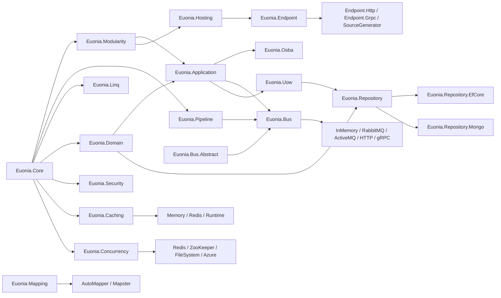

# Euonia (.NET)

> *Eunoia* —— 源自希腊语 *εὔνοια*：美好的思维、善意、心态平和。

Euonia 是用于构建企业级 .NET 应用与服务的开发框架。它把**面向对象可扩展业务架构（OSBA）**与**领域驱动设计（DDD）**结合起来，提供从基础原语、模块化宿主、领域建模、业务对象、权限策略、消息总线，到仓储、缓存、分布式同步、动态 HTTP/gRPC 端点的完整基础设施。

- **当前版本**：2026.4.7（见 [project.props](project.props)）
- **目标框架**：.NET 9 / .NET 10；Quartz 集成仅面向 .NET 10，Endpoint Source Generator 以 `netstandard2.0` analyzer 发布
- **包规模**：Source 下 39 个可打包项目，每个包都附带独立 README
- **测试**：27 个测试/夹具项目，1,100+ 个测试用例；另有 2 个 BenchmarkDotNet 基准项目
- **许可**：GPL-3.0（见 [LICENSE](LICENSE)）

Euonia 同时提供 **[Java 版本](https://github.com/euonia-project/euonia-java)**；本仓库是 **.NET 版本**。

## 目录

- [模块总览](#模块总览)
- [包一览](#包一览)
- [核心层](#核心层)
- [领域与应用层](#领域与应用层)
- [消息总线](#消息总线)
- [宿主与端点](#宿主与端点)
- [示例应用](#示例应用)
- [快速开始](#快速开始)
- [构建、测试与基准](#构建测试与基准)
- [项目结构](#项目结构)
- [版本与兼容性](#版本与兼容性)
- [文档与链接](#文档与链接)

## 模块总览

Euonia 采用分层设计：底层是不依赖业务的能力包，上层通过模块系统组合成应用。各包之间保持单向依赖，业务对象与权限引擎可以独立使用。



> 箭头表示主要的依赖或组合关系，不覆盖所有项目引用；完整依赖以各项目 `.csproj` 为准。

### 设计取向

- **不强绑某一套架构**：DDD、CQRS、MVVM、CRUD、低代码都可以在同一组原语上组合；Osba 不依赖 `Euonia.Domain`，Domain 只是可选的上层建模方式。
- **默认安全**：权限判定 fail-closed，Endpoint 的 HTTP/gRPC 默认要求授权，消息总线远程端点默认要求授权。
- **授权值不固化**：权限码与行级授予从应用数据实时解析，撤销立即生效，不依赖重新签发令牌。
- **契约稳定**：公共 API 尽量保持源码兼容；破坏性变更集中记录在 [CHANGELOG.md](CHANGELOG.md)。
- **可观测**：Bus、Osba 等模块通过 `ActivitySource`、`Meter` 与结构化日志暴露运行状态，可直接接入 OpenTelemetry。

## 包一览

### 基础与横切能力

| 包 | 目标框架 | 说明 |
|---|---|---|
| [Euonia.Core](Source/Euonia.Core/README.md) | net9.0 / net10.0 | 基础原语：ID 生成、集合、反射、异步协调、释放模式、HTTP 异常、权限契约与扩展方法 |
| [Euonia.Modularity](Source/Euonia.Modularity/README.md) | net9.0 / net10.0 | 模块系统、依赖图、约定式服务注册、同步/异步生命周期、插件模块与访问器 |
| [Euonia.Pipeline](Source/Euonia.Pipeline/README.md) | net9.0 / net10.0 | 受 ASP.NET Core 启发的类型化中间件管道，支持优先级、DI 与自动行为发现 |
| [Euonia.Linq](Source/Euonia.Linq/README.md) | net9.0 / net10.0 | 规约模式、谓词/表达式构建器、分页排序与 `IQueryable` 扩展 |
| [Euonia.Mapping](Source/Euonia.Mapping/README.md) | net9.0 / net10.0 | 与映射库解耦的 `ITypeAdapter` 抽象与 `ProjectedAs` 门面 |
| [Euonia.Mapping.Automapper](Source/Euonia.Mapping.Automapper/README.md) | net9.0 / net10.0 | AutoMapper 后端与模块注册 |
| [Euonia.Mapping.Mapster](Source/Euonia.Mapping.Mapster/README.md) | net9.0 / net10.0 | Mapster 后端与模块注册 |
| [Euonia.Validation](Source/Euonia.Validation/README.md) | net9.0 / net10.0 | FluentValidation 集成、泛型/范围/正则校验器与可绑定校验对象 |
| [Euonia.Caching](Source/Euonia.Caching/README.md) | net9.0 / net10.0 | 多级缓存框架：分层缓存句柄、缓存管理器、背板同步与流式配置 |
| [Euonia.Caching.Memory](Source/Euonia.Caching.Memory/README.md) | net9.0 / net10.0 | `Microsoft.Extensions.Caching.Memory` 提供程序与 `ICacheService` 实现 |
| [Euonia.Caching.Redis](Source/Euonia.Caching.Redis/README.md) | net9.0 / net10.0 | Redis 分布式缓存句柄、背板与 `ICacheService` 实现 |
| [Euonia.Caching.Runtime](Source/Euonia.Caching.Runtime/README.md) | net9.0 / net10.0 | `System.Runtime.Caching` 提供程序与 `ICacheService` 实现 |
| [Euonia.Concurrency](Source/Euonia.Concurrency/README.md) | net9.0 / net10.0 | 分布式锁与信号量抽象：超时、取消、异步获取与句柄丢失监控 |
| [Euonia.Concurrency.Redis](Source/Euonia.Concurrency.Redis/README.md) | net9.0 / net10.0 | 基于 StackExchange.Redis 的锁与信号量实现，支持租约续期 |
| [Euonia.Concurrency.ZooKeeper](Source/Euonia.Concurrency.ZooKeeper/README.md) | net9.0 / net10.0 | 基于 ZooKeeper 临时顺序节点的锁与信号量实现 |
| [Euonia.Concurrency.FileSystem](Source/Euonia.Concurrency.FileSystem/README.md) | net9.0 / net10.0 | 基于锁文件的跨进程互斥，适用于单机或共享卷 |
| [Euonia.Concurrency.Azure](Source/Euonia.Concurrency.Azure/README.md) | net9.0 / net10.0 | 基于 Azure Blob 租约的分布式锁 |

### 领域、应用与权限

| 包 | 目标框架 | 说明 |
|---|---|---|
| [Euonia.Domain](Source/Euonia.Domain/README.md) | net9.0 / net10.0 | DDD 构建块：实体、聚合根、值对象、领域事件、命令、审计与实体缓存契约 |
| [Euonia.Application](Source/Euonia.Application/README.md) | net9.0 / net10.0 | 用例、应用服务、Castle 拦截器与消息管道行为 |
| [Euonia.Uow](Source/Euonia.Uow/README.md) | net9.0 / net10.0 | 工作单元、事务边界、环境上下文与 `[UnitOfWork]` 拦截器 |
| [Euonia.Repository](Source/Euonia.Repository/README.md) | net9.0 / net10.0 | 持久化无关仓储抽象、上下文提供者、实体契约与分页排序扩展 |
| [Euonia.Repository.EfCore](Source/Euonia.Repository.EfCore/README.md) | net9.0 / net10.0 | EF Core 上下文基类、仓储实现、值转换与 ID 值生成器 |
| [Euonia.Repository.Mongo](Source/Euonia.Repository.Mongo/README.md) | net9.0 / net10.0 | MongoDB 上下文、仓储、模型配置与事务支持 |
| [Euonia.Osba](Source/Euonia.Osba/README.md) | net9.0 / net10.0 | 面向对象可扩展业务架构：富业务对象运行时、规则、工厂、执行器、生命周期与权限边界 |
| [Euonia.Security](Source/Euonia.Security/README.md) | net9.0 / net10.0 | 操作权限与行级数据权限的策略引擎，可脱离 Osba 独立使用 |

### 消息总线

| 包 | 目标框架 | 说明 |
|---|---|---|
| [Euonia.Bus.Abstract](Source/Euonia.Bus.Abstract/README.md) | net9.0 / net10.0 | 信封/上下文、消息约定、传输策略、可靠性存储、接收者与事件契约 |
| [Euonia.Bus](Source/Euonia.Bus/README.md) | net9.0 / net10.0 | 总线引擎：处理器发现、分发、序列化、发件箱/收件箱/死信与遥测 |
| [Euonia.Bus.InMemory](Source/Euonia.Bus.InMemory/README.md) | net9.0 / net10.0 | 进程内传输，适合开发、测试与单进程场景 |
| [Euonia.Bus.RabbitMq](Source/Euonia.Bus.RabbitMq/README.md) | net9.0 / net10.0 | RabbitMQ 传输：扇出交换机、直连队列、优先级、死信与 Polly 重试 |
| [Euonia.Bus.ActiveMq](Source/Euonia.Bus.ActiveMq/README.md) | net9.0 / net10.0 | ActiveMQ 传输：Topic/Queue、临时回复队列与关联 ID |
| [Euonia.Bus.Http](Source/Euonia.Bus.Http/README.md) | net9.0 / net10.0 | HTTP 远程调用传输（`CallAsync`），与 gRPC 共用 `RemoteReply` 协议 |
| [Euonia.Bus.Grpc](Source/Euonia.Bus.Grpc/README.md) | net9.0 / net10.0 | gRPC 泛化调用、服务端接收、拦截器、健康检查与自动发现 |
| [Euonia.Bus.HealthChecks](Source/Euonia.Bus.HealthChecks/README.md) | net9.0 / net10.0 | 传输器、发件箱、收件箱与死信积压健康检查 |

### 宿主、端点与调度

| 包 | 目标框架 | 说明 |
|---|---|---|
| [Euonia.Hosting](Source/Euonia.Hosting/README.md) | net9.0 / net10.0 | ASP.NET Core 宿主引导、请求上下文、异常/追踪中间件、JWT/内省认证与授权扩展 |
| [Euonia.Endpoint](Source/Euonia.Endpoint/README.md) | net9.0 / net10.0 | `[ExposeWebApi]` / `[ExposeGrpc]` 契约与共享数据契约，不依赖 ASP.NET Core |
| [Euonia.Endpoint.Http](Source/Euonia.Endpoint.Http/README.md) | net9.0 / net10.0 | 把标记的服务方法映射为 Minimal API，生成优先 + 运行时兜底 |
| [Euonia.Endpoint.Grpc](Source/Euonia.Endpoint.Grpc/README.md) | net9.0 / net10.0 | 基于 protobuf-net.Grpc 的 code-first gRPC 运行时、方法级授权与 proto 导出 |
| [Euonia.Endpoint.SourceGenerator](Source/Euonia.Endpoint.SourceGenerator/README.md) | netstandard2.0 analyzer | 构建期生成 HTTP lambda、gRPC 契约/适配器与注册标记 |
| [Euonia.Quartz](Source/Euonia.Quartz/README.md) | net10.0 | Quartz.NET 4 集成：特性化作业、四类触发器与流式配置 |

## 核心层

### Core（Euonia.Core）

> 其他所有包复用的基础库。

| 命名空间 | 内容 |
|---|---|
| `Nerosoft.Euonia` | `ObjectId`（Snowflake / UUID / ULID / Random）、`ShortUniqueId`、`GuidGenerator`、`UlidGenerator`、`SnowflakeId`、`Singleton<T>`、`Clock`、`Check`、`Optional<T>`、`Unit`、`Weak<T>`、`ObjectPool<T>` |
| `Nerosoft.Euonia.Collections` | `DequeCollection<T>`、`PageableCollection<T>`、`TreeView<T>`、`TypeList<T>`、`ObservableGroup<TKey,TValue>`、`ObservableGroupedCollection<T>`、`ViewCollection<T>` |
| `Nerosoft.Euonia.Disposing` | 同步/异步一次性释放原语：`SingleDisposable<T>`、`AsyncSingleDisposable<T>`、`CollectionDisposable`、`NoopDisposable` |
| `Nerosoft.Euonia.Reflection` | `AssemblyHelper`、`AssemblyLoadContextManager`、`TypeHelper`、`Reflect` / `Reflect<T>`、`EnumHelper`、`EnumParser<T>`、`PropertyAccessorCache<T>`、`MethodInvokerBuilder` |
| `Nerosoft.Euonia.Threading` | `AsyncLock`、`AsyncSemaphore`、`AsyncManualResetEvent`、`AsyncAutoResetEvent`、`AsyncConditionVariable`、`AsyncMonitor`、`AsyncCountdownEvent`、`AsyncLazy<T>`、`AsyncProducerConsumerQueue<T>`、`AsyncCollection<T>`、`AsyncContext`、`PauseToken`、`StatefulMutex` |
| `Nerosoft.Euonia.Security` | `UserPrincipal`、`UserClaimTypes`、`BusinessOperation`、`PermissionAttribute`、`IPermissionChecker`、`IPermissionCodeSource`、`IObjectScopeAuthorizer`、`IObjectOperationResolver` 等权限契约 |
| `System`（异常） | `BadRequestException`、`ForbiddenException`、`NotFoundException`、`ConflictException`、`InternalServerErrorException`、`BadGatewayException`、`GatewayTimeoutException`、`MethodNotAllowedException`、`RequestTimeoutException`、`TooManyRequestsException`、`ServiceUnavailableException`、`UpgradeRequiredException`、`BusinessException`、`ConfigurationException`、`InvalidValueException` |

常用扩展方法覆盖字符串大小写/校验/脱敏、集合拓扑排序与分页、类型与程序集、Claims、事件、任务协调等。异常类型通过 `[HttpStatusCode]` 与 `HttpStatusException` 统一映射为 HTTP 状态码。

> `Euonia.Core` 只定义权限**契约**；策略编译与判定实现位于 `Euonia.Security`，两者可以独立使用。

### Modularity（Euonia.Modularity）

> 把应用拆成可组合模块，按依赖图加载，并统一管理服务注册与生命周期。

| 能力 | 说明 |
|---|---|
| 模块与依赖 | `ModuleContextBase`、`[DependsOn]`；加载阶段校验循环依赖、自依赖与非法模块类型，依赖快照不可变 |
| 应用工厂 | `ApplicationFactory.Create/CreateAsync<TStartupModule>`、`AddModularityApplication<TStartupModule>`；`Initialize` / `Shutdown` / `Dispose` 幂等且线程安全 |
| 生命周期 | `AheadConfigureServices` → `ConfigureServices` → `AfterConfigureServices` → `OnApplicationInitialization` → `OnApplicationShutdown`，均有异步版本；未重写异步方法时回退到同步实现 |
| 插件式模块 | `IModuleSource`、`DelegateModuleSource`、`FileModuleSource`、`FolderModuleSource`；`ApplicationCreationOptions.AddModuleSource/AddModuleFolder/AddModuleFiles` |
| 自动注册 | `ITransientDependency` / `IScopedDependency` / `ISingletonDependency`、`[ExposeServices]`、`[ExportService]`（可多个）、`[DisableAutomaticRegistration]`；`AddAssemblyOf(Type)`、`AddTypes(...)` |
| 访问器 | scoped `IServiceAccessor`、`IRequestContextAccessor`、`IObjectAccessor<T>`、`ILazyServiceProvider`（含键控解析） |
| 命名服务 | `GetNamedService<T>(name)`；命名注册表按 `IServiceCollection` 隔离，避免多容器串名 |
| 配置 | 显式 `IConfiguration` 不再被忽略；未指定环境名时回退 `DOTNET_ENVIRONMENT` / `ASPNETCORE_ENVIRONMENT`；支持 `ReloadOnChange` |

插件模块示例：

```csharp
var application = await ApplicationFactory.CreateAsync<HostModule>(
    services,
    configuration,
    options =>
    {
        options.AddModuleFolder("plugins", SearchOption.AllDirectories);
        options.AddModuleFiles("extensions/Reporting.dll");
    });
```

### Pipeline（Euonia.Pipeline）

> 类型化中间件管道，`IPipeline<TRequest, TResponse>` 统一覆盖即发即忘与请求/响应场景。

| 类型 | 作用 |
|---|---|
| `IPipeline<TRequest, TResponse>` | 管道契约：`Use`、`Build`、`RunAsync` |
| `IPipelineBehavior<TRequest, TResponse>` | 环绕内层处理器的行为：`HandleAsync(request, next)` |
| `PipelineBase<TRequest, TResponse>` | 反向链构建的基础实现，最内层先执行 |
| `DefaultPipelineProvider<TRequest, TResponse>` | 从 `IServiceProvider` 解析行为并编译委托 |
| `PipelineBehaviorAttribute` | 在请求类型上声明行为与优先级 |
| `AddPipeline()` | 注册管道基础服务 |

```csharp
var pipeline = new DefaultPipelineProvider<OrderContext, OrderResult>(serviceProvider)
    .Use<LoggingBehavior>()
    .Use(async (context, next) =>
    {
        var result = await next(context);
        return result;
    });

var result = await pipeline.RunAsync(new OrderContext(42));
```

### Linq（Euonia.Linq）

> 把查询条件建模为可组合、可复用的对象。

- **规约**：`Specification<T>` 支持 `&`、`|`、`!`，`ISpecification<T>` 可直接传给仓储/ `IQueryable`。
- **表达式构建**：`PredicateBuilder`、`Lambda.ParsePredicate`、`PredicateExpressionBuilder<T>`。
- **范围规约**：整型、长整型、浮点、十进制、日期、时间、时间跨度的 `SegmentSpecification`。
- **查询构建器**：`QueryHandler<T>` 组合过滤、分页、排序，并提供 `GetCount`。
- **扩展**：`Where(specification)`、`WhereIf`、`WhereIfNotEmpty`、`Between`、`OrderBy(propertyName, sortType)`。

### Mapping（Euonia.Mapping）

> 业务代码只依赖抽象，具体映射库可替换。

| 包 | 入口 |
|---|---|
| `Euonia.Mapping` | `ITypeAdapter`、`ITypeAdapterFactory`、`TypeAdapter.ProjectedAs<T>()`、`ProjectedAsCollection<T>()` |
| `Euonia.Mapping.Automapper` | `AutomapperModule`、`AutomapperOptions`、`AutomapperTypeAdapterFactory` |
| `Euonia.Mapping.Mapster` | `MapsterModule`、`MapsterOptions`、`MapsterTypeAdapterFactory` |

### Validation（Euonia.Validation）

- **统一入口**：`Validator.Validate<T>` / `ValidateAsync<T>`，失败抛 `ValidationException`。
- **FluentValidation 集成**：`AddValidator(types)`、`ValidationModule` 自动注册 `IValidator<T>`。
- **可绑定对象**：`ValidatableObject<T>` 支持值变更即时校验与错误集合。
- **轻量规则**：`GenericValidator<T>`、`RegularValidator`、`RangeValidator<T>`。
- **结果模型**：`ValidationResult`、`ValidationException`。

### Caching（Euonia.Caching）

> 以缓存句柄分层组织内存与分布式缓存，由 `ICacheManager<T>` 统一编排。

| 包 | 提供程序 |
|---|---|
| `Euonia.Caching` | 多级编排、`CacheFactory`、`ConfigurationBuilder`、`DictionaryCacheHandle<T>`、`CacheBackplane`、`ICacheService` / `BaseCacheService` |
| `Euonia.Caching.Memory` | `MemoryCacheHandle<T>`、`MemoryCacheService`、`WithMemoryCacheHandle(...)` |
| `Euonia.Caching.Redis` | `RedisCacheHandle<T>`、`RedisCacheService`、Redis 背板、`WithRedisCacheHandle(...)` |
| `Euonia.Caching.Runtime` | `RuntimeCacheHandle<T>`、`RuntimeCacheService`、`WithRuntimeCacheHandle(...)` |

```csharp
var cache = CacheFactory.Build<string>("app", settings =>
{
    settings.WithUpdateMode(CacheUpdateMode.Up)
            .WithMemoryCacheHandle("memory");
});

cache.Add("greeting", "hello");
var value = cache.GetOrAdd("user:1", _ => LoadUserName(1));
```

### Concurrency（Euonia.Concurrency）

> 分布式锁与信号量的统一契约。获取句柄支持同步/异步、超时、取消，并在连接或租约丢失时通过 `HandleCancellationToken` 通知调用方。

| 包 | 能力 |
|---|---|
| `Euonia.Concurrency` | `ILockFactory`、`ILockProvider`、`ISemaphoreFactory`、`ISemaphoreProvider`、`ISynchronizationHandle` 与便捷扩展 |
| `Euonia.Concurrency.Redis` | Redis 锁/信号量、租约续期、`MinValidityTime`、忙等待退避 |
| `Euonia.Concurrency.ZooKeeper` | 临时顺序节点锁/信号量、会话与连接超时、认证与 ACL |
| `Euonia.Concurrency.FileSystem` | 锁文件跨进程互斥，适用于单机或共享卷 |
| `Euonia.Concurrency.Azure` | Blob 租约锁、自动续约、租约时长与退避配置 |

```csharp
var locker = lockFactory.Create($"inventory:{sku}");
await using var handle = await locker.AcquireAsync(
    TimeSpan.FromSeconds(10),
    cancellationToken);

// 临界区
```

## 领域与应用层

### Domain（Euonia.Domain）

> 持久化无关的 DDD 构建块。

| 类型 | 作用 |
|---|---|
| `Entity` / `Entity<TKey>` | 类型化标识、瞬态判断、基于标识的相等性 |
| `Aggregate<TKey>` | 聚合根与领域事件管理：`RaiseEvent`、`GetEvents`、`GetAndClearEvents`、`LoadFromHistory` |
| `ValueObject<T>` | 基于反射的不可变值对象，自动实现 `Equals`、`GetHashCode`、`==` / `!=` |
| `DomainEvent` / `ApplicationEvent` | 领域事件与应用层集成事件；可生成 `EventAggregate` 快照并携带序列号、意图、来源 |
| `EventAggregate` | 事件持久化快照：Id、EventId、Timestamp、TypeName、EventPayload、EventSequence |
| `Command` / `Command<TData>` | 自动生成 `CommandId`，可扩展 `Properties` 字典 |
| `CommandResponse` / `CommandStatus` | 命令执行结果与状态（`Succeed` / `Failure` / `Canceled`） |
| `IAggregateRoot<TKey>` / `IHasDomainEvents` / `IDomainService` | 聚合根、事件载体与领域服务契约 |
| `AuditedAttribute` / `AuditingRecord` / `IAuditingStore` / `AuditingOptions` | 变更审计 |
| `EntityCacheAttribute` / `IEntityCache` | 实体缓存契约 |

### Application（Euonia.Application）

> 应用层构建块：用例、应用服务、Castle 拦截器与总线管道行为。

**核心类型**

| 类型 | 作用 |
|---|---|
| `IServiceContext` / `ServiceContextBase` | 描述程序集、生命周期、自动注册开关；`services.Register<TContext>()` 扫描并注册应用服务与管道行为 |
| `IApplicationService` / `BaseApplicationService` | 应用服务契约与基类；通过 `ILazyServiceProvider` 懒加载 `IBus`、`UserPrincipal`、请求上下文、日志与用例执行器 |
| `IUseCase<TInput,TOutput>` / `IUseCaseExecutor` | 类型化用例与执行器，结果分发给 presenter |
| `IUseCasePresenter<TOutput>` / `DefaultUseCasePresenter<TOutput>` | 成功/失败/取消的结果呈现 |
| `ApplicationModule` | 注册全部拦截器、管道行为、presenter 与用例执行器 |

**拦截器（11 个）**

| 拦截器 | 触发方式 | 作用 |
|---|---|---|
| `LoggingInterceptor` | 所有应用服务方法 | Debug 记录参数（敏感参数脱敏），异常记录后原样抛出 |
| `AuthorizationInterceptor` | `[Authorize]` | 校验登录状态与角色 |
| `ValidationInterceptor` | `[NotNull]` / `[Validation]` | 调用 `Validator` 校验参数 |
| `TracingInterceptor` | 所有方法（Debug 开启时） | 记录调用链、`X-Request-Trace-Id` 与 `X-Correlation-ID` |
| `LockInterceptor` | `[Lock]` / `[DistributedLock]` / `[SemaphoreLock]` | 进程内信号量、分布式锁或分布式信号量 |
| `TimingInterceptor` | `[Timing]` | 记录耗时并在超阈值时告警 |
| `CacheInterceptor` | `[Cache]` | 缓存方法结果 |
| `CacheEvictionInterceptor` | `[CacheEvict]` | 按组/键失效缓存 |
| `IdempotentInterceptor` | `[Idempotent]` | 幂等窗口内相同指纹只执行一次 |
| `RetryInterceptor` | `[Retry]` | 固定/线性/指数退避重试 |
| `CircuitBreakerInterceptor` | `[CircuitBreaker]` | 失败率超阈值后短路 |

**管道行为（3 个）**

| 行为 | 作用 |
|---|---|
| `ValidationBehavior` | 处理消息前执行校验 |
| `UserContextBehavior` | 把当前用户身份写入消息元数据 |
| `CorrelationIdBehavior` | 保证消息带有关联 ID |

```csharp
internal sealed class SalesServiceContext : ServiceContextBase
{
    public override void ConfigureServices(IServiceCollection services)
    {
        // 额外服务
    }
}

builder.Services.Register<SalesServiceContext>();

public sealed class OrderApplicationService : BaseApplicationService, IApplicationService
{
    [Cache(Key = "order:{0}", TimeoutSeconds = 60, Groups = new[] { "orders" })]
    public Task<OrderDto?> GetAsync(long id, CancellationToken cancellationToken)
        => throw new NotImplementedException();

    [Retry(MaxRetries = 3, DelayMs = 200, Backoff = RetryBackoffMode.Exponential)]
    [DistributedLock("order:{id}")]
    public Task SubmitAsync(long id, CancellationToken cancellationToken)
        => throw new NotImplementedException();
}
```

> 消息日志行为 `MessageLoggingBehavior` 属于 `Euonia.Bus`，由 `MessageBusModule` 注册，不在 `ApplicationModule` 中。

### UoW（Euonia.Uow）

> 定义事务边界、提交/回滚生命周期与环境工作单元。

| 类型 | 作用 |
|---|---|
| `IUnitOfWork` | `SaveChangesAsync`、`RollbackAsync`、`CompleteAsync`、`Items` 字典、嵌套 `Outer` |
| `IUnitOfWorkManager` | 创建/管理工作单元作用域：`Begin(options, requiresNew)` |
| `IUnitOfWorkAccessor` | 访问当前环境工作单元（`AsyncLocal`） |
| `UnitOfWork` / `ChildUnitOfWork` | 完整实现与嵌套轻量代理（`CompleteAsync` 委托父级） |
| `UnitOfWorkInterceptor` | Castle 拦截器，自动包装 `[UnitOfWork]` / `IUnitOfWorkEnabled` 方法 |
| `UnitOfWorkOptions` | `IsTransactional`、`IsolationLevel`、`Timeout` |
| `UnitOfWorkModule` / `AddUnitOfWork()` | 注册 UoW 基础设施与拦截器 |

`IsTransactional = true` 时会开启真实数据库事务：`CompleteAsync` 提交，未完成释放时回滚。`[UnitOfWork]` 支持 `Task`、`Task<T>`、`ValueTask` 与 `ValueTask<T>`，不会提前提交。

### Repository（Euonia.Repository）

> 持久化无关的仓储抽象，EF Core 与 MongoDB 各自提供实现。

| 类型 | 作用 |
|---|---|
| `IRepository<TEntity>` | 查询、CRUD、分页；所有写操作支持 `autoSave` |
| `IRepository<TEntity,TKey>` / `IRepository<TContext,TEntity,TKey>` | 按键查询 / 绑定上下文的仓储 |
| `IRepositoryContext` | `SetOf<T>()`、`SaveChangesAsync`、事务、提交/回滚 |
| `IContextProvider` / `IContextFactory` | 有序工厂链解析上下文 |
| `IConnectionStringResolver` / `[ConnectionString]` | 连接字符串解析 |
| 实体契约 | `IEntity`、`IAuditable`、`IHasCreateTime`、`IHasUpdateTime`、`IHasDeleteTime`、`IHasSnowflakeId`、`ITombstone`、`IConcurrentEntity` |
| `RepositoryExtensions` | `Paginate`、`Sort`、`GetPagedCollectionAsync` |

**EF Core**

- `DataContextBase<TContext>` 实现 `IRepositoryContext`，自动应用配置、逻辑删除查询过滤器与审计字段。
- `AddEfCoreRepository<TContext>(options, lifetime)` 注册 `DbContext`、开放式泛型仓储与工作单元；`AddDataContextFactory<TContext>(lifetime)` 注册 `IDbContextFactory`。
- 值生成器：`SnowflakeIdValueGenerator`、`UlidValueGenerator`、`ShortUniqueIdValueGenerator`、`SequentialGuidValueGenerator`、`GuidVersion7ValueGenerator`、`RowVersionValueGenerator`、`UtcTimeValueGenerator`。
- 值转换器：`UniversalTimeConverter`；连接配置：`ConnectionConfigurator`。

**MongoDB**

- `DataContextBase<TContext>` 基于 `MongoDbContext`，支持客户端会话与类型化集合访问。
- `AddMongoRepository<TContext>(options, lifetime)` 注册上下文、仓储与工作单元工厂。
- `MongoDbOptions.UseConnection(...)` / `UseDatabase(...)`；`ModelProfile<T>` / `ModelBuilder` 配置集合映射。
- 副本集环境支持 `BeginTransactionAsync` / `CommitAsync` / `RollbackAsync`。

```csharp
services.AddEfCoreRepository<AppDbContext>(options =>
{
    options.UseSqlite(configuration.GetConnectionString("Default"));
});

public sealed class OrderService(IRepository<AppDbContext, Order, long> repository)
{
    public Task<Order?> GetAsync(long id, CancellationToken cancellationToken)
        => repository.GetAsync(id, cancellationToken);

    public async Task<Order> CreateAsync(Order order, CancellationToken cancellationToken)
        => await repository.InsertAsync(order, autoSave: true, cancellationToken);
}
```

### OSBA（Euonia.Osba）

> **Object-Oriented Scalable Business Architecture**：把“一次业务操作”建模成对象，由框架在正确时机完成属性存储、变更追踪、规则校验、工厂分派、执行器编排与权限裁决。

Osba 不是 ORM，也不是 DDD 专用框架，而是**业务模型运行时**。它不依赖 `Euonia.Domain`、EF Core 或 `Euonia.Security`，DDD 与具体鉴权引擎都是可选的上层组合。

#### 对象层级

```text
ObjectBase                         —— 公共根：属性、规则、上下文、生命周期、权限
└── ObjectBase<T>                  —— 属性注册（RegisterProperty）
     ├── BusinessObject<T>         —— 变更追踪（ChangedProperties / AcceptChanges）
     │    ├── ObservableObject<T>  —— NEW / CHANGED / DELETED 状态
     │    │    └── EditableObject<T> —— 异步规则校验与保存
     │    └── ReadOnlyObject<T>    —— 只读对象（工厂装载作用域内可填充）
     └── ServiceObject<T>          —— 独立业务操作；有属性与规则，无变更追踪
```

> `IServiceObject` 只组合 `IOsbaObject` 与 `IHasRuleCheck`，不继承 `IBusinessObject`；`IBusinessObject` 才承诺 `INotifyPropertyChanged` / `INotifyPropertyChanging` 等可编辑对象契约。

#### 能力清单

- **属性系统**：类型级元数据缓存、实例级字段数组、环形撤销历史、可观察值与父子对象图。
- **变更追踪**：`ChangedProperties`、`HasChangedProperties`、`AcceptChanges`、`MarkAsClean`；属性改回基线后自动移出变更集。
- **领域对象控制**：`GetOriginalValue`、`GetOriginalValues`、`GetChangedValues`、`RejectChanges`、可重写的 `CanTransitionTo` / `StateChanged`。
- **规则系统**：对象级 `ObjectRuleBase` / `IObjectRule`、属性级 `PropertyRuleBase` / `IPropertyRule`、`CommonRule.Required/Regular/Lambda`、`DataAnnotationRule`、`ExecuteOnStateAttribute`；支持优先级、严重级别与按操作绕过。
- **工厂**：约定名 + 特性双通道查找；支持可选参数、`params`、`Task` / `ValueTask`；`BusinessObjectFactory` 的公开操作可派生接管。
- **执行器**：`IActuator.For<T>().Fetch/Create/Update/Delete/Execute(...)` 把“取对象 → Handle → 终结”串成管道，可挂 `IActuatorBehavior<T>`。
- **生命周期回调**：`IObjectLifecycle` 提供 `OnSavingAsync` / `OnSavedAsync` / `OnExecutingAsync` / `OnExecutedAsync`。
- **权限边界**：类型级/方法级 `[Permission]`、行级数据权限；契约在 `Euonia.Core`，Osba 只实现自己那一半，不引用 `Euonia.Security`。
- **诊断**：`ActivitySource("Euonia.Osba")`、`Meter("Euonia.Osba")` 与宿主的 `ILoggerFactory`。
- **启动期校验**：`OsbaOptions.ValidateOnStartup` 检查工厂签名、`[Inject]` 可解析性、属性元数据与缺失的持久化方法。

#### 装配

```csharp
services.AddBusinessObject(options =>
{
    options.ValidateOnStartup = true;      // 生产宿主建议开启
    options.StrictFactoryMethods = true;   // 缺 Insert/Update/Delete 时保存直接失败
    options.EnableDiagnostics = true;      // ActivitySource / Meter
}, typeof(Order).Assembly);
```

`BusinessContextAccessor` 不再在解析时自动写环境上下文；ASP.NET 中间件或手动作用域请显式 `SetCurrent(...)`，并在 `finally` 中 `Clear()`。

#### 规则

```csharp
protected override void AddRules()
{
    // 对象级：无参构造 ⇒ Property == null，保存时执行
    Rules.AddRule<PasswordStrengthRule>();

    // 属性级：传入注册过的 PropertyInfo<T>
    Rules.AddRule<CommonRule.Required>(NameProperty);
    Rules.AddRule(new CommonRule.Regular(EmailProperty, @"^[\w-\.]+@([\w-]+\.)+[\w-]{2,4}$"));

    // 便捷 Lambda 重载
    Rules.AddRule<Order>(AmountProperty, order => order.Amount > 0, "金额必须大于 0");
}
```

规则实例是**类型级共享单例**，不能持有实例/请求状态；需要依赖时从 `IRuleContext.ServiceProvider` 或 `context.Target → BusinessContext` 获取。

#### 权限

Osba 与权限引擎的分工：

| | 操作权限 | 数据权限 |
|---|---|---|
| 回答 | 当前用户**能否执行某项操作** | 当前用户**能看到/操作哪些数据行** |
| 粒度 | 类型级 `[Permission]` + 行级（按授权标识声明策略） | 行级 |
| 强制点 | `BusinessObjectFactory` 调用边界 | 查询下推 + 工厂保存边界 |
| 失败形态 | `SecurityException` | 查询排除该行／保存抛 `SecurityException` |

两者不是适配关系：Osba 只面对 Core 的权限契约，宿主用 `AddBusinessObject(asm)` + `AddPermission(...)` 两行接线，也可以只注册自己的实现。完整接线与多场景示例见 [`Source/Euonia.Osba/PERMISSION.md`](Source/Euonia.Osba/PERMISSION.md)、[`PERMISSION-SAMPLE.md`](Source/Euonia.Osba/PERMISSION-SAMPLE.md) 与 [`PERMISSION-DESIGN.md`](Source/Euonia.Osba/PERMISSION-DESIGN.md)。

#### 阅读入口

- 架构、使用方法、逐文件结构：[`Source/Euonia.Osba/README.md`](Source/Euonia.Osba/README.md)
- 设计取舍：[`DESIGN.md`](Source/Euonia.Osba/DESIGN.md)
- 端到端示例：[`SAMPLE.md`](Source/Euonia.Osba/SAMPLE.md)

### Security（Euonia.Security）

> 独立的权限策略引擎：操作权限与行级数据权限，不依赖任何对象模型、用户模型或应用框架。

#### 两条线

| | 操作权限 | 数据权限 |
|---|---|---|
| 回答 | 当前用户**能否执行某项操作** | 当前用户**能看到/操作哪些数据行** |
| 出口 | `IPermissionChecker` | `IScopeGuard` |
| 依据 | `[Permission]` 权限码/角色，或宿主自定义判定 | 资源维度 × 从应用数据实时解析的授权集合 |
| 失败 | 断言失败，由调用方裁决 | 判定为不可访问 |

#### 装配

```csharp
services.AddPermission(permission => permission
    .Scan(typeof(Order).Assembly)
    .OnAttributeOrName(BusinessOperation.Read,   "Order", typeof(FetchAttribute))
    .OnAttributeOrName(BusinessOperation.Create, "Order", typeof(CreateAttribute)));

services.AddScoped<IScopeSubjectResolver, MySubjectResolver>();
services.AddUserPrincipal();   // ASP.NET Core 宿主；非 Web 宿主需自行注册当前用户主体
```

- 规则必须显式给出；没有方法级权限码时用 `p.NoOperationCodes()` 明确断言，不能靠“忘记配置”静默放行。
- `AddPermission` 可多次调用，各模块的扫描程序集、权限码来源与操作规则按并集合并。
- 没有默认 `IScopeSubjectResolver`：授权值由应用从数据实时解析，撤销立即生效。

#### 判定

```csharp
var guard = provider.GetRequiredService<IScopeGuard>();
await guard.EnsureResolvedAsync();              // 同步判定前预热
var visible = guard.Apply(dbContext.Orders);    // 下推到数据库
guard.Allows(order, BusinessOperation.Read);    // 单行判定
guard.Explain(order, BusinessOperation.Read);   // 审计：命中了哪条策略
```

核心不变式：策略编译成 `Allow` / `Deny` 一对表达式，**读侧下推与单行判定共用同一份编译结果**；最终结论是 `Allow && !Deny`，`Deny` 一律优先。数据权限的模型与策略写在同一个 `ScopeModel<T>` 声明里，启动期完整校验，配置错误 fail-fast。

更多内容见 [`Source/Euonia.Security/README.md`](Source/Euonia.Security/README.md) 与 [`DESIGN.md`](Source/Euonia.Security/DESIGN.md)。

## 消息总线

### Bus Abstract（Euonia.Bus.Abstract）

> 所有总线传输与 `Euonia.Bus` 引擎的扩展基础。

- **消息分类**：`IUnicast`、`IMulticast`、`IRequest<TResponse>`，或 `[Unicast]`、`[Multicast]`、`[Request]` 特性。
- **信封与上下文**：`IMessageEnvelope<T>` 携带 MessageId、CorrelationId、ConversationId、RequestTraceId、Channel、Authorization、User、Metadata 与 Payload；`IMessageContext` 提供 `Response` / `Failure` / `Complete`。
- **传输契约**：`ITransporter` 定义 `PublishAsync`、`SendAsync<TMessage,TResponse>`、`CallAsync<TRequest,TResponse>`。
- **约定与策略**：`IMessageConvention` 分类消息；`ITransportStrategy` 决定走本地还是分布式传输。
- **可靠性**：`IOutboxStore`、`IInboxStore`、`IDeadLetterStore`、`IDeadLetterService` 及对应条目类型。
- **接收者**：`IRecipientRegistrar`、`IRecipient`、`IConsumer`、`ISubscriber`、`IExecutor`。
- **执行环境**：`MessageExecutionDescriptor` 描述服务提供程序与请求上下文的来源（新建作用域、借用调用方作用域、信封覆盖等）。
- **注解**：`[Channel]`、`[Subscribe]`、`[Enqueue]`、`[LocalMessage]`、`[DistributedMessage]`、`[DispatchIn]`、`[ReceiveIn]` 等。

### Bus（Euonia.Bus）

> 处理器发现、注册、分发、序列化、可靠性存储与遥测的运行时。

| 类型 | 作用 |
|---|---|
| `IBus` | 顶层 API：`PublishAsync`（多播）、`SendAsync`（单播，可选 `Subject<T>` 回调）、`CallAsync`（请求-响应） |
| `MessageBus` | 编排引擎：类型校验 → 上下文解析 → 信封构建 → 管道执行 → 分发决策 → 传输投递 |
| `IHandler<TMessage>` / `IHandler<TMessage,TResponse>` | 类型化处理器契约 |
| `[Subscribe("channel")]` | 声明处理器方法 |
| `IDispatcher` / `StrategicDispatcher` | 策略匹配、基数校验、按配置版本失效的传输器列表缓存 |
| `IHandlerContext` / `DefaultHandlerContext` | 按通道管理处理器；单播执行首个处理器，多播并行扇出全部实现 |
| `MessageHandlerFinder` / `ChannelRegistrar` | 自动发现 `[Subscribe]` 与 `IHandler<,>`；幂等去重 |
| `DefaultConfigurator` / `ConfiguratorBuilder` | 约定、策略、通道注册与通道解析器 |
| `ServiceActivator` | 启动时执行自动装配、启动传输接收者，停机时释放注册器 |

**执行作用域**

- 进程内 `SendAsync` / `CallAsync` 复用调用方作用域，处理器可共享 `DbContext`、事务等 scoped 服务。
- `PublishAsync` 是 fire-and-forget，使用消息专用作用域，但保留发布方请求上下文。
- HTTP/gRPC 入站处理复用请求作用域；跨进程消费、死信重放与收件箱重执行使用信封中的身份。
- 后台调度器统一经 `BackgroundExecution.Run` 在 `ExecutionContext.SuppressFlow()` 下启动。

**三类操作**

| 操作 | 方法 | 消息类型 | 传输策略 | 返回值 |
|---|---|---|---|---|
| 发布 | `PublishAsync` | Multicast | 并行发送至所有匹配传输 | `Task` |
| 发送 | `SendAsync` | Unicast | 单个传输 | `Task`（或 `Subject<T>` 回调） |
| 调用 | `CallAsync` | Request | 单个传输 | `Task<TResponse>` |

**流式选项与投递属性**

- `PublishOptions` / `SendOptions` / `CallOptions` 与对应 builder：`WithChannel`、`WithQueue`、`WithPriority`、`WithDelay`、`WithTimeout`、`WithMetadata`、`WithPipeline`。
- `Queue`：覆盖 RabbitMQ / ActiveMQ 的 `Send` / `Call` 目标队列；发布走交换机/主题时忽略。
- `Priority`：RabbitMQ 写入消息属性并收敛到 `[0, min(MaxPriority, 9)]`（队列需以 `x-max-priority` 声明）；ActiveMQ 映射为 `MsgPriority`。
- `Delay`：**分发前**的进程内延迟（毫秒），对所有内置传输一致生效；进程退出会丢失延迟中的消息，需要持久化延迟时使用发件箱或传输器自身的延迟能力。

**可靠性：发件箱 / 收件箱 / 死信**

| 类型 | 作用 |
|---|---|
| `InMemoryOutboxStore` / `InMemoryInboxStore` | 内存实现（仅开发/参考）；缓存按存储实例隔离 |
| `InMemoryDeadLetterStore` | 内存死信存储 |
| `OutboxDispatcher` / `InboxDispatcher` | 轮询失败记录并重投/重执行；重试耗尽转入死信终态；每轮按保留策略清理 |
| `DeadLetterService` | 查询、重放（按来源分投递/重执行）、丢弃 |

| 选项 | 语义 |
|---|---|
| `OutboxOptions.Enabled` / `MaxRetryAttempts` / `PollingInterval` | 发件箱开关、最大重投递次数、轮询间隔 |
| `OutboxOptions.RetentionPeriod` / `InboxOptions.RetentionPeriod` | 已终结条目保留时长（默认 24 小时，`<= 0` 不清理） |
| `InboxOptions.Enabled` | 收件箱开关；`UseInbox` 仅为发送侧标记 |
| `MessageBusOptions.AutoLoadAssemblies` | 启动时扫描处理器的程序集简单名称；加载失败即启动失败 |
| `MessageBusOptions.DefaultTransporter` | 默认传输器（分发与接收者注册共用） |

**注册**

```csharp
services.AddEuoniaBus();
services.AddInMemoryOutbox();       // 发件箱（可选）
services.AddInMemoryInbox();        // 收件箱（可选）
services.AddInMemoryDeadLetters();  // 死信捕获与重放（可选）
services.AddMessageHandler(ServiceLifetime.Scoped, typeof(Program).Assembly);

services.AddConfiguratorBuilder(config => config
    .RegisterChannel(typeof(Program).Assembly)
    .SetConvention(builder => builder.Add<DefaultMessageConvention>())
    .SetStrategy("InMemory", strategy => strategy.Add<LocalMessageTransportStrategy>()));
```

也可以直接依赖 `[DependsOn(typeof(MessageBusModule))]`，由模块注册总线并为 `MessageBusOptions` 绑定 `Euonia:Bus` 配置节。

**可观测性**

| 名称 | 内容 |
|---|---|
| Meter `Nerosoft.Euonia.Bus` | `bus.messages.published` / `.sent` / `.called` / `.failed`，耗时直方图 `bus.messages.duration`，重试与死信 `bus.outbox.retries` / `.deadlettered`、`bus.inbox.retries` / `.deadlettered` |
| ActivitySource `Nerosoft.Euonia.Bus` | `bus.publish` / `bus.send` / `bus.call`，标签含 `messaging.message.id`、`messaging.channel`、`messaging.correlation_id`、`messaging.request_trace_id`、`messaging.destination.name`、`messaging.message.type` |

```csharp
builder.AddOpenTelemetry()
       .WithMetrics(metrics => metrics.AddMeter("Nerosoft.Euonia.Bus"))
       .WithTracing(tracing => tracing.AddSource("Nerosoft.Euonia.Bus"));
```

**序列化**

内置键控序列化器 `SystemTestJson`（`System.Text.Json`）与 `NewtonsoftJson`（含 `ClaimsPrincipal` 转换器，`TypeNameHandling.None`）。各传输通过 `SerializerProvider` 选择，默认 `SystemTestJson`。

### 传输适配器

| 传输 | 语义与要点 |
|---|---|
| **InMemory** | 进程内消息；`IUnicast` → `InMemoryConsumer`，`IMulticast` → `InMemorySubscriber`，`IRequest<>` → `InMemoryExecutor`；每个容器使用独立信使，避免跨容器串消息 |
| **RabbitMQ** | 发布走扇出交换机，发送/调用走直连队列；队列名 `{channel}@{subscriptionId}`，可用前缀；支持 `x-max-priority`、DLX/DLQ、持久化与 Polly 重试；`AutoAck` 默认 `false` |
| **ActiveMQ** | 发布走 Topic，发送/调用走 Queue；临时回复队列 + 关联 ID；持久连接与 Polly 重试；`Priority` 映射 NMS 优先级 |
| **HTTP** | 仅支持 `CallAsync`（`Send` / `Publish` 抛 `NotSupportedException`）；`MapBusEndpoint()` 暴露 `POST /bus/call`；`RemoteReply<T>` 还原异常；支持 `Endpoints` 通道路由表与 `x-*` 消息头 |
| **gRPC** | 运行时构造 `Method<GrpcRequest, GrpcResponse>` 的泛化一元调用，无需生成桩；`AddGrpcBusServer()` + `MapGrpcBusService()`；支持 `Endpoints` 路由表、拦截器、健康检查与 `MapGrpcServices()` 自动发现 |

**远程端点安全**：HTTP 与 gRPC 的 `RequireAuthorization` 默认均为 `true`，避免总线端点被匿名调用。

### Bus HealthChecks

```csharp
services.AddHealthChecks()
        .AddEuoniaBusHealthChecks(options =>
        {
            options.MaxDeadLetters = 10;
            options.MaxOutboxFailed = 100;
            options.MaxInboxFailed = 100;
            options.RequireTransporter = true;
        });

app.MapHealthChecks("/health");
```

未注册对应存储时该项自动跳过；检查过程不会实例化 `IBus`，不会触发发件箱轮询等后台工作。

## 宿主与端点

### Hosting（Euonia.Hosting）

> ASP.NET Core 宿主引导、请求上下文、认证授权与中间件。

| 类型 / 扩展 | 作用 |
|---|---|
| `HostUtility.Run/RunAsync<TStartup>` | 构建并运行 Web 宿主；`HostBuilderOptions` 提供 `EnableHttp2`（默认 `true`）、`CaptureStartupErrors`、`ApplicationName`、`ConfigureWebHostBuilder`、`ConfigureHostBuilder` |
| `HostingModule` | 注册请求上下文访问器、`UserPrincipal`、`IApplicationBuilder` 访问器、异常处理与请求追踪中间件 |
| `AddJwtAuthentication(...)` | JWT 或引用令牌 introspection 双模认证；token 含 `.` 时按 JWT 处理，否则走 introspection |
| `JwtAuthenticationOptions` | Issuer、Audience、SigningKey、NameClaimType、RoleClaimType |
| `ScopeClaimsTransformer` | 把空格分隔的 scope 声明标准化为独立声明 |
| `AddScopePolicy(...)` / `RequireScope(...)` | 基于 scope 的授权策略 |
| `[AuthorizeRoles("role1","role2")]` | 基于角色的授权特性 |
| `ExceptionHandlingMiddleware` | 异常 → HTTP 状态码 + JSON 错误响应 |
| `RequestTraceMiddleware` | 追加 `x-request-trace-id` 响应头 |
| `app.InitializeApplication()` | 执行模块初始化并挂载请求上下文 |

```csharp
HostUtility.Run<Startup>(args, options =>
{
    options.EnableHttp2 = true;
    options.ConfigureHostBuilder = builder => builder.UseSerilog();
});
```

`HostingModule` 不负责认证方案本身；需要在模块的 `ConfigureServices` 中显式调用 `AddJwtAuthentication(...)` 并配置 `AddAuthorization()`。异常处理中间件应放在管道外层，避免开发者异常页吞掉统一 JSON 响应。

### Endpoint（Euonia.Endpoint）

> 把应用服务接口方法**同时**暴露为 HTTP Minimal API 与 gRPC 服务。HTTP 采用“编译期生成优先 + 运行时兜底”；gRPC 采用 protobuf-net.Grpc 的 code-first 模式，仅支持编译期生成。

| 包 | 职责 |
|---|---|
| `Euonia.Endpoint` | `[ExposeWebApi]`、`[ExposeGrpc]`、`GrpcMethod` 与共享数据契约；不依赖 ASP.NET Core |
| `Euonia.Endpoint.Http` | Minimal API 映射、参数绑定、认证元数据、扫描与运行时兜底 |
| `Euonia.Endpoint.Grpc` | gRPC 运行时、生成契约注册、方法级授权、proto 导出 |
| `Euonia.Endpoint.SourceGenerator` | 构建期生成 HTTP lambda、gRPC 契约/适配器与程序集级映射标记 |

#### 契约

```csharp
using System.Runtime.Serialization;
using Nerosoft.Euonia.Endpoint;

public interface IOrderService
{
    [ExposeWebApi(Prefix = "api/orders", Route = "{id}", Method = new[] { "GET" })]
    [ExposeGrpc(Prefix = "sample.OrderService", Route = "Get")]
    Task<OrderDto> GetAsync(string id, CancellationToken cancellationToken = default);

    [ExposeGrpc(Method = GrpcMethod.ServerStreaming)]
    IAsyncEnumerable<OrderDto> WatchAsync(WatchRequest request, CancellationToken cancellationToken = default);
}

[DataContract]
public sealed class OrderDto
{
    [DataMember(Order = 1)]
    public string Id { get; set; } = string.Empty;
}
```

| 特性 | 属性 | 说明 |
|---|---|---|
| `[ExposeWebApi]` | `Prefix` / `Route` / `Method` | HTTP 方法数组，默认 `POST`；支持 GET/POST/PUT/DELETE/PATCH/HEAD/OPTIONS/TRACE/CONNECT |
| `[ExposeGrpc]` | `Prefix` / `Route` / `Method` | gRPC 服务全名、方法名与 `GrpcMethod`：`Unary` / `ServerStreaming` / `ClientStreaming` / `DuplexStreaming` |

Prefix/Route 为空时按接口名与方法名推导：去掉 `I` 前缀与 `ApplicationService` / `AppService` / `Service` 后缀，方法名去掉 `Async`，再转 kebab-case；HTTP 默认前缀为 `api`。

#### 注册与映射

```csharp
builder.Services.AddDynamicHttpEndpoint(builder.Configuration);
builder.Services.AddDynamicGrpcEndpoint(builder.Configuration);

var app = builder.Build();
app.MapDynamicHttpEndpoint();
app.MapDynamicGrpcEndpoint();
```

配置节：

```json
{
  "Euonia": {
    "Endpoint": {
      "Http": {
        "EnableExposeApplicationServiceAsWebApi": true,
        "DefaultRoutePrefix": "api",
        "RequireAuthorization": true,
        "ScanAssemblies": ["MyApp.Application"],
        "ScanNamespaces": ["MyApp.Application.Services"],
        "ScanEntryAssembly": false
      },
      "Grpc": {
        "EnableExposeApplicationServiceAsGrpc": true,
        "RequireAuthorization": true,
        "EnableReflection": false,
        "ScanAssemblies": ["MyApp.Application"],
        "ScanEntryAssembly": false
      }
    }
  }
}
```

#### HTTP 行为

- **生成优先**：Source Generator 生成强类型 lambda 与 `[assembly: HttpGeneratedMapping(...)]`；`MapDynamicHttpEndpoint` 先执行生成映射，再扫描配置范围内的程序集补漏。
- **参数绑定**：路由同名参数 → route；基础类型/枚举/ `Guid` /日期时间/ `Uri` 及集合 → query；复杂类型/ `byte[]` → JSON body；`CancellationToken`、`HttpContext`、`HttpRequest`、`HttpResponse`、`ClaimsPrincipal`、`Stream`、`PipeReader` 自动注入。
- **返回**：`Task` / `ValueTask` → 204；`Task<T>` / `ValueTask<T>` → 200 + JSON；`IResult` → 原样返回。
- **错误**：必填 body 为空、JSON `null`、非法 JSON、非 JSON Content-Type → 400；绑定内部异常 → 500，原始异常只写日志。
- **授权**：合并接口方法、实现类、实现方法上的 `[Authorize]` / `[AllowAnonymous]`；多实现时只用接口元数据，避免任一实现误放开。
- **开关**：`EnableExposeApplicationServiceAsWebApi` 关闭时不注册也不映射；`ThrowOnRouteConflict` 控制路由冲突是抛异常还是跳过。

#### gRPC 行为

- Source Generator 生成 `[Service]` 契约接口、请求/响应包装、调用应用服务的适配器、`AddGenerated` / `MapGenerated` 与 `[assembly: GrpcGeneratedMapping(...)]`。
- `MapDynamicGrpcEndpoint` 发现标记、注册适配器并映射服务；**没有运行时兜底**，插件程序集必须自行引用生成器。
- `GrpcMethod` 与签名不一致时报告 `EUONIA001` 并跳过；多个契约推导出相同服务名时报告 `EUONIA002`。
- `GrpcMethodAuthorizationInterceptor` 按生成的方法描述符读取接口/实现方法上的 `[Authorize]` / `[AllowAnonymous]` 并执行策略校验，失败返回 `PermissionDenied`。
- 未注册应用服务时默认在 `MapDynamicGrpcEndpoint` 抛出；`ThrowOnUnregisteredService = false` 时跳过并记录 Warning。
- `EndpointProtoExporter.Export(assembly, outputDirectory)` 可导出 `.proto`，供其他语言客户端使用。

#### 限制

- HTTP 不支持文件上传、`IAsyncEnumerable<T>` 返回、多个 body 参数、`ref/out/in/params`、泛型方法、静态方法；生成器只处理接口方法。
- gRPC 仅支持编译期生成；DTO 需要 `[DataContract]` / `[DataMember(Order = n)]`，字段号发布后不可修改或复用。
- 生成器只处理当前编译中的接口；被引用程序集里的接口需要在那个程序集也启用生成器。

完整说明见 [`Source/Euonia.Endpoint/README.md`](Source/Euonia.Endpoint/README.md)、[`Endpoint.Http`](Source/Euonia.Endpoint.Http/README.md)、[`Endpoint.Grpc`](Source/Euonia.Endpoint.Grpc/README.md) 与 [`Endpoint.SourceGenerator`](Source/Euonia.Endpoint.SourceGenerator/README.md)。

### Quartz（Euonia.Quartz）

> Quartz.NET 4 集成：用特性声明作业与触发器，`AddQuartz` 统一注册调度器、作业与托管服务。

| 特性 | 说明 |
|---|---|
| `[BackgroundJob("name")]` | 作业名称、分组、说明、恢复与持久化选项 |
| `[SimpleSchedule(identity, milliseconds)]` | 固定间隔；也可指定时/分/秒 |
| `[CronExpressionSchedule(identity, cron)]` | Cron 表达式，`TimeZoneName` 默认 `UTC` |
| `[CalendarIntervalSchedule(identity, interval, unit)]` | 日历单位间隔，可跨夏令时 |
| `[DailyTimeIntervalSchedule(identity, interval, unit)]` | 每日时间窗口内的间隔触发 |

`AddJobs(assembly)` 扫描程序集中的 `IJob`；`BackgroundBuildOptions` 配置调度器标识、失火阈值、重复作业处理、启动延迟与 `WaitForJobsToComplete`。Quartz 4 仅提供 `net10.0` 资产，面向 `net9.0` 的应用请使用 `2026.4.6`。

## 示例应用

`Samples/Euonia.Sample.Webapi` 展示 Euonia 与 ASP.NET Core 的完整集成，按限界上下文拆分为三层：

| 目录 / 组件 | 说明 |
|---|---|
| `Program.cs` / `Startup.cs` | 使用 `HostUtility.Run<Startup>()` 启动宿主，Serilog 按级别分文件输出 |
| `HostModuleContext.cs` | 顶层模块，依赖 `FacadeServiceModule` 与 `HostingModule`；注册控制器、健康检查、JWT、用户主体、Swagger 与 Serilog 请求日志 |
| `Services/Domain` | 聚合、命令、领域事件、处理器、映射配置、规则、权限模型与 Osba 对象基类 |
| `Services/Facade` | 应用服务契约与实现、管道行为、消息订阅者、JWT 身份访问器、总线配置 |
| `Services/Persist` | EF Core 实体、仓储、规格、`SampleDataContext`、`DataContextWithBus`（保存时发布领域事件）与种子数据 |
| `Permissions/*` | `TeamScope`、`ProjectScope`、`RepositoryScope` 等数据权限模型 |
| `Controllers/*` | `Auth`、`Bus`、`Home`、`Permission`、`Project`、`Repository`、`Team`、`User` |
| `Filters/ApiExceptionMiddleware` | 统一异常映射；位于最外层，保留 `{ code, error, details }` JSON 响应 |
| `Toolkit/Cryptography.*` | AES/DES/RSA/MD5/SHA 等示例工具 |

示例覆盖：模块化组合、Osba + DDD 混合建模、操作/数据权限、消息总线（InMemory + RabbitMQ 双传输）、EF Core（InMemory/SQLite/SQL Server）、AutoMapper/Mapster、FluentValidation、Serilog 与 Swagger。

```bash
cd Samples/Euonia.Sample.Webapi
dotnet run
```

## 快速开始

### 1. 安装

以下为核心包示例；完整清单见[包一览](#包一览)，版本号可按 `project.props` 统一管理：

```xml
<PackageReference Include="Euonia.Core" Version="2026.4.7" />
<PackageReference Include="Euonia.Modularity" Version="2026.4.7" />
<PackageReference Include="Euonia.Hosting" Version="2026.4.7" />
<PackageReference Include="Euonia.Domain" Version="2026.4.7" />
<PackageReference Include="Euonia.Application" Version="2026.4.7" />
<PackageReference Include="Euonia.Osba" Version="2026.4.7" />
<PackageReference Include="Euonia.Security" Version="2026.4.7" />
<PackageReference Include="Euonia.Bus" Version="2026.4.7" />
<PackageReference Include="Euonia.Bus.InMemory" Version="2026.4.7" />
<PackageReference Include="Euonia.Repository.EfCore" Version="2026.4.7" />
<PackageReference Include="Euonia.Caching" Version="2026.4.7" />
<PackageReference Include="Euonia.Caching.Memory" Version="2026.4.7" />
<PackageReference Include="Euonia.Concurrency" Version="2026.4.7" />
```

### 2. 模块化宿主

```csharp
using Nerosoft.Euonia.Hosting;
using Nerosoft.Euonia.Modularity;

[DependsOn(typeof(HostingModule))]
public sealed class AppModule : ModuleContextBase
{
    public override void ConfigureServices(ServiceConfigurationContext context)
    {
        context.Services.AddControllers();
        context.Services.AddJwtAuthentication("JwtAuthenticationOptions");
        context.Services.AddUserPrincipal();
    }
}

public sealed class Startup(IConfiguration configuration)
{
    public void ConfigureServices(IServiceCollection services)
        => services.AddModularityApplication<AppModule>(configuration);

    public void Configure(IApplicationBuilder app)
    {
        app.InitializeApplication();
        app.UseRouting();
        app.UseAuthentication();
        app.UseAuthorization();
        app.UseEndpoints(endpoints => endpoints.MapControllers());
    }
}

HostUtility.Run<Startup>(args);
```

### 3. 业务对象

```csharp
using Nerosoft.Euonia;
using Nerosoft.Euonia.Osba;

public sealed class Order : EditableObject<Order>
{
    public static readonly PropertyInfo<string> ProductNameProperty =
        RegisterProperty<string>(nameof(ProductName));

    public long Id { get; set; }

    public string ProductName
    {
        get => GetProperty(ProductNameProperty);
        set => SetProperty(ProductNameProperty, value);
    }

    [FactoryCreate]
    protected void Create(string productName)
    {
        MarkAsNew();
        ProductName = productName;
        Id = ObjectId.NewSnowflake();
    }

    protected override void AddRules()
    {
        Rules.AddRule<CommonRule.Required>(ProductNameProperty);
        Rules.AddRule<Order>(ProductNameProperty,
            order => order.ProductName?.Length >= 3,
            "产品名称至少需要 3 个字符");
    }
}

var order = await objectFactory.CreateAsync<Order>("Widget");
order = await objectFactory.SaveAsync(order);
```

### 4. 消息总线

```csharp
services.AddEuoniaBus();
services.AddMessageHandler(ServiceLifetime.Scoped, typeof(Program).Assembly);
services.Configure<MessageBusOptions>(options => options.DefaultTransporter = "InMemory");

[Subscribe("orders")]
public sealed class OrderCreatedSubscriber : IHandler<OrderCreated>
{
    public Task HandleAsync(OrderCreated message, IMessageContext context)
        => Task.CompletedTask;
}

await bus.PublishAsync(new OrderCreated { OrderId = 42 });
```

### 5. 动态端点

```csharp
public interface IOrderService
{
    [ExposeWebApi(Prefix = "api/orders", Route = "{id}", Method = new[] { "GET" })]
    [ExposeGrpc(Prefix = "sample.OrderService", Route = "Get")]
    Task<OrderDto> GetAsync(string id, CancellationToken cancellationToken = default);
}

builder.Services.AddScoped<IOrderService, OrderService>();
builder.Services.AddDynamicHttpEndpoint(builder.Configuration);
builder.Services.AddDynamicGrpcEndpoint(builder.Configuration);

var app = builder.Build();
app.MapDynamicHttpEndpoint();
app.MapDynamicGrpcEndpoint();
```

## 构建、测试与基准

```bash
# 还原并构建全部项目
dotnet restore Euonia.slnx
dotnet build Euonia.slnx -c Release

# 运行测试（与 CI 一致，使用 Microsoft.Testing.Platform）
dotnet test --solution Euonia.Test.slnx -c Release

# 打包（Release 默认 GeneratePackageOnBuild）
dotnet pack Euonia.Build.slnx -c Release -o artifacts

# 基准
dotnet run -c Release --project Benchmarks/Euonia.Osba.Benchmarks
dotnet run -c Release --project Benchmarks/Euonia.Bus.Benchmarks
```

CI 使用 .NET 10、Release 配置：`dotnet-build.yml` 构建 `Euonia.Build.slnx`，`dotnet-test.yml` 测试 `Euonia.Test.slnx`，标签推送触发 `push-nuget.yml` 打包并发布到 NuGet。

## 项目结构

```text
euonia-net/
├── Source/                     39 个框架/NuGet 项目
│   ├── Euonia.Core/            基础原语与权限契约
│   ├── Euonia.Modularity/      模块系统与应用生命周期
│   ├── Euonia.Hosting/         ASP.NET Core 宿主
│   ├── Euonia.Endpoint*/       动态 HTTP/gRPC 端点
│   ├── Euonia.Bus*/            消息总线与传输
│   ├── Euonia.Domain/          DDD 构建块
│   ├── Euonia.Application/     用例、应用服务与拦截器
│   ├── Euonia.Osba/            业务对象运行时
│   ├── Euonia.Security/        权限策略引擎
│   ├── Euonia.Repository*/     仓储抽象与 EF Core/MongoDB 实现
│   ├── Euonia.Caching*/        多级缓存与提供程序
│   ├── Euonia.Concurrency*/    分布式同步与提供程序
│   └── Euonia.*                Mapping / Validation / Linq / Pipeline / Quartz / Uow
├── Tests/                      27 个测试与夹具项目
├── Benchmarks/                 2 个 BenchmarkDotNet 项目
├── Samples/
│   └── Euonia.Sample.Webapi/   完整示例：模块、Osba、权限、总线、EF Core
├── Directory.Packages.props    中央包版本管理
├── Euonia.slnx                 全量解决方案
├── Euonia.Build.slnx           构建/打包解决方案
├── Euonia.Test.slnx            测试解决方案
├── CHANGELOG.md                版本变更记录
└── README.md / README.en.md    中文 / 英文说明
```

## 版本与兼容性

- **版本号**：`年份.主版本.修订号`（如 `2026.4.7`），统一由 [project.props](project.props) 的 `<Version>` 控制。
- **目标框架**：全部项目为 `net9.0;net10.0`；`Euonia.Quartz` 仅 `net10.0`；`Euonia.Endpoint.SourceGenerator` 为 `netstandard2.0;net10.0`，NuGet 包只携带 `netstandard2.0` analyzer。
- **已移除 `netstandard2.1`**：不再提供相关条件编译分支与兼容 polyfill。
- **可空引用类型**：所有项目启用 `<Nullable>enable</Nullable>`，公开 API 带可空性标注。
- **中央包管理**：统一使用 `Directory.Packages.props`；`Euonia.Build.slnx` 负责打包，包内包含各项目 README。
- **破坏性变更**：见 [CHANGELOG.md](CHANGELOG.md) 的“未发布”与各版本小节；升级前请重点阅读其中标注的 API/行为变化。

## 文档与链接

- **总览**：[README.md](README.md)（中文）、[README.en.md](README.en.md)（English）
- **变更记录**：[CHANGELOG.md](CHANGELOG.md)
- **各包文档**：见[包一览](#包一览)中的链接；每个 NuGet 包也内嵌对应 README
- **Osba**：[README](Source/Euonia.Osba/README.md)、[DESIGN](Source/Euonia.Osba/DESIGN.md)、[SAMPLE](Source/Euonia.Osba/SAMPLE.md)、[PERMISSION](Source/Euonia.Osba/PERMISSION.md)
- **Security**：[README](Source/Euonia.Security/README.md)、[DESIGN](Source/Euonia.Security/DESIGN.md)
- **Bus 示例**：[SAMPLE](Source/Euonia.Bus/SAMPLE.md)、[HTTP SAMPLE](Source/Euonia.Bus.Http/SAMPLE.md)、[gRPC SAMPLE](Source/Euonia.Bus.Grpc/SAMPLE.md)
- **示例应用**：[Samples/Euonia.Sample.Webapi](Samples/Euonia.Sample.Webapi)

### 项目链接

- **GitHub (.NET)**：[github.com/euonia-project/euonia-dotnet](https://github.com/euonia-project/euonia-dotnet)
- **Java 版本**：[github.com/euonia-project/euonia-java](https://github.com/euonia-project/euonia-java)

### 许可

本项目依据 [GNU General Public License v3.0](LICENSE) 发布。

### 捐赠


---

[](https://www.jetbrains.com/)

感谢 [JetBrains](https://www.jetbrains.com/) 通过其[开源免费许可证计划](https://www.jetbrains.com/community/opensource)提供[全家桶产品支持](https://www.jetbrains.com/products.html)。

---


