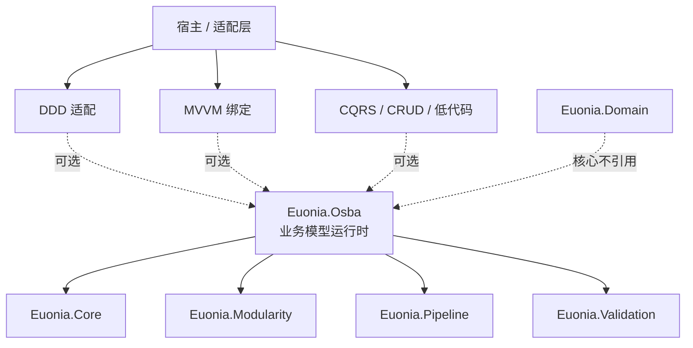
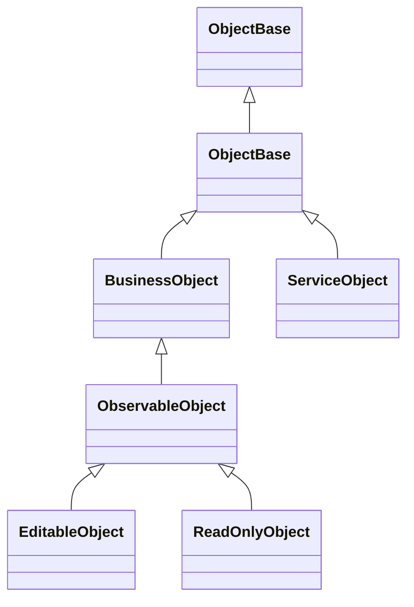
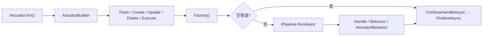

# Euonia.Osba 设计文档

> 状态：与当前源码同步（`2026.4.6` 版本线）
> 范围：对象模型、规则、工厂、执行器、权限边界、性能与公共 API 兼容性
> 配套文档：[`README.md`](README.md)（使用与文件结构）、[`SAMPLE.md`](SAMPLE.md)（端到端示例）、[`PERMISSION-DESIGN.md`](PERMISSION-DESIGN.md)（权限设计）

本文记录 **设计决策与取舍**，不是逐 API 使用手册；具体用法以 README / SAMPLE 为准。

---

## 1. 目标与边界

### 1.1 一句话定位

`Euonia.Osba` 是**业务模型（Business Model）运行时**，不是 ORM，也不是 DDD 专用框架。

它让一个业务对象同时拥有：

- 属性元数据与类型化读写；
- 变更追踪、原始值与回滚；
- 编辑状态机与生命周期；
- 字段级 / 对象级规则；
- 工厂方法分派与执行器编排；
- 操作权限与行级数据权限边界。

### 1.2 设计目标

| 目标 | 含义 |
|---|---|
| 富业务模型 | 业务对象自带行为、规则、状态与生命周期，而不是贫血 DTO |
| 架构中立 | 可融入 DDD、MVVM、CQRS、CRUD、低代码等不同设计思想 |
| 易用性 | 属性注册、读取、保存、校验、执行器都有低样板代码的入口 |
| 扩展性 | 派生类、宿主工厂、规则、管道行为、生命周期都可接管 |
| 性能 | 属性读写、规则检查、保存等热路径保持低分配、低延迟 |
| 兼容性 | 增强时不破坏既有公共 API 与既有宿主代码 |

### 1.3 非目标

Osba 核心**不**提供：

- 仓储、Unit of Work、领域事件分发；
- 聚合根、实体身份、值对象的强制语义；
- ORM / 数据库访问；
- 鉴权引擎本身；
- UI 框架或绑定系统；
- 完整的 DDD 分层脚手架。

这些能力可以由宿主、适配层或可选包组合进来，而不是成为核心的编译期依赖。

### 1.4 与 DDD / MVVM 的关系

| 关注点 | DDD 领域模型 | MVVM 编辑模型 | Osba 业务模型 |
|---|---|---|---|
| 核心目标 | 聚合、不变量、领域事件 | 属性通知、编辑状态、校验 | 通用业务对象运行时 |
| 属性通知 | 通常不需要 | 需要 | 提供 |
| 变更追踪 | 关注聚合一致性 | 关注脏检查/回滚 | 提供 |
| 状态机 | 聚合生命周期 | `None/New/Changed/Deleted` | 提供，可派生扩展 |
| 规则 | 不变量 / 领域规则 | 字段/表单校验 | 提供属性级/对象级规则 |
| 权限 | 通常不属于领域层 | 通常不属于 ViewModel | 工厂边界统一裁决 |
| 持久化 | 仓储 / UoW | 由宿主负责 | 工厂方法内完成，事务归宿主 |

**共同点**：都反对贫血模型，都强调行为、规则与生命周期。
**差异**：Osba 把「业务模型」做成更小的公共分母；DDD 是它的一种投影，MVVM 是另一种投影。

---

## 2. 为什么不直接引入 `Euonia.Domain`

### 2.1 依赖方向



如果核心直接引用 `Euonia.Domain`，所有使用 Osba 的宿主都会被迫接受：

- 聚合根、实体身份、值对象语义；
- 领域事件、仓储、UoW 的假设；
- Domain 的版本演进与包依赖。

这会把「可选架构」变成「强制架构」，也会让 MVVM、CRUD、低代码等场景背上不需要的基础设施。

### 2.2 语义绑定

`Euonia.Domain` 的契约带有明确的 DDD 假设：

- `IAggregateRoot`：聚合边界与一致性边界；
- `IEntity<TKey>`：实体身份与相等性；
- `IValueObject`：不可变值对象；
- `IHasDomainEvents`：领域事件缓冲与分发；
- 仓储 / UoW：持久化与事务生命周期。

Osba 的业务对象还包括：

- `ServiceObject<T>`：一次独立业务操作/命令；
- `ReadOnlyObject<T>`：查询结果/读模型；
- `EditableObject<T>`：表单、MVVM、CRUD 编辑；
- 未来的低代码、工作流、规则驱动模型。

这些对象不一定有实体身份，也不一定需要聚合和领域事件。直接继承 Domain 会把不合适的约束强加给它们。

### 2.3 场景差异

MVVM 需要：

- `INotifyPropertyChanged` / `INotifyPropertyChanging`；
- `ObservableList<T>` / `ObservableDictionary<TKey,TValue>`；
- `IsBusy` / `IsSelfBusy`；
- `IsDirty` / `RejectChanges`；
- `ValidationState` / `BrokenRuleCollection`。

DDD 更关注：

- 聚合边界与不变量；
- 领域事件；
- 仓储 / UoW；
- 领域服务。

Osba 用同一套属性、规则、状态、工厂、权限原语支撑这些不同投影，而不是把其中一种投影写死进核心。

### 2.4 性能与演进

- 聚合、领域事件、仓储抽象不是所有场景都需要；核心不引入它们，热路径保持轻量。
- Domain 与 Osba 可以独立演进，避免破坏性变更互相绑定。
- 需要 DDD 时，通过适配层/组合接入；需要 MVVM 时，直接使用通知、集合与编辑状态能力。

### 2.5 推荐集成方式

```text
Euonia.Osba.Domain（可选适配包，未来可加）
   ├── AggregateRootAdapter<T, TKey>
   ├── DomainEventCollector
   └── Repository / UoW 桥接
          ↓
     Euonia.Osba
          ↓
     Euonia.Domain（只在适配包/宿主中出现）
```

- **聚合根适配**：组合优先于继承；Osba 对象持有/实现 `IAggregateRoot<TKey>`。
- **领域事件**：用 `OnSavingAsync` / `OnSavedAsync` 收集与发布。
- **仓储/UoW**：在工厂方法内部调用；Osba 不拥有事务边界。
- **原始值与回滚**：用 `GetOriginalValue` / `GetChangedValues` / `RejectChanges` 做审计、并发检查与编辑取消。
- **状态机**：用 `CanTransitionTo` / `StateChanged` 表达聚合状态迁移。

---

## 3. 总体架构

### 3.1 模块划分

| 目录 | 职责 |
|---|---|
| `Abstracts/` | 公共契约：对象、可编辑、只读、服务对象、生命周期、通知、规则检查 |
| `Core/` | 对象模型：属性存储、变更追踪、状态机、父子图、生命周期、校验入口 |
| `Reflection/` | 属性元数据、字段数据、字段管理器、环形历史、可观察值 |
| `Rules/` | 规则基类、通用规则、规则管理器、规则上下文、注册表、严重级别 |
| `Factory/` | 工厂接口、反射分派、参数匹配、实例创建、注入、授权边界 |
| `Actuators/` | 执行器入口、构建器、读取/创建/更新/删除/执行执行器、管道行为 |
| `Permission/` | 操作权限与行级数据权限的 Osba 侧实现 |
| `Diagnostics/` | `ActivitySource` / `Meter` / 日志回退 |
| `Properties/` | 本地化资源 |

### 3.2 对象模型层次



| 类型 | 能力 | 典型用途 |
|---|---|---|
| `ObjectBase` / `ObjectBase<T>` | 属性存储、规则、上下文、权限钩子、生命周期、父子图 | 所有 Osba 对象的根 |
| `BusinessObject<T>` | 变更追踪、泛型读写、原始值/回滚 | 需要脏检查的业务对象 |
| `ObservableObject<T>` | 编辑状态机、繁忙状态、`IsSavable` | 需要状态与通知的对象 |
| `EditableObject<T>` | 保存流程、`Saved` 事件、工厂方法 | 实体编辑、CRUD、表单 |
| `ReadOnlyObject<T>` | 只读属性写入保护、装载控制 | 查询结果、详情展示 |
| `ServiceObject<T>` | 属性 + 规则 + 执行体，无变更追踪/保存 | 一次业务操作/命令 |

---

## 4. 对象模型设计

### 4.1 属性元数据与字段存储

- `PropertyInfo<T>`：名称、类型、友好名、默认值、反射信息。
- `PropertyInfoManager`：按类型缓存属性列表，避免每次反射。
- `FieldDataManager`：按类型缓存合并后的元数据与名称索引；实例只分配字段数组。
- `FieldData<T>`：字段值、环形撤销历史、变更标记、原始值基线。
- `ObservableValue`：按需创建，只有订阅者时才分配。

设计取舍：

- 元数据按类型共享，实例只存值，降低每对象内存。
- 未注册属性走兜底字典，保证扩展性，但热路径优先使用注册属性。
- 历史深度有界，避免无限增长。

### 4.2 变更追踪与原始值

`BusinessObject<T>` 提供：

| API | 作用 |
|---|---|
| `ChangedProperties` / `HasChangedProperties` | 哪些属性被改过 |
| `GetOriginalValue` / `GetOriginalValues` | 自上次 `AcceptChanges` 以来的基线值 |
| `GetChangedValues` | 已更改属性的当前值 |
| `IsDirty` | `HasChangedProperties` 的语义别名 |
| `RejectChanges` | 回滚到原始值并清空变更记录 |
| `AcceptChanges` / `MarkAsClean` | 提交当前值为新基线 |

基线语义：

1. 第一次修改时捕获原始值；
2. 后续多次修改始终保留第一次修改前的值；
3. `AcceptChanges` 把当前值提交为新基线；
4. `RejectChanges` 恢复旧基线，并复位状态；
5. `FieldData<T>` 使用独立变更标记，`HistoryDepth = 0` 时 `IsChanged` 仍然正确。

### 4.3 状态机

状态：

```text
None → New / Changed / Deleted → None
```

- `MarkAsNew` / `MarkAsChanged` / `MarkAsDeleted` 都是 `virtual`，统一经过 `TransitionTo`。
- `CanTransitionTo(ObjectEditState)`：派生类可禁止非法迁移。
- `TransitionTo(...)`：可整体替换迁移逻辑。
- `OnStateChanged(...)`：迁移后的领域行为。
- `StateChanged` 事件：外部观察迁移。
- `AcceptChanges` 复位到 `None`，不经过 `CanTransitionTo`，但会触发 `StateChanged`。

默认迁移是宽松的；需要严格领域状态机时，在派生类重写 `CanTransitionTo`。

### 4.4 属性访问与装载控制

- `GetProperty(IPropertyInfo)` / `SetProperty(IPropertyInfo, object)` 是 `virtual`。
- `CanReadProperty` / `CanWriteProperty` 可重写。
- 派生类可以把 setter 设为 `private` / `protected`，只暴露领域方法。
- `IsLoading` / `BeginLoad()` 开放给派生类，用于自定义物化逻辑。
- `CanLoadProperty` 控制哪些属性允许装载。

### 4.5 父子对象图

- 子对象属性变化会向上通知父对象。
- 父对象上持有该子对象的属性会被标脏并发出 `PropertyChanged`。
- `ObservableList<T>` 的元素变化、集合增删，`ObservableDictionary<TKey,TValue>` 的项变化也会通知父对象。
- 父子关系使用弱事件，避免长生命周期父对象持有短生命周期子对象。

### 4.6 生命周期

`IObjectLifecycle` 定义四个边界：

| 回调 | 时机 | 典型用途 |
|---|---|---|
| `OnSavingAsync` | 保存前、规则/权限通过后 | 审计、缓存失效、事件收集 |
| `OnSavedAsync` | 保存成功、`MarkAsClean` 后 | 发布事件、刷新读模型 |
| `OnExecutingAsync` | 执行体执行前 | 命令审计、上下文准备 |
| `OnExecutedAsync` | 执行体成功后 | 结果缓存、事件发布 |

设计取舍：

- 回调默认空实现，不改变规则与权限裁决顺序。
- 回调异常原样向上抛出，由调用方决定回滚或重试。
- Osba 不拥有事务边界；事务由宿主 / UoW 负责。

---

## 5. 规则系统设计

### 5.1 规则类型

- `RuleBase`：规则基类，生成 `rule://命名空间.类型名/属性名` 名称。
- `CommonRule.Required` / `Regular` / `Lambda`：常用规则。
- `DataAnnotationRule`：把 DataAnnotations 转成规则。
- `ExecuteOnStateAttribute`：规则只在特定编辑状态下执行。
- 属性级 / 对象级规则：属性级在属性变更或保存前检查；对象级在保存/执行前检查。

### 5.2 规则注册与作用域

- `AddBusinessObject` 注册容器级 `IRuleRegistry`，每个容器一个 `RuleRegistry`。
- 没有 `BusinessContext` 的对象回退到进程级 `RuleManager`。
- `AddRules()` 每个类型在每个规则管理器中只执行一次。
- 宿主/插件可以在 `AddRules()` 之外通过 `IRuleRegistry.GetRules(type).AddRule(rule)` 注册类型级规则；线程安全，已创建对象在下一次检查时生效。
- 执行器可以用 `WithRule` / `WithRules` 附加本次操作专属规则；规则挂在目标对象上，不写入共享集合。

### 5.3 规则上下文

`IRuleContext` 提供：

- `Target`：目标对象；
- `Rule`：当前规则；
- `Results`：规则结果；
- `AddErrorResult` / `AddWarningResult` / `AddInformationResult` / `AddSuccessResult`；
- `ServiceProvider` / `GetService<T>()`：按请求从目标对象的当前作用域解析服务；
- `Complete()`：完成上下文。

设计取舍：

- 类型级规则实例是共享的，**不能存请求态**；需要请求态时从 `context.Target` 或 `context.GetService<T>()` 获取。
- `AddErrorResult(null)` / 空白描述会补占位消息，不会被静默当成通过。
- 只有 `Error` 让对象无效；`Warning` / `Information` 不阻断保存。

### 5.4 绕过与挂起

- `SuspendRuleChecking()`：挂起本对象规则检查，不给结论。
- `BypassRuleChecks`：当前异步流内绕过规则检查，可向下穿透子对象。
- `Actuator.BypassRule<T>()` / `BypassRule(name)`：本次操作按精确类型/名称排除。
- `Actuator.BypassRuleChecks()`：本次操作跳过规则检查。
- `Actuator.WithRuleChecksOnDelete()`：删除也执行对象级规则（默认不执行）。

**规则是验证线，不是安全线**。绕过规则不会解除权限；越权仍由工厂边界抛 `SecurityException`。

### 5.5 性能设计

- 属性级规则按属性索引缓存，命中路径无锁、无分配。
- 对象级规则按类型缓存，`Add` 时失效。
- 同步完成的规则不创建状态机、不进入 `Task.WhenAll`。
- 内部 `RunRules` 使用 `ValueTuple`，减少元组分配。
- 规则上下文惰性创建结果列表，规则通过时不分配。

---

## 6. 工厂设计

### 6.1 方法查找

- 约定名 + 特性双通道：
  - `[FactoryCreate]` / `[FactoryFetch]` / `[FactoryInsert]` / `[FactoryUpdate]` / `[FactoryDelete]` / `[FactoryExecute]`；
  - 方法名 `Create` / `Fetch` / `Insert` / `Update` / `Delete` / `Execute`。
- 反射结果按（目标类型、特性类型、参数形态）缓存。
- 支持可选参数、`params`、`Task` / `Task<T>` / `ValueTask` / `ValueTask<T>`。
- `TargetInvocationException` 解包，业务异常不被包一层。

### 6.2 实例创建与注入

`BusinessObjectFactory.GetObjectInstance<TTarget>()`：

1. `ActivatorUtilities.GetServiceOrCreateInstance<TTarget>(_provider)`：优先容器解析，否则构造函数注入创建。
2. 若实现 `IHasLazyServiceProvider`，注入 `ILazyServiceProvider`。
3. 若实现 `IUseBusinessContext`，注入 `BusinessContext`（触发规则初始化）。
4. 扫描 `[Inject]` 属性：支持单个服务、集合、数组、键控服务；未注册的单值服务赋 `null` 并写诊断日志。

### 6.3 扩展点

`BusinessObjectFactory` 的公开操作方法（`Create` / `Fetch` / `SaveAsync` / `ExecuteAsync` 等）以及 `GetObjectInstance` / `WithActivator` / `WithActivatorAsync` 都是 `virtual`。

宿主可以派生工厂接管：

- 实例创建与依赖注入；
- 授权、初始化、工厂方法调用；
- 操作流程与诊断。

### 6.4 criteria 入口边界

`IObjectFactory.InsertAsync/UpdateAsync/DeleteAsync/ExecuteAsync(criteria)` 是低层入口：

- 目标对象由工厂方法内部创建并填充，调用前没有可判定的行；
- 行级权限只能在写入后复核；
- `InsertAsync` / `ExecuteAsync(criteria)` 已标记 `[Obsolete]`；
- 受数据权限约束的类型应使用 `Fetch → IScopeGuard.AllowsObject → Save`。

### 6.5 读取语义

`Fetch` 只调用工厂读取方法，不触发保存，也不改变对象状态；读取执行器因此可以安全地用于「读取 → 处理」场景。

---

## 7. 执行器与管道

### 7.1 组成

- `IActuator` / `Actuator`：执行器入口。
- `ActuatorBuilder<TTarget>`：配置工厂、管道、行为。
- `ActuatorBase<TTarget>`：获取目标 → 处理 → 终结的通用流程。
- `FetchActuator` / `CreateActuator` / `UpdateActuator` / `DeleteActuator` / `ExecuteActuator`：具体终结语义。
- `IActuatorBehavior<TTarget>`：容器注册的管道行为。

### 7.2 执行流程



### 7.3 空管道快路径

当满足以下条件时：

- 管道由框架默认创建；
- 没有 `Handle(...)`；
- 没有 `Behavior(...)`；
- 没有 `IActuatorBehavior<TTarget>`；

执行器跳过管道组件快照、排序与委托组合，直接执行「后续处理 → 终结」。

语义与完整管道一致；自定义 `IPipeline`、`Behavior`、`IActuatorBehavior` 始终走完整管道。

### 7.4 规则与生命周期

- `Handle` 注册的处理逻辑在**终结之前**执行，因此规则看到的是处理后的对象。
- `WithRule` 附加的规则挂在目标对象上，不写入类型级共享集合；操作结束即卸下。
- `IObjectLifecycle` 的 `OnExecutingAsync` / `OnExecutedAsync` 由工厂边界调用。

---

## 8. 权限边界

Osba 的权限设计遵循「契约在 Core，实现各一半」：

- `Euonia.Core` 提供权限契约：`PermissionAttribute`、`IPermissionChecker`、`IPermissionCodeSource`、`IObjectScopeAuthorizer`、`IObjectOperationResolver`、`BusinessOperation`。
- Osba 负责对象/操作/范围裁决与 fail-closed。
- 宿主通过 `AddPermission` 接入具体鉴权引擎。
- Osba 不引用 `Euonia.Security`。

权限裁决只发生在工厂边界；规则绕过不等于权限放行。详见 [`PERMISSION-DESIGN.md`](PERMISSION-DESIGN.md)。

---

## 9. 性能设计

### 9.1 热路径优化

| 优化 | 说明 |
|---|---|
| 类型级元数据缓存 | `PropertyInfoManager` 按类型缓存属性；`FieldDataManager` 按类型缓存元数据与名称索引 |
| 实例字段数组 | 字段值按稳定索引存放在 `IFieldData[]`，不为每个对象分配字典 |
| 环形撤销历史 | 入栈 / 裁剪 / 撤销 O(1)，历史长度有界 |
| 按需可观察值 | `ObservableValue` 只在有订阅者时创建 |
| 规则同步快路径 | 同步完成的规则不创建状态机、不进入 `Task.WhenAll` |
| 规则返回值 | 内部 `RunRules` 使用 `ValueTuple`，减少元组分配 |
| 反射缓存 | 工厂方法、参数形态、`ValueTask<T>.AsTask`、`Inject` 属性均缓存 |
| 异步不捕获上下文 | 库内异步路径统一 `ConfigureAwait(false)` |
| 零订阅优化 | `PropertyChanged` / `Saved` 无订阅者时不构造事件参数、不走弱事件管理器 |
| 空管道快路径 | 无 `Handle` / `Behavior` / `IActuatorBehavior` 时跳过管道组件快照与委托组合 |

### 9.2 基准参考值

ShortRun 参考值（Apple M4 Max / .NET 10.0.11 / BenchmarkDotNet）：

| 场景 | 耗时 | 分配 |
|---|---:|---:|
| 属性写 | 37 ns | 24 B |
| 带一条属性规则写 | 126–130 ns | 304 B |
| `ValidateAsync` | 47–48 ns | 232 B |
| `SaveAsync`（无持久化） | 323–328 ns | 936 B |
| `GetOriginalValue` | 8 ns | 0 B |
| `RejectChanges` | 94 ns | 112 B |
| `MarkAsChanged` + `AcceptChanges` | 8.9 ns | 0 B |
| `FetchFactory`（直接工厂读取） | 1.12 µs | 1.48 KB |
| `FetchActuator`（空管道快路径） | 1.24 µs | 1.94 KB |

> 这些数字用于量级判断，不是正式 CI 门禁。正式门禁建议在固定硬件上使用默认 BenchmarkDotNet Job，并对回归超过 20% 或分配翻倍的情况失败。

---

## 10. 公共 API 兼容性

Osba 在增强时遵循以下约束：

- **新增接口成员提供默认实现**：`IFieldData.OriginalValue`、`IRuleContext.ServiceProvider` / `GetService<T>()` 都有默认实现，旧的自定义实现无需修改即可编译。
- **保留旧重载与构造函数**：`RegisterProperty` 的 `Expression<Func<T, object>>` 重载、`BusinessObjectFactory(IServiceProvider, IObjectActivator)` 构造函数仍然可用。
- **不改变既有签名**：已有方法只做 `virtual` 化或内部实现优化，调用方代码无需调整。
- **自定义管道不被跳过**：执行器空管道快路径只作用于框架默认管道；宿主注册的 `IPipeline` 与 `IActuatorBehavior` 始终执行。
- **回归测试**：`PublicApiCompatibilityTests` 覆盖旧重载、默认接口成员、旧构造函数与自定义管道。

兼容性测试文件：

- `Tests/Euonia.Osba.Tests/PublicApiCompatibilityTests.cs`
- `Tests/Euonia.Osba.Tests/RuleRegistrationTests.cs`

---

## 11. 测试与基准

### 11.1 测试

```text
Euonia.Osba.Tests             295 passed
Euonia.Osba.Standalone.Tests    7 passed
```

覆盖范围：

- 属性类型推断与旧表达式重载；
- `FetchActuator` 与执行器管道；
- 生命周期回调；
- 原始值 / 回滚 / 状态迁移；
- 规则服务解析与外部规则注册；
- 自定义工厂；
- 旧公共 API 兼容性。

> `dotnet test` 在当前测试宿主下可能报告 `Zero tests ran`；请直接运行测试可执行文件：
>
> ```bash
> Tests/Euonia.Osba.Tests/bin/Debug/net10.0/Euonia.Osba.Tests -noLogo
> Tests/Euonia.Osba.Standalone.Tests/bin/Debug/net10.0/Euonia.Osba.Standalone.Tests -noLogo
> ```

### 11.2 基准

```bash
# 全部
dotnet run -c Release --project Benchmarks/Euonia.Osba.Benchmarks

# 只跑某一组
dotnet run -c Release --project Benchmarks/Euonia.Osba.Benchmarks -- --filter '*ObjectLifecycle*'
dotnet run -c Release --project Benchmarks/Euonia.Osba.Benchmarks -- --filter '*RuleAndFactory*'
dotnet run -c Release --project Benchmarks/Euonia.Osba.Benchmarks -- --filter '*DomainControl*'
```

建议门禁指标：

- `ObjectLifecycleBenchmarks.WriteExisting`
- `RuleAndFactoryBenchmarks.WriteWithPropertyRule`
- `RuleAndFactoryBenchmarks.SavePlain`
- `RuleAndFactoryBenchmarks.FetchFactory`
- `RuleAndFactoryBenchmarks.FetchActuator`
- `DomainControlBenchmarks.RejectChanges`

---

## 12. 已知边界与后续工作

### 12.1 已知边界

- 核心不提供仓储、UoW、领域事件；需要时由宿主/适配层组合。
- `FetchActuator` 仍有约 0.12 µs / 0.46 KB 的执行器开销（相对直接工厂读取）。
- 基准数字来自 ShortRun，不是正式 CI 门禁。
- `RegisterProperty<object>(...)` 显式泛型可能与旧 `Expression<Func<T, object>>` 重载产生歧义；普通类型推断路径不受影响。

### 12.2 后续工作

1. 把基准门禁接入 CI（固定硬件、默认 Job、回归阈值）。
2. 继续观察并优化 `FetchActuator` 的剩余执行器开销。
3. 按需增加 DDD / MVVM 适配层，但保持核心不引用 `Euonia.Domain`。
4. 评估规则提供者（`IRuleProvider`）与模块化规则注册。
5. 补充更多领域对象场景：并发、审计、身份、软删除。

---

## 13. 相关文档

| 文档 | 内容 |
|---|---|
| [`README.md`](README.md) | 架构、使用、逐文件结构 |
| [`SAMPLE.md`](SAMPLE.md) | 从零到运行的端到端示例 |
| [`PERMISSION.md`](PERMISSION.md) | 权限体系完整说明 |
| [`PERMISSION-SAMPLE.md`](PERMISSION-SAMPLE.md) | 多业务场景权限示例 |
| [`PERMISSION-DESIGN.md`](PERMISSION-DESIGN.md) | 权限接线设计决策 |
| [`ARCHITECTURE-REVIEW.md`](ARCHITECTURE-REVIEW.md) | 历史架构/性能评审基线 |
| [`../../CHANGELOG.md`](../../CHANGELOG.md) | 版本变更记录 |
