# Euonia.Osba 权限边界设计

本文描述 Osba 在**工厂边界**执行权限的当前设计：契约来自 `Euonia.Core`，Osba 只负责
「何时判定、判定失败如何表现、把哪个方法交给判定」。

## 1. 边界与职责

- **Core** 定义权限契约：`PermissionAttribute`、`PermissionRequirements`、
  `IPermissionRequirementSource`、`IPermissionChecker`、`IObjectScopeAuthorizer`、
  `IObjectOperationResolver`。
- **Osba** 实现工厂边界：`ObjectAuthorization` 执行操作权限，`ScopeAuthorization` 执行
  数据权限；两者都只调用 Core 契约。
- **宿主** 在组合根注册判定实现与授权值来源；Osba 不引用任何具体策略引擎。

权限要求与数据权限实现都由宿主选择；Osba 不把它们写死进对象模型。

## 2. 无法判定时必须失败

目标声明了要求，却取不到 `BusinessContext` 或 `IPermissionChecker` 时，闸门抛
`InvalidOperationException`，而不是当作「没有要求」放行。原则与数据权限一致：
**判定不了就是配置错误**。

没有声明任何要求的类型不强制接线；放行由「没有要求」决定，不由「判定失败」决定。

`BusinessObject.CanPerformOperation(...)` 仍是查询：无从判定时返回 `true`，不抛异常；
真正的拦截在工厂边界。

## 3. 权限与验证是两条线

越权不走规则通道，统一抛 `SecurityException`；规则只负责数据校验：

| | 验证线（`Rules`） | 权限线（工厂边界） |
|---|---|---|
| 回答 | 数据是否合法 | 用户能不能做 / 能不能碰这一行 |
| 位置 | `EditableObject.SaveAsync`；命令对象在命令体之前 | `BusinessObjectFactory` 调用边界 |
| 失败 | `ValidationException` | `SecurityException` |
| 可否绕过 | 可（`SuspendRuleChecking` / `BypassRuleChecks` / `WithRuleChecksOnDelete`） | **不可** |

因此越权不会出现在 `ValidationException.Errors` 里。需要表单预提示时，在调用侧显式捕获
`SecurityException`，或先用 `CanPerformOperation` / `IObjectScopeAuthorizer.Allows` 查询。

## 4. 契约归属

Osba 需要的权限契约都在 Core，因此 Osba 不引用任何策略引擎也能编译和运行。
Osba 只消费契约，不实现 `IPermissionChecker`；数据权限也只通过 `IObjectScopeAuthorizer`
调用实现。

契约关系如图 1 所示。

**图 1：Osba 与 Core 的权限契约**

如图 1 所示，Osba 的 `ObjectAuthorization` 消费 `IPermissionChecker` 与
`IPermissionRequirementSource`；`ScopeAuthorization` 消费 `IObjectScopeAuthorizer`。
具体实现由宿主注册，Osba 不感知其内部结构。

## 5. 判定时机

| 入口 | 操作权限 | 数据权限 |
|---|---|---|
| `SaveAsync(target)` | 前置 | 前置 + 后置 |
| `ExecuteAsync(target)` | 前置 | 前置 |
| `Create` / `CreateAsync` | 前置 | 不判定（只构造对象） |
| `InsertAsync` / `Fetch` / `UpdateAsync` / `DeleteAsync` / `ExecuteAsync(criteria)` | 前置 | 后置 |

后置检查发生在业务方法返回之后：它阻止越权对象返回给调用方，不阻止已经发生的写入。
预提交强制由持久化层拦截器或数据库约束负责。

`Create` / `CreateAsync` 只构造对象、不落库；按设计由调用方随后填充字段，因此不判定数据范围。

## 6. 已知边界

- 删除路径默认跳过的是**验证规则**，不是权限；越权删除仍抛 `SecurityException`。
- criteria 写入口的数据库写入发生在后置判定之前；受约束类型应走 `Fetch → 判定 → Save`。
- 范围列的「搬迁」（例如把 `TeamId` 改到无权团队）能发现并抛出，但无法阻止已写入的数据。
- `CanPerformOperation` 没有方法上下文，只含类型级与已登记来源，不含方法级声明。
- 子集合未加载时，数据权限单行判定应给出明确异常，而不是当成越权；由具体实现负责。

## 7. 回归护栏

| 测试 | 钉住的行为 |
|---|---|
| `SaveAsync_Update_OutOfScope_ShouldFailWithSecurityException` + `SaveAsync_OutOfScope_OnDelete_ShouldFailWithSecurityException` | 越权形态一致，均抛 `SecurityException` |
| `PermissionLineIndependenceTests` | 权限线不受规则绕过影响 |
| `SaveAsync_WithRequirementsButNoBusinessContext_ShouldFailInsteadOfBypassing` + `SaveAsync_ModeledTypeWithoutBusinessContext_ShouldFailInsteadOfBypassing` | 无法判定即失败 |
| `PermissionMethodIsolationTests` | 方法级声明只作用于被工厂调用的方法 |
| `CanPerformOperation_Should_Only_Reflect_Type_Level_Requirements` | 查询不含方法级要求 |
| `ScopeTests` / `ScopeRowPermissionTests` | 数据权限与越权形态 |
| `Euonia.Osba.Standalone.Tests` | 不引用策略引擎也可用权限 |
| `ObjectPermissionOptInTests.AddBusinessObject_Alone_Should_Not_Register_Permission_Engine` | `AddBusinessObject` 不注册判定实现 |
