# Euonia.Osba 权限

Osba 在**工厂边界**执行两类权限：

- **操作权限**：当前用户能否执行某个方法；
- **数据权限**：当前用户能否读取/写入某一行。

Osba 只负责边界与强制执行；权限要求、判定与行级策略由 Core 契约和宿主注册的实现提供。

## 1. 权限边界

`Euonia.Osba` 的权限契约全部来自 `Euonia.Core`：

| 契约 | Osba 的用法 | 宿主提供 |
|---|---|---|
| `PermissionAttribute` | 声明类型级/方法级权限要求 | — |
| `IPermissionRequirementSource` | 可选：补充声明之外的要求 | 码来自数据时实现 |
| `IPermissionChecker` | 判定权限码与角色 | `IsGranted` / `IsInRole` |
| `IObjectScopeAuthorizer` | 工厂边界的行级判定 | 数据权限实现 |
| `IObjectOperationResolver` | 对象状态 → 业务操作 | 通常由 `AddBusinessObject` 注册 |

`PermissionRequirements` 是 Core 提供的声明读取器（不是契约）：`For(type)` / `For(method)` /
`For(type, method)` / `Merge` / `Adapt`。

Osba 不引用任何具体鉴权引擎；宿主在组合根选择实现，容器里有对应契约即可工作。

没有判定实现时是 **fail-closed**：声明了要求的类型会在工厂边界因「无人判定」而抛
`InvalidOperationException`，不会静默放行；没有任何声明才放行。

## 2. 声明权限点

权限码是**任意非空字符串、单一维度**。`order:read`、`repo-push`、`order.approve` 都合法；
冒号只是命名习惯，不是「资源 + 操作」结构。

`[Permission]` 可打在**类型**或**方法**上，可用多次（多码 = AND，多角色 = OR）：

```csharp
[Permission("order:read")]                      // 类型级：对该类型的所有方法生效
public class Order : EditableObject<Order>
{
    [FactoryUpdate]
    [Permission("order:update")]                // 方法级：只在 UpdateAsync 被工厂调用时生效
    protected override Task UpdateAsync(CancellationToken cancellationToken = default)
        => Task.CompletedTask;
}
```

- 首尾空白在读取时被裁剪；比较忽略大小写；不得以保留前缀 `@` 开头。
- 类型级与方法级取并集：两者都存在时都要满足。
- 方法级要求只针对**被工厂调用的那个方法**，不遍历同类型的其它方法。

类型级与方法级的隔离关系如图 1 所示。



**图 1：类型级 vs 方法级隔离**

如图 1 所示，`UpdateAsync` 路径只要求 `order:read` + `order:update`；同类型其它方法上的码
不会叠加到这条路径上。

## 3. 工厂如何执行

`BusinessObjectFactory` 的 10 处入口在调用业务方法前统一执行 `ObjectAuthorization`：

1. 解析出**即将 invoke 的 `MethodInfo`**；
2. 调用 `EnsureAuthorized(target, operation, method, requirementType)`；
3. 收集类型级 + 该方法级要求，并与宿主登记的要求来源取并集；
4. 逐条交给 `IPermissionChecker` 判定；
5. 满足则 `InvokeAsync(method)`，否则抛 `SecurityException`。

工厂边界的判定链路如图 2 所示。



**图 2：工厂边界的权限判定链路**

如图 2 所示，`IPermissionChecker` 只返回 `true` / `false`，由 `ObjectAuthorization` 汇总后决定
执行还是拒绝。闸门拿到的 `MethodInfo` 与随后实际调用的是同一个方法。

`SaveAsync` 根据对象状态映射操作（New→`Create`、Changed→`Update`、Deleted→`Delete`、
命令对象→`Execute`）；该操作只用于数据权限寻址，不参与权限码发现。

**行为约定**：

- 没有任何 `[Permission]` → 放行；
- 有要求却取不到 `BusinessContext` / `IPermissionChecker` → `InvalidOperationException`；
- 有要求且判定得出，但未满足 → `SecurityException`。

### 查询与闸门

`BusinessObject.CanPerformOperation(operation)` 是**查询**：不抛异常，无从判定时返回 `true`。
它没有方法上下文，只反映类型级要求与已登记来源，**不包含方法级声明**。真正的拦截始终在工厂边界。

需要在方法级权限码上做条件分支时，直接查询判定契约：

```csharp
var checker = BusinessContext.GetRequiredService<IPermissionChecker>();
if (!checker.IsGranted("order:update"))
{
    // 分支处理
}
```

## 4. 数据权限

数据权限在工厂边界由 `ScopeAuthorization` 强制执行。它通过 `IObjectScopeAuthorizer` 回答：

- `IsConstrained(type)`：该类型是否受数据权限约束；
- `Allows(target, operation, scope)`：这一行是否在范围内；
- `Explain(target, operation, scope)`：拒绝原因；
- `EnsureResolvedAsync(scope, ct)`：判定前预热。

判定时机：

| 入口 | 时机 |
|---|---|
| `SaveAsync(target)` | 前置 + 后置 |
| `ExecuteAsync(target)` | 前置 |
| `Create` / `CreateAsync` | 不判定（只构造对象） |
| `InsertAsync` / `Fetch` / `UpdateAsync` / `DeleteAsync` / `ExecuteAsync(criteria)` | 后置 |

后置检查发生在业务方法返回之后，它阻止的是「越权对象返回给调用方」，不是「越权数据写入」。
真正的预提交强制由持久化层拦截器或数据库约束保证。

数据权限的模型、策略与授权值来源由宿主选择的 `IObjectScopeAuthorizer` 实现提供；Osba 只负责在工厂边界调用它。具体实现由宿主按其选用的权限组件文档接入。

## 5. 宿主装配

最小装配只需要注册 Osba：

```csharp
services.AddBusinessObject(typeof(Order).Assembly);
```

需要策略引擎时，可选装配 `Euonia.Security`：

```csharp
services.AddPermission(p => p.Scan(typeof(Order).Assembly));
```

具体装配、数据权限模型与授权值来源见 [Euonia.Security README](../Euonia.Security/README.md)。

## 6. 完整示例

示例工程：[docs/examples/osba-console](../../docs/examples/osba-console/README.md)。

```bash
dotnet run --project docs/examples/osba-console
```

预期输出：

```text
granted(order:read+order:update) => saved=A-1
missing(order:update) => SecurityException
missing(order:read) => SecurityException
```

<details>
<summary>展开完整 Program.cs</summary>

```csharp
// ---------------------------------------------------------------------------
// Euonia.Osba 最小可运行示例：工厂边界上的方法级权限
//
// 运行：
//   dotnet run --project docs/examples/osba-console
//
// 预期输出：
//   granted(order:read+order:update) => saved=A-1
//   missing(order:update) => SecurityException
//   missing(order:read) => SecurityException
//
// 要点：
//   * 类型级 [Permission("order:read")] 对该类型的所有操作生效；
//   * 方法级 [Permission("order:update")] 只在 UpdateAsync 被工厂调用时生效；
//   * 闸门由 BusinessObjectFactory 在调用业务方法之前强制执行，未授予即抛 SecurityException。
// ---------------------------------------------------------------------------

using System.Security;
using System.Security.Claims;
using Microsoft.Extensions.DependencyInjection;
using Nerosoft.Euonia.Osba;
using Nerosoft.Euonia.Security;

var failures = 0;

await RunScenario("granted(order:read+order:update)", ["order:read", "order:update"], expectDenied: false);
await RunScenario("missing(order:update)", ["order:read"], expectDenied: true);
await RunScenario("missing(order:read)", ["order:update"], expectDenied: true);

return failures == 0 ? 0 : 1;

async Task RunScenario(string name, string[] codes, bool expectDenied)
{
    var services = new ServiceCollection();

    // 1) 业务对象：扫描包含 Order 的程序集，注册工厂、业务上下文与对象类型。
    services.AddBusinessObject(typeof(Order).Assembly);

    // 2) 权限引擎：只需 Scan；[Permission] 声明自动生效，不需要声明任何操作入口规则。
    services.AddPermission(permission => permission.Scan(typeof(Order).Assembly));

    // 3) 授权值来源：真实应用在这里查询用户与授权表。
    services.AddSingleton<IScopeSubjectResolver>(new CodeSubjectResolver(codes));

    // 4) 当前用户（角色来自声明）。
    services.AddSingleton(CreateUser("alice"));

    await using var provider = services.BuildServiceProvider();
    using var scope = provider.CreateScope();

    // 业务上下文是环境作用域，工厂用它解析判定实现与授权数据。
    BusinessContextAccessor.SetCurrent(scope.ServiceProvider);
    var businessContext = scope.ServiceProvider.GetRequiredService<BusinessContext>();
    var factory = scope.ServiceProvider.GetRequiredService<IObjectFactory>();

    var order = new Order { Name = "A-1", BusinessContext = businessContext };
    order.MarkAsChanged();   // 有变更才会走到更新工厂方法

    try
    {
        var saved = await factory.SaveAsync(order, CancellationToken.None);
        Console.WriteLine($"{name} => saved={saved.Name}");

        if (expectDenied)
        {
            failures++;
        }
    }
    catch (SecurityException)
    {
        Console.WriteLine($"{name} => SecurityException");

        if (!expectDenied)
        {
            failures++;
        }
    }
    finally
    {
        BusinessContextAccessor.Clear();
    }
}

static UserPrincipal CreateUser(string userId)
{
    var identity = new ClaimsIdentity(
        [new Claim(UserClaimTypes.Subject, userId), new Claim(UserClaimTypes.Role, "operator")],
        authenticationType: "Bearer",
        nameType: ClaimTypes.Name,
        roleType: UserClaimTypes.Role);

    return new UserPrincipal(new ClaimsPrincipal(identity));
}

/// <summary>
/// 可编辑业务对象：类型级要求 <c>order:read</c>，更新方法另有 <c>order:update</c>。
/// </summary>
[Permission("order:read")]
public sealed class Order : EditableObject<Order>
{
    /// <summary>获取或设置订单名称。</summary>
    public string Name { get; set; } = string.Empty;

    /// <summary>
    /// 更新工厂方法：只在更新保存时被调用，其上的 <c>order:update</c> 因此只约束更新路径。
    /// </summary>
    /// <param name="cancellationToken">取消令牌。</param>
    [Permission("order:update")]
    [FactoryUpdate]
    protected override Task UpdateAsync(CancellationToken cancellationToken = default)
    {
        return Task.CompletedTask;
    }
}

/// <summary>
/// 授予固定权限码集合的解析器（模拟授权数据）。
/// </summary>
public sealed class CodeSubjectResolver(string[] codes) : IScopeSubjectResolver
{
    /// <inheritdoc />
    public ValueTask<ScopeSubjectSet> ResolveAsync(ClaimsPrincipal? user, CancellationToken cancellationToken = default)
    {
        return ValueTask.FromResult(ScopeSubjectSet.CreateBuilder().AddCodes(codes).Build());
    }
}
```

</details>

关键接线（完整代码见 [Program.cs](../../docs/examples/osba-console/Program.cs)）：

```csharp
services.AddBusinessObject(typeof(Order).Assembly);
services.AddPermission(p => p.Scan(typeof(Order).Assembly));   // 可选策略引擎
// 授权值与判定实现由宿主注册，完整接线见 Program.cs
```

```csharp
var order = new Order { Name = "A-1", BusinessContext = businessContext };
order.MarkAsChanged();
var saved = await factory.SaveAsync(order, CancellationToken.None);
```

第一条输出表示类型级 `order:read` 与方法级 `order:update` 都已授予；后两条分别表示缺少
`order:update` 与缺少 `order:read` 时，工厂边界抛出 `SecurityException`。

## 7. 启动期校验

权限装配在注册期会检查：

- 配置回调为空：既没有扫描程序集，也没有登记要求来源或断言无模型；
- 空权限码且没有角色；
- 权限码以保留前缀 `@` 开头；
- 同一成员上同一个码重复声明。

首次解析数据权限判定契约时还会检查：是否至少扫描过一个程序集（或显式断言无模型），
以及所需的判定/授权值实现是否已注册。

诊断一次报全，不会修一个跑一次。

## 8. 故障排查

| 现象 | 处理 |
|---|---|
| `InvalidOperationException`：缺少 `BusinessContext` | 用工厂创建/读取对象，或给手工 `new` 的对象设置 `BusinessContext` |
| `InvalidOperationException`：缺少 `IPermissionChecker` | 注册判定实现；接引擎时检查 `AddPermission` 是否执行 |
| `SecurityException` | 类型级或方法级要求未满足；检查授予数据与方法级声明 |
| 方法级码不生效 | 确认该方法就是工厂调用的那个（`[FactoryXxx]` 或约定名），且调用经过工厂 |
| 查询返回 `true` 但保存被拒 | `CanPerformOperation` 不含方法级要求；以工厂边界为准 |
| 数据权限未生效 | 检查 `IObjectScopeAuthorizer` 是否注册、类型是否被实现约束 |

## 9. API 速查

```csharp
// Core 契约
public interface IPermissionChecker
{
    bool IsGranted(string permission);
    bool IsInRole(string role);
    ValueTask EnsureResolvedAsync(CancellationToken cancellationToken = default);
}

public interface IPermissionRequirementSource
{
    IReadOnlyList<PermissionAttribute> RequirementsFor(Type type, MethodInfo? method, string operation);
}

// Osba
public virtual bool CanPerformOperation(string operation);
```

`PermissionRequirements` 提供 `For(type)` / `For(method)` / `For(type, method)` / `Merge` / `Adapt`。
工厂内部通过 `ObjectAuthorization` 把即将 invoke 的 `MethodInfo` 交给判定；该链路不是宿主 API。

## 10. 已废弃 API

| 已废弃成员 | 现状 | 替代 |
|---|---|---|
| `IPermissionCodeSource` | 保留，标 `[Obsolete]` | `IPermissionRequirementSource` 或 `PermissionRequirements` |
| `ObjectPermissionCodeSource` | 保留，标 `[Obsolete]` | 无需登记；声明自动生效 |
| `PermissionOptions.OnAttributeOrName` / `OnMethod` | 保留，标 `[Obsolete]` | 删除调用 |
| `PermissionOptions.Source(IPermissionCodeSource)` | 保留，标 `[Obsolete]` | `Requirements(IPermissionRequirementSource)` |
| `PermissionOptions.NoOperationCodes` | 保留，标 `[Obsolete]`；空操作 | 删除调用 |
