# Euonia.Osba

> **Object-oriented Scalable Business Architecture**
>
> 面向对象、可扩展的业务对象框架：把「一次业务操作」建模成对象，由框架在正确的时机完成属性存储、变更追踪、规则校验、工厂分派、执行器编排与权限裁决。

`Euonia.Osba` 不是 ORM，也不是 DDD 专用框架。它的定位是**业务模型（Business Model）运行时**：对象拥有属性、行为、规则、状态、生命周期与权限边界，而不是贫血的数据容器。DDD、MVVM、CQRS、CRUD、低代码都可以在同一组原语上组合；DDD 只是其中一种可选投影。

它解决的是富业务对象在服务端落地时反复出现的几件事：

- 属性怎样声明、怎样读写、怎样知道「改了哪些字段」；
- 一次创建 / 读取 / 保存 / 删除 / 命令执行怎样被统一编排；
- 字段级与对象级校验何时执行、失败怎样表达；
- 权限在哪个边界裁决，怎样保证「判定不了」时不会静默放行；
- 上述能力怎样在不绑定具体数据库、不绑定具体鉴权引擎的前提下组合起来。

本文包含**架构设计、使用方法、逐文件结构**。设计决策与取舍见 [`DESIGN.md`](DESIGN.md)；更长的端到端示例见 [`SAMPLE.md`](SAMPLE.md)，权限专题见 [`PERMISSION.md`](PERMISSION.md)、[`PERMISSION-SAMPLE.md`](PERMISSION-SAMPLE.md) 与 [`PERMISSION-DESIGN.md`](PERMISSION-DESIGN.md)。

---

## 目录

1. [定位与能力](#1-定位与能力)
2. [快速开始](#2-快速开始)
3. [架构设计](#3-架构设计)
4. [使用方法](#4-使用方法)
5. [文件结构](#5-文件结构)
6. [设计约定与常见陷阱](#6-设计约定与常见陷阱)
7. [相关文档](#7-相关文档)
8. [版本与许可](#8-版本与许可)

---

## 1. 定位与能力

### 1.1 定位：业务模型，而不是 DDD 专用框架

Osba 的核心目标是提供**业务模型（Business Model）的运行时**，而不是实现某一套架构范式。

- **不绑定 DDD**：不要求聚合根、实体身份、值对象、领域事件、仓储/UoW；这些是可选的上层设计。
- **不绑定 MVVM**：但提供 `INotifyPropertyChanged` / `INotifyPropertyChanging`、`ObservableList/Dictionary`、`IsBusy`、`IsDirty`、`RejectChanges` 等 MVVM 友好能力。
- **不绑定应用层或持久化**：持久化由工厂方法完成，事务边界由宿主决定。
- **可选集成**：DDD、MVVM、CQRS、CRUD、低代码都可以在同一组原语上组合。

与 DDD 的共同点是：都反对贫血模型，都强调行为、规则与生命周期；区别是 Osba 把「业务模型」做成更小的公共分母，DDD 是它的一种投影。

> 因此 Osba **不直接引用 `Euonia.Domain`**：Domain 是可选的上层适配目标，而不是核心依赖。需要 DDD 时通过适配层/组合接入；需要 MVVM 时直接使用通知、集合与编辑状态能力。

### 1.2 它解决什么问题

Osba 的核心抽象是**业务对象**：一个对象同时拥有

- **属性元数据**：`PropertyInfo<T>`（名称、类型、友好名、默认值、反射信息）；
- **属性存储与变更追踪**：`FieldDataManager` / `FieldData<T>` / `ChangedProperties`；
- **生命周期状态**：`None / New / Changed / Deleted`；
- **规则**：属性级与对象级校验；
- **工厂方法**：`[FactoryCreate]` / `[FactoryFetch]` / `[FactoryInsert]` / `[FactoryUpdate]` / `[FactoryDelete]` / `[FactoryExecute]`；
- **权限声明**：类型级或工厂方法级的 `[Permission]`。

框架负责在**工厂边界**（创建、读取、保存、执行）调用这些能力，并把「验证线」与「权限线」严格分开。

### 1.3 三种对象

| 类型 | 基类 | 有属性 | 变更追踪 | 有状态机 | 可保存 | 典型用途 |
|---|---|:---:|:---:|:---:|:---:|---|
| 可编辑对象 | `EditableObject<T>` | ✅ | ✅ | ✅ | ✅ | 实体编辑、表单、CRUD |
| 只读对象 | `ReadOnlyObject<T>` | ✅ | 继承变更追踪，但写入被拒绝 | ❌ | ❌ | 查询结果、详情展示 |
| 服务对象 | `ServiceObject<T>` | ✅ | ❌ | ❌ | ❌ | 一次独立业务操作 / 命令 |

> `ServiceObject<T>` 刻意不继承 `BusinessObject<T>`：它只保留属性存储与规则能力，没有 `ChangedProperties`、没有 `SaveAsync`、没有编辑状态。它的校验应写成**对象级规则**。

### 1.4 能力清单

- **属性系统**：静态注册、类型级元数据缓存、实例级字段数组、环形撤销历史、按需可观察值。
- **变更追踪**：`ChangedProperties` / `HasChangedProperties` / `AcceptChanges` / `MarkAsClean`，只回写改过的字段。
- **领域对象控制**：原始值（`GetOriginalValue` / `GetOriginalValues`）、`GetChangedValues`、`RejectChanges`，以及可重写的状态迁移（`CanTransitionTo` / `StateChanged`）。
- **状态机**：`MarkAsNew` / `MarkAsChanged` / `MarkAsDeleted`，保存时由 `ScopeOperationMap` 唯一映射到业务操作。
- **规则系统**：`RuleBase`、`CommonRule.Required/Regular/Lambda`、`DataAnnotationRule`、`ExecuteOnStateAttribute`；支持类型级 / 实例级 / 操作级规则，支持优先级、严重级别、按操作绕过。
- **工厂**：约定名 + 特性双通道查找，支持可选参数、`params`、`Task` / `ValueTask`，并缓存反射结果。
- **执行器**：`IActuator.For<T>().Fetch/Create/Update/Delete/Execute(...)` 把「取对象 → Handle → 终结」串成管道，可挂 `IActuatorBehavior<T>`。
- **生命周期回调**：`IObjectLifecycle` 在保存与执行边界提供 `OnSavingAsync` / `OnSavedAsync` / `OnExecutingAsync` / `OnExecutedAsync` 扩展点。
- **权限**：操作权限与行级数据权限；契约在 `Euonia.Core`，Osba 只实现自己的一半，**不引用 `Euonia.Security`**。
- **上下文**：`BusinessContext` / `BusinessContextAccessor`，按异步流传播；支持手动作用域，后台任务应使用 `IServiceScopeFactory` 新建作用域。
- **可观测性**：`ActivitySource("Euonia.Osba")`、`Meter("Euonia.Osba")`、`ILoggerFactory` 回退。
- **启动期校验**：工厂签名、`[Inject]` 可解析性、属性元数据、缺失持久化方法。
- **性能**：类型级元数据缓存、实例字段数组、规则同步快路径、反射结果缓存、库内 `ConfigureAwait(false)`。

### 1.5 目标框架与依赖

| 项目 | 值 |
|---|---|
| 目标框架 | `net9.0;net10.0` |
| 当前版本 | `2026.4.6`（见仓库根 `project.props`） |
| 根命名空间 | `Nerosoft.Euonia.Osba` |
| 包名 | `Euonia.Osba` |
| 许可 | GPL-3.0（见仓库根 `LICENSE`） |

项目引用：

```text
Euonia.Osba
├── Euonia.Core          —— 权限契约、反射/类型辅助、AsyncContext、Check 等
├── Euonia.Modularity    —— IHasLazyServiceProvider / ILazyServiceProvider / InjectAttribute
├── Euonia.Pipeline      —— IPipeline<TRequest,TResponse> / IPipelineBehavior
└── Euonia.Validation    —— ValidationException / ValidationResult
```

**刻意不引用**：

- `Euonia.Security`：Osba 只面对 Core 里的权限契约（`IPermissionChecker`、`IPermissionCodeSource`、`IObjectScopeAuthorizer`、`IObjectOperationResolver`、`PermissionAttribute`），接引擎由宿主用 `AddPermission` 一行完成，不需要适配包。
- `Euonia.Domain`：Osba 是业务模型运行时，DDD 只是可选投影；直接依赖会把所有宿主绑定到聚合、实体、领域事件与仓储/UoW 语义。需要 DDD 时通过适配层/组合接入；MVVM 则直接使用通知、集合与编辑状态能力。
- EF Core / 任何具体数据库：持久化由业务对象的工厂方法通过 `BusinessContext` 自行完成。

---

## 2. 快速开始

### 2.1 安装

```bash
dotnet add package Euonia.Osba
```

或直接在项目中引用：

```xml
<PackageReference Include="Euonia.Osba" Version="2026.4.6" />
```

### 2.2 装配

```csharp
using Microsoft.Extensions.DependencyInjection;
using Nerosoft.Euonia.Osba;

var services = new ServiceCollection();

// 扫描程序集里的业务对象，并注册 Osba 基础设施
services.AddBusinessObject(options =>
{
    // 生产宿主建议开启：启动期检查工厂方法签名、[Inject] 可解析性、属性元数据
    options.ValidateOnStartup = true;

    // 缺少 Insert/Update/Delete 时保存直接失败，而不是调用基类空实现“静默成功”
    options.StrictFactoryMethods = true;

    // ActivitySource / Meter
    options.EnableDiagnostics = true;
}, typeof(Repo).Assembly);

// 应用自己的服务
services.AddScoped<RepoStore>();

var provider = services.BuildServiceProvider();

// 手动作用域：先建立环境上下文，再解析 BusinessContext / IObjectFactory
using var scope = provider.CreateScope();
BusinessContextAccessor.SetCurrent(scope.ServiceProvider);

try
{
    var factory = scope.ServiceProvider.GetRequiredService<IObjectFactory>();
    // ...
}
finally
{
    BusinessContextAccessor.Clear();
}
```

`AddBusinessObject` 注册的内容：

| 服务 | 生命周期 | 说明 |
|---|---|---|
| `OsbaOptions` | Singleton | 第一次注册为准，`TryAddSingleton` |
| `IActuator` | Scoped | 执行器入口，内部实现 `Actuator` 是 `internal` |
| `IRuleRegistry` | Singleton | 容器级规则注册表，默认 `RuleRegistry` |
| `IObjectOperationResolver` | Singleton | 对象状态 → 业务操作，默认 `ObjectOperationResolver` |
| `BusinessContextAccessor` | Scoped | 环境上下文访问器 |
| `BusinessContext` | Scoped | 业务上下文 |
| `IObjectFactory` | Scoped | 默认 `BusinessObjectFactory` |
| 扫描到的业务对象类型 | Transient | `TryAddTransient` |

> `AddBusinessObject` **不注册**任何权限服务，也不注册 `IObjectActivator`、`ILazyServiceProvider`、`UserPrincipal`。需要时由宿主自行注册。

### 2.3 定义业务对象

```csharp
using System.ComponentModel.DataAnnotations;
using Nerosoft.Euonia.Osba;

public sealed class Repo : EditableObject<Repo>
{
    // ① 属性元数据必须是 static readonly，并使用 RegisterProperty 的返回值
    public static readonly PropertyInfo<string> IdProperty =
        RegisterProperty<string>(p => p.Id);

    public static readonly PropertyInfo<string> NameProperty =
        RegisterProperty<string>(p => p.Name);

    public static readonly PropertyInfo<string> TeamIdProperty =
        RegisterProperty<string>(p => p.TeamId);

    // ② 属性读写一律走 GetProperty / SetProperty
    public string Id
    {
        get => GetProperty(IdProperty);
        private set => SetProperty(IdProperty, value);
    }

    [Required(ErrorMessage = "仓库名不能为空。")]
    [StringLength(64, MinimumLength = 3)]
    public string Name
    {
        get => GetProperty(NameProperty);
        set => SetProperty(NameProperty, value);
    }

    public string TeamId
    {
        get => GetProperty(TeamIdProperty);
        set => SetProperty(TeamIdProperty, value);
    }

    protected override void AddRules()
    {
        Rules.AddRule(new CommonRule.Required(NameProperty, "仓库名不能为空。"));
        Rules.AddRule(new CommonRule.Regular(NameProperty, "^[a-z0-9-]+$", "仓库名只能包含小写字母、数字和连字符。"));
        Rules.AddRule<Repo>(NameProperty, repo => repo.Name != "admin", "该名称被保留。");
    }
}
```

要点：

- `RegisterProperty<TValue>` 是 `protected static`；表达式重载**必须显式写泛型参数**（`TValue` 不在参数表里，编译器推断不出来）。
- **务必使用返回值**，不要自己 `new PropertyInfo<T>(...)`。
- 属性声明为 `public static readonly`，注册依赖静态字段初始化。
- `string` 属性的默认值是 `string.Empty`，`SetProperty` 会把 `null` 归一成 `string.Empty`。
- 读取用 `GetProperty(...)`；用户修改用 `SetProperty(...)`；**装载用 `LoadProperty(...)`**（不标脏、不触发规则）。

### 2.4 工厂方法

```csharp
public sealed class Repo : EditableObject<Repo>
{
    [FactoryCreate]
    [Permission("repo:create")]
    private Task CreateAsync(string name, CancellationToken cancellationToken = default)
    {
        Id = Guid.NewGuid().ToString("N");
        Name = name;
        return Task.CompletedTask;
    }

    [FactoryFetch]
    private Task FetchAsync(string id, CancellationToken cancellationToken = default)
    {
        var store = BusinessContext.GetRequiredService<RepoStore>();

        if (!store.Repos.TryGetValue(id, out var record))
        {
            throw new InvalidOperationException($"仓库 {id} 不存在。");
        }

        // 装载：不标脏、不触发规则
        LoadProperty(IdProperty, record.Id);
        LoadProperty(NameProperty, record.Name);
        LoadProperty(TeamIdProperty, record.TeamId);
        return Task.CompletedTask;
    }

    [FactoryInsert]
    protected override Task InsertAsync(CancellationToken cancellationToken = default)
    {
        BusinessContext.GetRequiredService<RepoStore>().Repos[Id] = ToRecord();
        return Task.CompletedTask;
    }

    [FactoryUpdate]
    [Permission("repo:push")]
    protected override Task UpdateAsync(CancellationToken cancellationToken = default)
    {
        BusinessContext.GetRequiredService<RepoStore>().Repos[Id] = ToRecord();
        return Task.CompletedTask;
    }

    [FactoryDelete]
    [Permission("repo:delete")]
    protected override Task DeleteAsync(CancellationToken cancellationToken = default)
    {
        BusinessContext.GetRequiredService<RepoStore>().Repos.Remove(Id);
        return Task.CompletedTask;
    }
}
```

约定名与特性等价：

| 操作 | 特性 | 可用的方法名 |
|---|---|---|
| 创建 | `[FactoryCreate]` | `Create`、`CreateAsync`、`FactoryCreate`、`FactoryCreateAsync` |
| 读取 | `[FactoryFetch]` | `Fetch`、`FetchAsync`、`FactoryFetch`、`FactoryFetchAsync` |
| 插入 | `[FactoryInsert]` | `Insert`、`InsertAsync`、`FactoryInsert`、`FactoryInsertAsync` |
| 更新 | `[FactoryUpdate]` | `Update`、`UpdateAsync`、`FactoryUpdate`、`FactoryUpdateAsync` |
| 删除 | `[FactoryDelete]` | `Delete`、`DeleteAsync`、`FactoryDelete`、`FactoryDeleteAsync` |
| 执行 | `[FactoryExecute]` | `Execute`、`ExecuteAsync`、`FactoryExecute`、`FactoryExecuteAsync` |

- 加了特性后方法名任意；不加特性则方法名必须落在约定名里（**大小写敏感**）。
- 目标方法可以有更多尾部参数，但必须有默认值；参数精确匹配的重载优先。
- 工厂方法可以返回 `Task`、`Task<T>`、`ValueTask`、`ValueTask<T>`，框架都会等待。
- 缺少 `Insert/Update/Delete/Execute` 且开启 `StrictFactoryMethods` 时，保存/执行会抛 `NotSupportedException`，不会静默成功。

### 2.5 执行器

```csharp
var actuator = scope.ServiceProvider.GetRequiredService<IActuator>();

// 读取
var loaded = await actuator.For<Repo>()
                           .Fetch("pay-web")
                           .Handle(r => r.TeamId = "TeamA")
                           .ExecuteAsync(cancellationToken);

// 创建
var repo = await actuator.For<Repo>()
                         .Create("pay-web")
                         .Handle(r => r.TeamId = "TeamA")
                         .ExecuteAsync(cancellationToken);

// 更新
await actuator.For<Repo>()
              .Update(repo.Id)
              .Handle(r => r.Name = "pay-web-2")
              .ExecuteAsync(cancellationToken);

// 删除
await actuator.For<Repo>()
              .Delete(repo.Id)
              .ExecuteAsync(cancellationToken);
```

读取执行器只调用工厂读取方法，不触发保存；需要更底层的读取时仍可直接使用 `IObjectFactory.FetchAsync<T>(...)` 或 `BusinessContext.FetchAsync<T>(...)`。

### 2.6 校验

```csharp
// 显式检查：返回 bool，不抛异常，不修改对象状态
var valid = await repo.ValidateAsync();

// 显式检查：有 Error 级违规时抛 ValidationException
await repo.EnsureValidAsync();

// 保存会自动校验；失败抛 ValidationException，Errors 带逐条违规
await repo.SaveAsync();

// 读取结论
repo.ValidationState;   // NotValidated / Valid / Invalid
repo.IsValid;           // ErrorCount == 0（首次校验前恒为 true）
repo.GetBrokenRules();  // BrokenRuleCollection
```

### 2.7 权限（可选）

Osba 不注册任何权限服务。宿主接引擎时：

```csharp
using Nerosoft.Euonia.Security;

services.AddBusinessObject(typeof(Repo).Assembly);

services.AddPermission(options =>
{
    options.Scan(typeof(Repo).Assembly);
    options.Source(ObjectPermissionCodeSource.Instance); // 用 Osba 的工厂方法约定收集 [Permission]
});
```

也可以不接引擎，只注册自己的 `IPermissionCodeSource` / `IPermissionChecker` / `IObjectScopeAuthorizer`。

### 2.8 运行

```csharp
var repo = await factory.FetchAsync<Repo>(id);
repo.Name = "pay-web-2";

// 状态：None → 属性已变更，但 State 仍是 None
await repo.SaveAsync(); // SaveAsync 会按 HasChangedProperties 标记为 Changed，再走 Update
```

---

## 3. 架构设计

### 3.1 分层与依赖方向

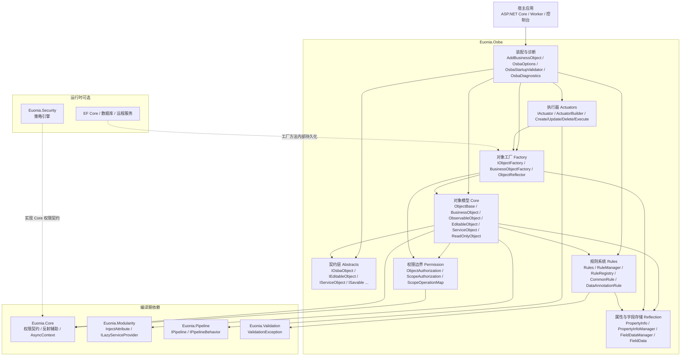

**依赖规则**：

1. 对象模型（`Core/`）只依赖 `Abstracts/`、`Reflection/`、`Rules/`、`Permission/` 的契约与少量实现，不依赖 `Factory/` / `Actuators/`。
2. 工厂（`Factory/`）依赖对象模型与权限边界，是「工厂边界」的强制点。
3. 执行器（`Actuators/`）依赖对象模型、工厂与 `Euonia.Pipeline`，只负责编排，不直接做持久化。
4. 权限边界（`Permission/`）只依赖 `Euonia.Core` 里的权限契约；**不引用** `Euonia.Security`。
5. 规则系统（`Rules/`）只做数据校验，不参与授权；权限边界只做授权，不写规则。

### 3.2 对象模型

#### 3.2.1 类继承

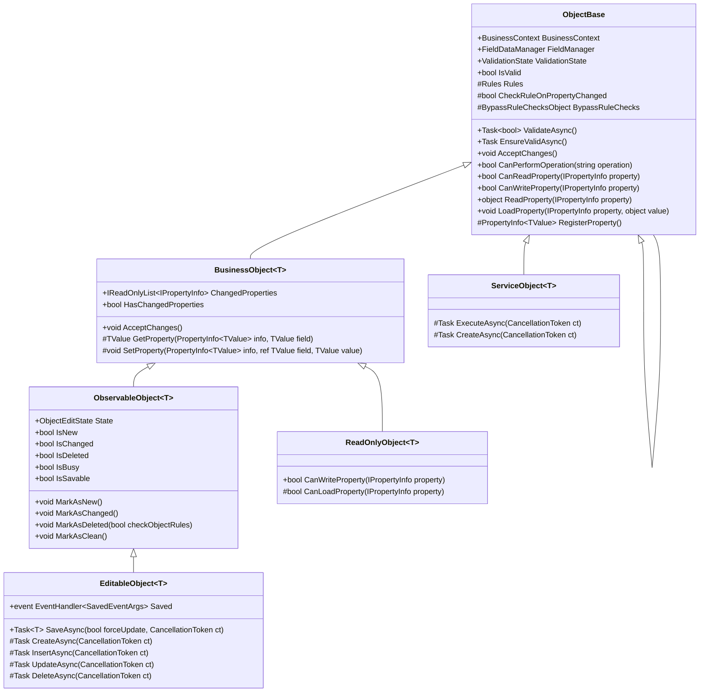

#### 3.2.2 契约关系

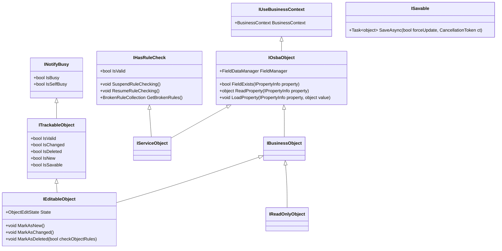

> `IServiceObject` 只组合 `IOsbaObject`（属性 + 上下文）与 `IHasRuleCheck`，**不继承 `IBusinessObject`**。因此服务对象不承诺 `INotifyPropertyChanged/Changing`，也没有变更追踪。

#### 3.2.3 各类型职责

| 类型 | 职责 | 关键点 |
|---|---|---|
| `ObjectBase` | 公共根：属性存储、规则、上下文、权限钩子、生命周期回调、装载作用域、父子图、`Dispose` | 不提供变更追踪；`Rules` 是 `protected` |
| `IObjectLifecycle` | 保存 / 执行生命周期回调契约 | 由 `ObjectBase` 实现，派生类覆写 `OnSaving/OnSaved/OnExecuting/OnExecuted` |
| `ObjectBase<T>` | 泛型属性注册入口 | `RegisterProperty` 的多种重载 |
| `BusinessObject<T>` | 变更追踪 + 泛型 `Get/SetProperty` + 原始值 / 回滚 | `ChangedProperties`、`GetOriginalValue`、`RejectChanges`；字段模式与字典模式共用存储 |
| `ObservableObject<T>` | 编辑状态机 + 繁忙状态 + `IsSavable` | `MarkAsNew/Changed/Deleted` 可重写（`TransitionTo`）；`CanTransitionTo` / `StateChanged` 可控制迁移 |
| `EditableObject<T>` | 保存流程 + `Saved` 事件 + 工厂方法空实现 | `SaveAsync` 先校验、再走 `IObjectFactory`；删除成功后复位为 `None` |
| `ReadOnlyObject<T>` | 只读对象 | `CanWriteProperty => false`；`LoadProperty` 只在装载作用域或显式绕过时允许 |
| `ServiceObject<T>` | 一次独立业务操作 | 只保留属性 + 规则；`ExecuteAsync` 是执行体 |

### 3.3 生命周期与状态机

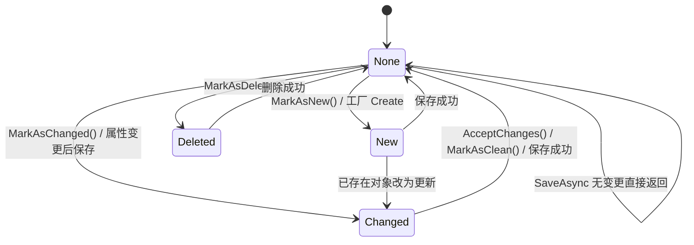

状态到操作的唯一映射在 `ScopeOperationMap`：

| 对象状态 | 业务操作 | 工厂方法 | 说明 |
|---|---|---|---|
| `New` | `create` | `[FactoryInsert]` | 新建后保存 |
| `Changed` | `update` | `[FactoryUpdate]` | 更新 |
| `Deleted` | `delete` | `[FactoryDelete]` | 删除 |
| `None` + `forceUpdate` 或 `HasChangedProperties` | `update` | `[FactoryUpdate]` | `SaveAsync` 内部先 `MarkAsChanged()` |
| `None` + 无变更 | — | — | 直接返回 `this`，不跑规则、不落库 |
| `IServiceObject` | `execute` | `[FactoryExecute]` | 命令执行 |

> `ObjectEditState` 由调用方通过公开的 `MarkAsNew/Changed/Deleted` 设置。它改变的是**实际执行的操作**，每个操作各自应用自己的策略，不构成「把同一变更路由到更宽松的键」的越权通道。
>
> `MarkAsNew/Changed/Deleted` 是 `virtual`，统一经过 `TransitionTo`：派生类可重写 `CanTransitionTo` 表达领域状态机（例如禁止 `Deleted` 回到 `New`），并通过 `StateChanged` 观察迁移。`AcceptChanges` 是提交/复位，不经过 `CanTransitionTo`，但会触发 `StateChanged`。

### 3.4 属性存储与变更追踪

#### 3.4.1 元数据与实例数据分离

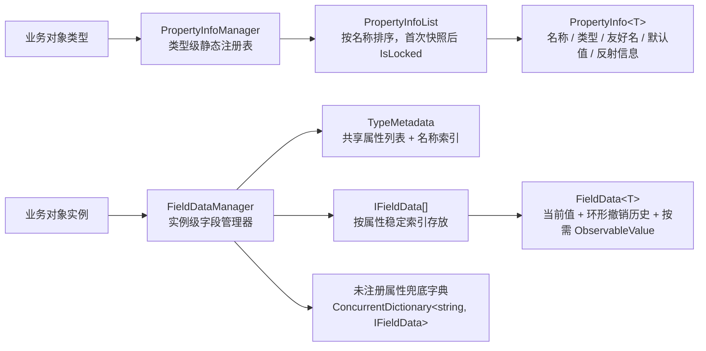

- **类型级**：`PropertyInfoManager` 用 `ConcurrentDictionary<Type, PropertyInfoList>` 缓存属性列表；首次取快照时把列表置为 `IsLocked`，之后禁止再注册。`FieldDataManager.ForceStaticFieldInit` 触发类型的静态初始化，确保 `static readonly PropertyInfo<T>` 字段先注册。
- **实例级**：`FieldDataManager` 只持有 `IFieldData[]`（首次访问才分配）和类型元数据引用；属性值按稳定索引存放，不再为每个对象分配一个字典。
- **兜底**：未在元数据中注册的自定义 `IPropertyInfo` 走按名称的 `ConcurrentDictionary`，保持兼容。

#### 3.4.2 两种写入模式

| 模式 | 写法 | 值存放 | 规则读取 | 适用 |
|---|---|---|---|---|
| 字典模式 | `SetProperty(PropertyInfo<T> info, T value)` | `FieldDataManager` | `ReadProperty` 直接读字典 | 最常见；无需声明 CLR 字段 |
| 字段模式 | `SetProperty(PropertyInfo<T> info, ref T field, T value)` | 调用方字段 + 同步一份到 `FieldDataManager` | `ReadProperty` 读同步后的字典 | 性能更好、EF 友好 |

> 字段模式会把值同步写入 `FieldDataManager`，因此 `DataAnnotationRule`、`CommonRule.*`、Lambda 规则通过 `ReadProperty` 读到的是**真实值**，不会读到默认值。

#### 3.4.3 `LoadProperty` vs `SetProperty`

| 入口 | 是否标脏 | 是否触发规则 | 是否发变更通知 | 用途 |
|---|:---:|:---:|:---:|---|
| `LoadProperty` | ❌ | ❌ | ❌ | 工厂方法装载数据、EF 物化 |
| `SetProperty` | ✅（值不同时） | ✅（属性级规则） | ✅ | 用户修改 |
| 同值 `SetProperty` | ❌ | ❌ | ❌ | 直接返回 |

- `LoadProperty` 会检查 `CanLoadProperty`：只读对象只在**装载作用域**（工厂方法执行期间）或显式 `BypassRuleChecks` 时允许写入。
- `SetProperty` 对 `string` 的 `null` 归一为 `string.Empty`；对 `IOsbaObject` 类型的属性按引用比较，其余按值比较。
- `AcceptChanges()` 清除 `ChangedProperties`、把字段历史基线重置为当前值；`ObservableObject.AcceptChanges()` 还会把 `State` 复位为 `None`。

#### 3.4.4 父子对象图

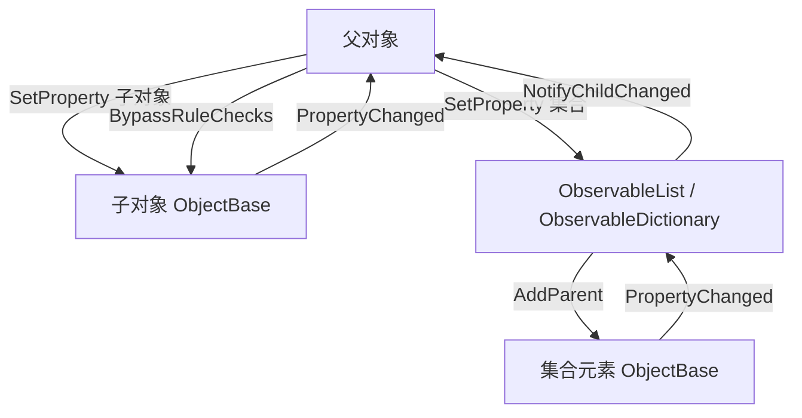

- 父对象设置子对象时，`AttachChild` 会解除旧子对象的父链接、建立新子对象的父链接。
- 子对象属性变化时，父对象上**持有该子对象的属性**会被标脏并发出 `PropertyChanged`。
- `ObservableList<T>` / `ObservableDictionary<TKey,TValue>` 会把父链接传给元素，并在集合增删、元素变化时通知父对象。
- 规则绕过沿父链**向下穿透**；子对象自身的绕过不会反向影响父对象。遍历深度上限 32，防止异常对象图形成环。

### 3.5 工厂与反射分派

#### 3.5.1 保存时序

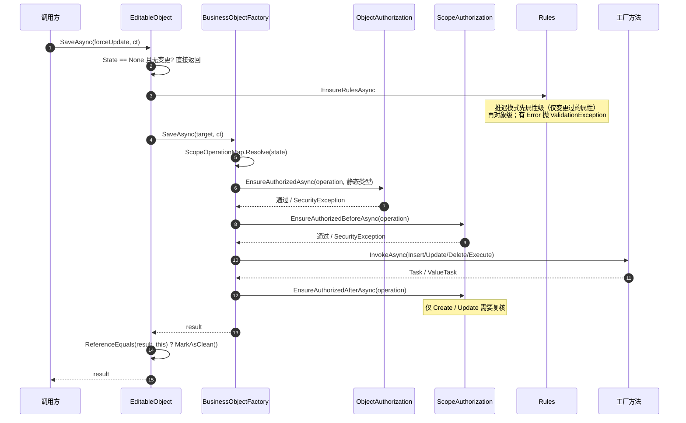

#### 3.5.2 方法查找

`ObjectReflector` 负责「工厂方法」与「`[Inject]` 属性」的反射：

- **候选方法**：先看当前类型（`BindingFlags.DeclaredOnly`），当前层没有任何候选才上溯基类。
- **匹配口径**：特性命中，或方法名落在该特性推导出的约定名里。约定名由 `OperationConventions.Names(attributeType, "Factory")` 统一生成，**工厂查找与权限扫描共用同一份**。
- **参数匹配**：目标方法参数数量可以多于传入条件，但多出的参数必须有默认值；精确长度匹配优先；支持 `params` 数组；参数匹配有打分，最高分唯一才返回，否则抛 `AmbiguousMatchException`。
- **缓存**：无参方法按 `(目标类型, 特性类型)` 缓存；单参方法按 `(目标类型, 特性类型, 实参运行时类型, 是否 null)` 缓存；多参方法按拼接的字符串键缓存。

#### 3.5.3 实例创建与注入

`BusinessObjectFactory.GetObjectInstance<TTarget>()`：

1. `ActivatorUtilities.GetServiceOrCreateInstance<TTarget>(_provider)`：优先从容器解析，否则用构造函数注入创建。
2. 若实现 `IHasLazyServiceProvider`，注入 `ILazyServiceProvider`。
3. 若实现 `IUseBusinessContext`，注入 `BusinessContext`（触发规则初始化）。
4. 扫描 `[Inject]` 属性：支持单个服务、`IEnumerable<T>` / `IList<T>` / `ICollection<T>` / 数组、键控服务；未注册的单值服务赋 `null` 并写诊断日志。

`BusinessObjectFactory` 的公开操作方法（`Create` / `Fetch` / `SaveAsync` / `ExecuteAsync` 等）以及 `GetObjectInstance` / `WithActivator` / `WithActivatorAsync` 都是 `virtual`，宿主可派生工厂接管实例创建、注入或整个操作流程。

#### 3.5.4 严格工厂方法与异步返回值

- `OsbaOptions.StrictFactoryMethods` 默认 `true`。解析到的工厂方法如果声明类型是 `EditableObject<>` / `ServiceObject<>` 的基类空实现，抛 `NotSupportedException`，避免「保存成功但什么也没做」。
- 工厂方法返回值统一经 `AwaitResultAsync` 处理：`Task`、`Task<T>`、`ValueTask`、`ValueTask<T>` 都会被等待；`TargetInvocationException` 会解包，业务异常不被包一层。
- 同步入口 `Create` / `Fetch` 在没有同步上下文时直接 `GetAwaiter().GetResult()`；有同步上下文（UI）时走 `AsyncContext.Run`，避免死锁。服务端应优先使用 `*Async`。

#### 3.5.5 criteria 入口的边界

`IObjectFactory.InsertAsync/UpdateAsync/DeleteAsync/ExecuteAsync(criteria)` 是**低层入口**：

- 目标对象由工厂方法内部创建并填充，调用前没有可判定的行，行级权限只能在**写入后**复核；
- `InsertAsync` / `ExecuteAsync(criteria)` 已标记 `[Obsolete]`；
- 受数据权限约束的类型应使用 `Fetch → IScopeGuard.AllowsObject → Save`，或在工厂方法内部先判定；
- 框架会在 `ScopeAuthorization.WarnIfWriteBeforeCheck` 写诊断日志，但不会改变行为。

### 3.6 规则系统

#### 3.6.1 规则分类

| 维度 | 类型级 | 实例级 | 操作级 |
|---|---|---|---|
| 注册方式 | `Rules.AddRule(...)` / `AddRules()` | `Rules.AddInstanceRule(...)` | 执行器 `WithRule(...)` |
| 存储位置 | `RuleManager`（容器级 / 进程级兜底） | `Rules._instanceRules` | `RuleScope`（挂在 `Rules` 上） |
| 生命周期 | 类型 + 容器 | 对象实例 | 一次操作 |
| 并发可见性 | 同容器内共享 | 仅本对象 | 仅本次操作 |
| 典型用途 | 数据注解、领域校验 | 单对象特殊校验 | 按用例追加规则 |

按**绑定属性**再分：

| 类别 | `Property` | 何时执行 | 说明 |
|---|---|---|---|
| 属性级 | 非 `null` | 默认在属性变更时（`SetProperty`）；推迟模式在保存时补跑 | 未修改的属性不校验；违规按属性归因 |
| 对象级 | `null` | 保存 / 命令执行时 | 整体一致性、跨字段校验 |

> 实例级 / 操作级规则不按 `Property` 过滤，全部纳入**对象级**检查；`Property` 只用于结果归因与变更通知。
>
> 属性级规则在 setter 上**同步执行**；包含 I/O 的校验应写成对象级规则，或覆写 `CheckRuleOnPropertyChanged => false` 推迟到保存时的异步路径。
>
> 如果类型覆写 `CheckRuleOnPropertyChanged => false`，属性级规则**推迟到保存时**补跑：先属性级（只跑 `ChangedProperties`），再对象级。顺序不能颠倒，否则对象级先抛异常会让字段级错误整批丢失。

#### 3.6.2 执行流程

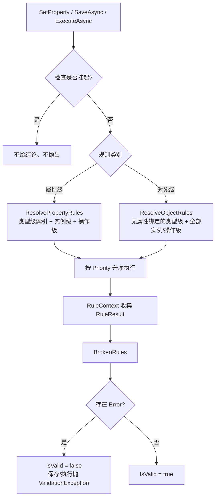

#### 3.6.3 规则的共享边界

- `AddBusinessObject` 注册 `IRuleRegistry`（Singleton），每个容器一个 `RuleRegistry`；规则默认按**容器**隔离，测试宿主、租户、插件互不可见。
- 没有 `BusinessContext` 的对象（手工 `new`、静态初始化期）回退到 `RuleManager` 的**进程级**默认注册表。
- `AddRules()` 对每个类型在每个规则管理器中只执行一次（`Initialized` 守卫）；`AddDataAnnotations()` 在 `AddRules()` 之前执行。
- 类型级规则实例是**共享**的，规则字段里绝不能存请求态；一切从 `context.Target` 取。
- 宿主/插件可以在 `AddRules()` 之外通过 `IRuleRegistry.GetRules(type).AddRule(rule)` 注册类型级规则；线程安全，已创建对象在下一次检查时生效。
- 需要按请求解析服务时用 `context.GetService<T>()` 或 `context.ServiceProvider`；不要依赖规则构造函数注入的 Scoped 服务。

#### 3.6.4 严重级别与绕过

| 机制 | 作用 | 是否解除权限 |
|---|---|:---:|
| `RuleSeverity.Error` | 让 `IsValid = false`，保存/执行抛 `ValidationException` | — |
| `Warning` / `Information` / `Success` | 记录结果，不阻断 | — |
| `SuspendRuleChecking()` | 挂起本对象的规则检查，不给结论 | ❌ |
| `BypassRuleChecks` | 当前异步流内绕过规则检查（可向下穿透子对象） | ❌ |
| `Actuator.BypassRule<T>()` | 本次操作按**精确类型**排除一条规则 | ❌ |
| `Actuator.BypassRule(name)` | 本次操作按规则名排除（忽略大小写） | ❌ |
| `Actuator.BypassRuleChecks()` | 本次操作跳过规则检查 | ❌ |
| `Actuator.WithRuleChecksOnDelete()` | 让删除也执行对象级规则（默认不执行） | ❌ |

> **规则是验证线，不是安全线**。`BypassRuleChecks()`、`SuspendRuleChecking()` 只跳过校验，越权仍由工厂边界抛 `SecurityException`。

### 3.7 执行器与管道

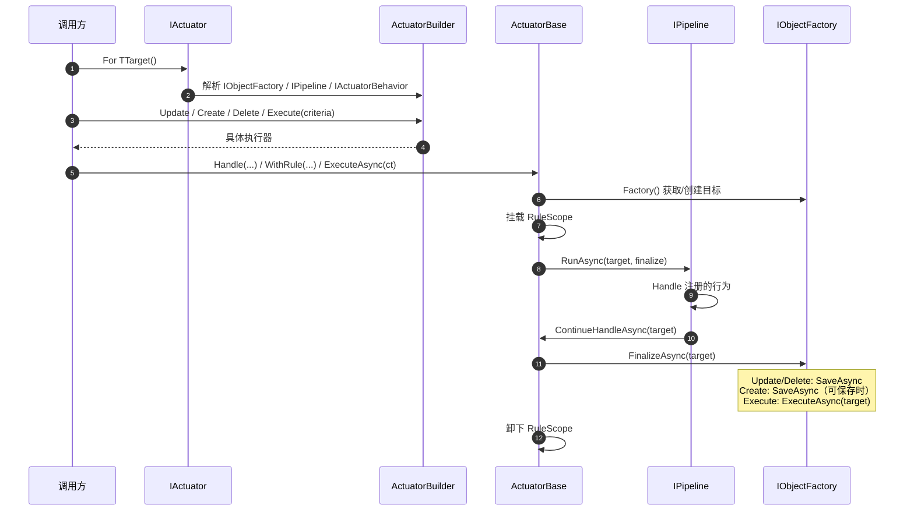

| 执行器 | 获取目标 | `ContinueHandleAsync` | 终结 |
|---|---|---|---|
| `FetchActuator<T>` | `FetchAsync(criteria)` | 无 | 原样返回目标（不保存） |
| `CreateActuator<T>` | `CreateAsync(criteria)` | 标记 `New` | 可保存对象 `SaveAsync(IsChanged)`；其余原样返回 |
| `UpdateActuator<T>` | `FetchAsync(criteria)` | 有变更且状态 `None` 时标记 `Changed` | `SaveAsync(IsChanged)` |
| `DeleteActuator<T>` | `FetchAsync(criteria)` | 标记 `Deleted`（可带规则检查开关） | `SaveAsync(IsChanged)` |
| `ExecuteActuator<T>` | `CreateAsync(criteria)` | 无 | `IObjectFactory.ExecuteAsync(target)` |

要点：

- 读取用 `Fetch`；它只调用工厂读取方法，不触发保存。
- `.Execute(ct)` 的参数进 `criteria`（用于定位工厂方法），`.ExecuteAsync(ct)` 的才是取消令牌。
- `Handle` 注册的处理逻辑在**终结之前**执行，因此规则看到的是处理后的对象。
- `WithRule` 附加的规则挂在目标对象上，不写入类型级共享集合；操作结束即卸下。
- 没有 `Handle` / `Behavior` / `IActuatorBehavior` 时走空管道快路径：直接执行「后续处理 → 终结」，语义与管道一致，但少一次组件快照与委托组合。
- `IActuatorBehavior<TTarget>` 注册到容器后会被自动追加到管道。

### 3.8 权限体系

Osba 的权限设计遵循「契约在 Core，实现各一半」：

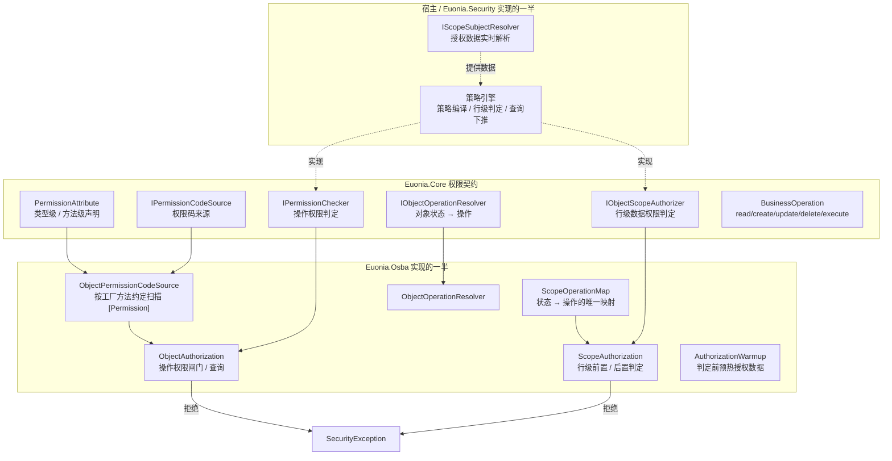

#### 3.8.1 两条线

| | 操作权限 | 数据权限（行级） |
|---|---|---|
| 回答 | 当前用户能否执行某项操作 | 当前用户能看到/操作哪些行 |
| 声明 | 类型级 / 工厂方法级 `[Permission]` | `ScopeModel<T>` + `ScopePolicy` |
| 判定 | `IPermissionChecker` | `IObjectScopeAuthorizer` |
| 强制点 | `BusinessObjectFactory` 调用边界 | 查询下推 + 工厂保存边界 |
| 失败形态 | `SecurityException` | 查询排除该行 / 保存抛 `SecurityException` |
| 与规则的关系 | 完全独立，不受规则绕过影响 | 完全独立，不受规则绕过影响 |

#### 3.8.2 操作权限

- `ObjectAuthorization` 是操作权限的**唯一**实现：收集要求 → 调用 `IPermissionChecker` → 拒绝抛 `SecurityException`。
- 要求来自宿主注册的 `IPermissionCodeSource`；未注册时回落到 `ObjectPermissionCodeSource.Instance`（按工厂方法约定扫描）。
- 类型级要求适用于该类型支持的全部操作；方法级要求只在该方法被执行时生效；两者取并集。
- **查询 vs 闸门**：
  - `ObjectBase.CanPerformOperation(operation)` 是查询语义：不抛异常，无从判定时返回 `true`；供业务方法内部做条件分支。
  - `ObjectAuthorization.EnsureAuthorized(...)` 是闸门：拒绝抛 `SecurityException`，判定不了抛 `InvalidOperationException`；由工厂边界调用。
- **fail-closed**：目标声明了权限要求，却没有 `BusinessContext` 或没有注册 `IPermissionChecker` → `InvalidOperationException`，不会静默放行。

#### 3.8.3 行级数据权限

- `ScopeAuthorization` 是行级数据权限在工厂边界的强制点。
- **前置判定**：目标由调用方提供且已填充（`SaveAsync(target)`、`ExecuteAsync(target)`）→ 调用业务方法前判定，失败无副作用。
- **后置判定**：目标由工厂方法内部填充（`Fetch`、`*Async(criteria)`）→ 业务方法返回后判定。
- `SaveAsync` 对 `Create` / `Update` 做前置 + 后置；`Delete` / `Execute` 只做前置。
- **已知边界**：criteria 写入口的写入发生在判定之前；框架写诊断日志，但无法在写入前拦截。受约束类型请走 `Fetch → 判定 → Save`。

#### 3.8.4 接线

```csharp
services.AddBusinessObject(typeof(Repo).Assembly);

services.AddPermission(options =>
{
    options.Scan(typeof(Repo).Assembly);
    options.Source(ObjectPermissionCodeSource.Instance);
});
```

`AddPermission`、`IScopeGuard`、`IScopeSubjectResolver`、`ScopeModel<T>` 等由 `Euonia.Security` 提供；Osba 只提供 `ObjectPermissionCodeSource` 与 `ScopeOperationMap` 这两块「对象模型自己的知识」。

### 3.9 业务上下文与作用域

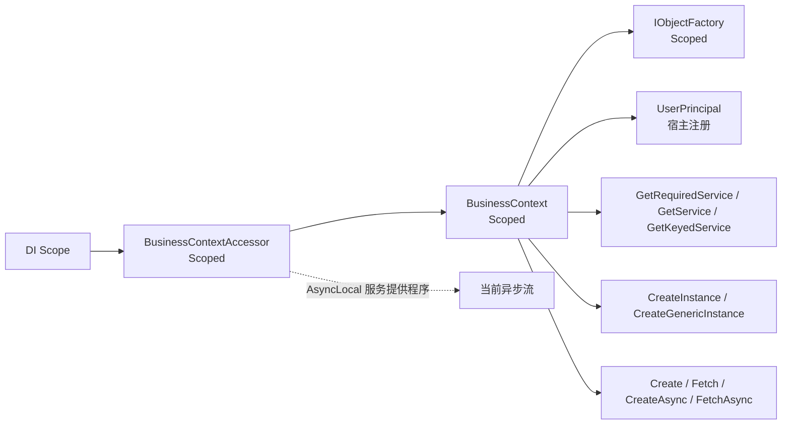

- `BusinessContext` 包装 `BusinessContextAccessor`、当前 `UserPrincipal`、服务解析、实例创建与工厂转发。
- `BusinessContextAccessor` 用 `AsyncLocal<IServiceProvider>` 传播；**构造函数不写静态环境上下文**，避免解析 Scoped 服务产生跨请求副作用。
- 手动作用域：先 `SetCurrent(scope.ServiceProvider)`，再解析 `BusinessContext` / `IObjectFactory`；用完 `Clear()`。
- ASP.NET Core 宿主应在请求中间件里显式 `SetCurrent` / `Clear`（Osba 本身不提供中间件）；后台任务应使用 `IServiceScopeFactory` 新建作用域，不要依赖环境上下文。
- 工厂创建的对象会自动注入 `BusinessContext`；手工 `new` 的对象必须自己设置，否则 `AddRules()` 不执行、权限闸门会报配置错误。

### 3.10 可观测性与启动期校验

`OsbaDiagnostics` 是 `internal` 的，但对外暴露的名字是稳定的：

| 类型 | 名称 | 用途 |
|---|---|---|
| `ActivitySource` | `Euonia.Osba` | 保存活动 `osba.save`，标签 `osba.object.type` / `osba.operation` |
| `Meter` | `Euonia.Osba` | 指标仪表 |
| Histogram | `osba.save.duration` | 保存耗时（ms） |
| Counter | `osba.save.failures` | 保存失败次数 |
| Histogram | `osba.auth.duration` | 授权判定耗时（ms），标签 `osba.auth.kind`（object/scope） |
| Histogram | `osba.rule.duration` | 规则执行耗时（ms） |
| Counter | `osba.rule.failures` | 规则失败次数 |

日志优先使用宿主注册的 `ILoggerFactory`，未注册时回退到 `Trace`。`OsbaOptions.EnableDiagnostics` 控制指标/追踪；`DiagnosticLevel` 控制日志级别。

启动期校验（`OsbaOptions.ValidateOnStartup = true`）的诊断码：

| 码 | 级别 | 含义 |
|---|---|---|
| `OSBA-F001` | Error | 工厂方法是泛型方法定义 |
| `OSBA-F002` | Error | 工厂方法返回 `IAsyncEnumerable<>`（不支持） |
| `OSBA-F003` | Error | 工厂方法有 `ref` / `out` 参数 |
| `OSBA-F004` | Warning | 同一方法声明多个工厂特性，解析有歧义 |
| `OSBA-F005` | Warning | 工厂方法是抽象方法，无法调用 |
| `OSBA-I001` | Error | `[Inject]` 属性形态不可解析（例如属性类型不受支持） |
| `OSBA-P001` | Error | 属性元数据无法构建（静态注册不完整） |
| `OSBA-P002` | Warning | 可编辑对象没有实现 Insert/Update/Delete |

> 只有 `Error` 级诊断会阻止启动（`OsbaConfigurationException`）；`Warning` 仅报告。

### 3.11 关键设计取舍与边界

1. **定位是业务模型运行时，不是 DDD 专用框架**。DDD、MVVM、CQRS、CRUD 都是可选投影；持久化写在工厂方法里（Active Record 风格），事务边界由宿主 / UoW 负责；Osba 核心不提供仓储、UoW、领域事件，但保留生命周期与原始值等扩展点供上层适配。
2. **验证线与权限线分离**。规则可被绕过，不能承担不变量或安全边界；权限只由工厂边界裁决，失败一律 `SecurityException`。
3. **规则按容器隔离，无 DI 时回退进程级**。`AddBusinessObject` 注册的 `IRuleRegistry` 是容器级；手工 `new` 的对象回退到 `RuleManager` 的静态容器。
4. **业务对象默认不承诺线程安全**。`FieldData<T>` 的字段级读写有锁，但对象级状态、变更列表、规则集合不保证并发修改安全；一个对象实例应由一个逻辑流使用。
5. **`IsValid` 首次校验前恒为 `true`**。要结论请用 `ValidationState` / `ValidateAsync()`，不要拿 `IsSavable` 当「能保存」的判据。
6. **服务对象无变更追踪**。它的校验只能写成对象级规则；属性级规则依赖 setter 变更通知，对服务对象不适用。
7. **不提供 EF Core 集成**。物化时请用 `LoadProperty`，或在物化后调用 `AcceptChanges()`，避免把刚加载的对象当成「已修改」。
8. **criteria 写入口是兼容路径**。受数据权限约束的类型不要用 `UpdateAsync(criteria)` / `DeleteAsync(criteria)` 做写操作；走 `Fetch → 判定 → Save`。

### 3.12 失败形态

| 场景 | 异常 | 触发点 |
|---|---|---|
| 规则校验失败（Error 级） | `Nerosoft.Euonia.Validation.ValidationException` | 保存 / 命令执行 |
| 越权（操作权限或行级数据权限） | `System.Security.SecurityException` | 工厂边界 |
| 有权限要求但无法判定（缺上下文 / 缺判定实现） | `InvalidOperationException` | 工厂边界（fail-closed） |
| 缺少 Insert/Update/Delete/Execute 且 `StrictFactoryMethods = true` | `NotSupportedException` | `BusinessObjectFactory` |
| 找不到匹配的工厂方法 | `MissingMethodException` | `ObjectReflector` |
| 工厂方法有多个同分匹配 | `AmbiguousMatchException` | `ObjectReflector` |
| 启动期结构性问题 | `OsbaConfigurationException` | `OsbaStartupValidator` |
| 只读对象被写入 / 装载越界 | `SecurityException` | `ObjectBase.SetProperty` / `LoadProperty` |

### 3.13 生命周期回调

`ObjectBase` 实现 `IObjectLifecycle`，在固定边界提供四个可覆写回调：

| 回调 | 触发时机 | 典型用途 |
|---|---|---|
| `OnSavingAsync` | 规则校验通过后、工厂方法执行前 | 审计、补充不变量检查 |
| `OnSavedAsync` | 工厂方法成功、对象复位为干净状态后 | 缓存失效、收集待发布事件 |
| `OnExecutingAsync` | 授权与规则校验通过后、执行体执行前 | 命令审计、准备上下文 |
| `OnExecutedAsync` | 执行体成功返回后 | 结果审计、清理临时状态 |

```csharp
public sealed class Repo : EditableObject<Repo>
{
    protected override async Task OnSavingAsync(CancellationToken cancellationToken = default)
    {
        await AuditAsync("repo.saving", cancellationToken);
    }

    protected override Task OnSavedAsync(object result, CancellationToken cancellationToken = default)
    {
        Cache.Remove($"repo:{Id}");
        return Task.CompletedTask;
    }
}
```

回调默认全部为空，不改变规则与权限的裁决顺序；异常会原样向上抛出，由调用方决定回滚或重试。

### 3.14 性能设计

| 优化 | 说明 |
|---|---|
| 类型级元数据缓存 | `PropertyInfoManager` 按类型缓存属性列表；`FieldDataManager` 按类型缓存合并后的元数据与名称索引，实例只分配字段数组 |
| 实例字段数组 | 字段值按稳定索引存放在 `IFieldData[]`，不再为每个对象分配字典；未注册属性才走兜底字典 |
| 环形撤销历史 | `FieldData<T>` 使用环形缓冲区，入栈 / 裁剪 / 撤销 O(1)，历史长度有界 |
| 按需可观察值 | `ObservableValue` 只在有订阅者时创建，未订阅路径不分配 |
| 规则同步快路径 | 同步完成的规则不创建状态机、不进入 `Task.WhenAll`；规则解析走属性索引缓存 |
| 规则返回值 | 内部 `RunRules` 使用 `ValueTuple`，减少每次属性检查的元组分配 |
| 反射缓存 | 工厂方法、参数形态、`ValueTask<T>.AsTask`、`Inject` 属性均缓存；多参方法按类型组合缓存 |
| 异步不捕获上下文 | 库内异步路径统一 `ConfigureAwait(false)`，避免同步上下文捕获与线程跳转 |
| 零订阅优化 | `PropertyChanged` / `Saved` 无订阅者时不构造事件参数、不走弱事件管理器 |
| 空管道快路径 | 执行器没有 `Handle` / `Behavior` / `IActuatorBehavior` 时跳过管道组件快照与委托组合，直接执行后续处理与终结 |

参考值（Apple M4 Max / .NET 10.0.11 / BenchmarkDotNet ShortRun，仅用于量级判断，不是正式门禁）：

| 场景 | 耗时 | 分配 |
|---|---:|---:|
| 属性写 | 37 ns | 24 B |
| 带一条属性规则写 | 130 ns | 304 B |
| `ValidateAsync` | 48 ns | 232 B |
| `SaveAsync`（无持久化） | 323 ns | 936 B |
| `FetchFactory`（直接工厂读取） | 1.12 µs | 1.48 KB |
| `FetchActuator`（空管道快路径） | 1.24 µs | 1.94 KB |
| `GetOriginalValue` | 8 ns | 0 B |
| `RejectChanges` | 94 ns | 112 B |
| `MarkAsChanged` + `AcceptChanges` | 8.9 ns | 0 B |

性能基线可用基准项目验证：

```bash
dotnet run -c Release --project Benchmarks/Euonia.Osba.Benchmarks
```

### 3.15 派生类对领域对象的控制

`BusinessObject<T>` 及其派生类可以在不引入 Domain 层的前提下，控制领域对象的关键场景：

| 场景 | 扩展点 |
|---|---|
| 属性读写权限 | `CanReadProperty` / `CanWriteProperty`；`GetProperty(IPropertyInfo)` / `SetProperty(IPropertyInfo, object)` 均可重写 |
| 领域行为封装 | 属性 setter 可以是 `private` / `protected`，只暴露领域方法；领域方法内部调用 `SetProperty` |
| 原始值与回滚 | `GetOriginalValue` / `GetOriginalValues` / `GetChangedValues` / `RejectChanges` / `IsDirty` |
| 状态机 | `CanTransitionTo` / `TransitionTo` / `StateChanged`；`MarkAsNew/Changed/Deleted` 可重写 |
| 装载与物化 | `IsLoading`、`BeginLoad()`（`protected internal`）、`CanLoadProperty` |
| 保存 / 执行边界 | `OnSavingAsync` / `OnSavedAsync` / `OnExecutingAsync` / `OnExecutedAsync` |
| 校验 | `AddRules`、`ValidateAsync`、`EnsureValidAsync`、`CheckRuleOnPropertyChanged` |

```csharp
public sealed class Order : EditableObject<Order>
{
    public static readonly PropertyInfo<decimal> AmountProperty = RegisterProperty(p => p.Amount);

    public decimal Amount
    {
        get => GetProperty(AmountProperty);
        private set => SetProperty(AmountProperty, value);
    }

    public void ChangeAmount(decimal amount)
    {
        if (amount < 0)
        {
            throw new InvalidOperationException("金额不能为负。");
        }

        Amount = amount;
    }

    protected override bool CanTransitionTo(ObjectEditState target)
    {
        // 已删除的订单不允许回到新增/修改状态
        return State != ObjectEditState.Deleted || target == ObjectEditState.None;
    }

    protected override Task OnSavingAsync(CancellationToken cancellationToken = default)
    {
        // 保存前补充领域不变量
        return Task.CompletedTask;
    }
}
```

```csharp
var order = await factory.FetchAsync<Order>(id);
order.ChangeAmount(120m);

var original = order.GetOriginalValue(Order.AmountProperty);
var changed = order.GetChangedValues();

order.RejectChanges(); // 回到加载时的金额
```

### 3.16 公共 API 兼容性策略

Osba 在增强时遵循以下约束：

- **新增接口成员提供默认实现**：`IFieldData.OriginalValue`、`IRuleContext.ServiceProvider` / `GetService<T>()` 都有默认实现，旧的自定义实现无需修改即可编译。
- **保留旧重载与构造函数**：`RegisterProperty` 的 `Expression<Func<T, object>>` 重载、`BusinessObjectFactory(IServiceProvider, IObjectActivator)` 构造函数仍然可用。
- **不改变既有签名**：已有方法只做 `virtual` 化或内部实现优化，调用方代码无需调整。
- **自定义管道不被跳过**：执行器空管道快路径只作用于框架默认管道；宿主注册的 `IPipeline` 与 `IActuatorBehavior` 始终执行。
- **回归测试**：`PublicApiCompatibilityTests` 覆盖旧重载、默认接口成员、旧构造函数与自定义管道。

---

## 4. 使用方法

### 4.1 装配与配置

```csharp
services.AddBusinessObject(options =>
{
    options.ValidateOnStartup = true;      // 默认 false
    options.StrictFactoryMethods = true;   // 默认 true
    options.EnableDiagnostics = true;      // 默认 true
    options.DiagnosticLevel = OsbaDiagnosticLevel.Warning;
}, typeof(Repo).Assembly);
```

| 选项 | 默认值 | 说明 |
|---|---|---|
| `ValidateOnStartup` | `false` | 是否在 `AddBusinessObject` 时执行启动期校验；测试程序集常有半成品类型，默认关闭 |
| `StrictFactoryMethods` | `true` | 缺少 Insert/Update/Delete/Execute 时是否抛错 |
| `EnableDiagnostics` | `true` | 是否启用 `ActivitySource` / `Meter` |
| `DiagnosticLevel` | `Warning` | 诊断日志最低级别（`Trace` / `Debug` / `Information` / `Warning` / `Error` / `None`） |

`AddBusinessObject` 返回 `IServiceCollection`，可链式调用；内部全部使用 `TryAdd*`，已注册的服务不会被覆盖。

### 4.2 属性注册

```csharp
public sealed class Repo : EditableObject<Repo>
{
    public static readonly PropertyInfo<string> NameProperty =
        RegisterProperty(p => p.Name);

    public static readonly PropertyInfo<string> CodeProperty =
        RegisterProperty<string>("Code", "编码");

    public static readonly PropertyInfo<int> CountProperty =
        RegisterProperty(p => p.Count, "数量", 0);

    public static readonly PropertyInfo<List<string>> TagsProperty =
        RegisterProperty(p => p.Tags, "标签", () => []);

    public string Name
    {
        get => GetProperty(NameProperty);
        set => SetProperty(NameProperty, value);
    }
}
```

- 表达式重载：`RegisterProperty<TValue>(Expression<Func<T, TValue>> expression, ...)` 会从属性推断 `TValue`，无需显式泛型，也不会为值类型装箱；旧的 `Expression<Func<T, object>>` 重载仍保留。
- 名称重载：`RegisterProperty<TValue>(string propertyName, string friendlyName = null, TValue defaultValue = default)`。
- 默认值工厂：`RegisterProperty<TValue>(string propertyName, string friendlyName, Func<TValue> defaultValue)`；每次读取 `DefaultValue` 都生成新实例，避免可变默认值在对象之间共享。
- `PropertyInfo<T>.FriendlyName` 会优先读取 `[Display]` / `[DisplayName]`，否则回退到属性名。

### 4.3 工厂方法约定

```csharp
[FactoryCreate]
private Task CreateAsync(string name, CancellationToken ct = default) { ... }

[FactoryFetch]
private Task FetchAsync(string id, CancellationToken ct = default) { ... }

[FactoryInsert]
protected override Task InsertAsync(CancellationToken ct = default) { ... }

[FactoryUpdate]
protected override Task UpdateAsync(CancellationToken ct = default) { ... }

[FactoryDelete]
protected override Task DeleteAsync(CancellationToken ct = default) { ... }
```

- 跨程序集重写工厂方法用 `protected override`（不是 `protected internal override`）。
- 工厂方法可以返回 `Task` / `Task<T>` / `ValueTask` / `ValueTask<T>`。
- 参数可以多于 `criteria`，但多出的尾部参数必须有默认值。
- `[FactoryExecute]` 用于服务对象，通常与 `[FactoryCreate]` 配对（执行器先创建实例，再执行）。

### 4.4 保存与状态

```csharp
var repo = await factory.CreateAsync<Repo>("pay-web");
// CreateAsync 会自动 MarkAsNew()

repo.TeamId = "TeamA";                 // 属性变更 → ChangedProperties
await repo.SaveAsync();                // State=New → Insert

var loaded = await factory.FetchAsync<Repo>(repo.Id);
loaded.Name = "pay-web-2";
await loaded.SaveAsync();              // State=None 且有变更 → 内部 MarkAsChanged → Update

loaded.MarkAsDeleted();
await loaded.SaveAsync();              // Delete；成功后 State 复位为 None
await loaded.SaveAsync();              // 幂等 no-op（State=None 且无变更）

await repo.SaveAsync(forceUpdate: true); // 无变更也强制 Update
```

- 保存成功后，若工厂返回的是**同一个实例**，对象会 `MarkAsClean()`；若工厂返回不同实例，`this` 不会被复位，调用方应使用返回值。
- 删除成功后对象复位为 `None`，重复 `SaveAsync` 不会重复删除。
- `SaveAsync` 会先跑规则；`IsDeleted && !CheckObjectRulesOnDelete` 时跳过规则。

### 4.5 规则

```csharp
protected override void AddRules()
{
    // 属性级：绑定到已注册的 PropertyInfo
    Rules.AddRule(new CommonRule.Required(NameProperty, "仓库名不能为空。"));
    Rules.AddRule(new CommonRule.Regular(NameProperty, "^[a-z0-9-]+$", "仓库名只能包含小写字母、数字和连字符。"));

    // 属性级：Lambda（handler 收到业务对象本身）
    Rules.AddRule<Repo>(NameProperty, repo => repo.Name != "admin", "该名称被保留。");

    // 对象级：无参构造 ⇒ Property == null
    Rules.AddRule<RepoConsistencyRule>();

    // 需要按属性构造的规则直接 new
    Rules.AddRule(new RepoUniqueRule(NameProperty));
}
```

自定义规则：

```csharp
public sealed class RepoUniqueRule(IPropertyInfo property) : RuleBase(property)
{
    public override Task ExecuteAsync(IRuleContext context, CancellationToken cancellationToken = default)
    {
        if (context.Target is not IEditableObject target)
        {
            return Task.CompletedTask;
        }

        var store = context.GetService<RepoStore>();
        var name = target.ReadProperty(Property)?.ToString();

        if (store != null && store.Repos.Values.Any(r => r.Name == name))
        {
            context.AddErrorResult($"仓库名 '{name}' 已存在。");
        }

        return Task.CompletedTask;
    }
}
```

- 规则名称形如 `rule://命名空间.类型名/属性名`，由 `RuleBase` 生成。
- `Priority` 越小越先执行。
- `ExecuteOnStateAttribute` 标在规则类上，只对 `IEditableObject` 目标生效；不填状态视为不限制。
- `AddErrorResult(null)` / 空白描述会用占位消息补上，不会被静默当成通过。
- 只有 `Error` 让对象无效；`Warning` / `Information` 不阻断保存。
- 类型级规则实例是共享的，**不能存请求态**；需要按请求解析服务时用 `context.GetService<T>()`（或 `context.ServiceProvider`），不要依赖构造函数注入的 Scoped 服务。

### 4.6 执行器

```csharp
var actuator = scope.ServiceProvider.GetRequiredService<IActuator>();

// 读取 + 处理（不保存）
var loaded = await actuator.For<Repo>()
                           .Fetch("pay-web")
                           .Handle(r => r.TeamId = "TeamA")
                           .ExecuteAsync(cancellationToken);

// 创建 + 处理 + 保存
var repo = await actuator.For<Repo>()
                         .Create("pay-web")
                         .Handle(r =>
                         {
                             r.TeamId = "TeamA";
                             r.Name = "pay-web";
                         })
                         .ExecuteAsync(cancellationToken);

// 更新 + 按操作附加规则
await actuator.For<Repo>()
              .Update(repo.Id)
              .Handle(r => r.Name = "pay-web-2")
              .WithRule(new RepoUniqueRule(Repo.NameProperty))
              .WithRule<RepoAuditRule>(scope.ServiceProvider)
              .BypassRule<SlowRule>()
              .ExecuteAsync(cancellationToken);

// 删除（默认不跑对象级规则；需要时开启）
await actuator.For<Repo>()
              .Delete(repo.Id)
              .WithRuleChecksOnDelete()
              .ExecuteAsync(cancellationToken);
```

自定义管道行为：

```csharp
public sealed class AuditBehavior<TTarget> : IActuatorBehavior<TTarget>
    where TTarget : ObjectBase<TTarget>
{
    public async Task<TTarget> HandleAsync(TTarget target, PipelineDelegate<TTarget, TTarget> next)
    {
        // 前置
        var result = await next(target);
        // 后置
        return result;
    }
}

services.AddScoped<IActuatorBehavior<Repo>, AuditBehavior<Repo>>();
```

### 4.7 服务对象

```csharp
public sealed class PushService : ServiceObject<PushService>
{
    public string RepoId { get; set; }
    public string Note { get; set; }
    public bool Pushed { get; private set; }

    [FactoryCreate]
    private Task CreateAsync(string repoId, CancellationToken cancellationToken = default)
    {
        RepoId = repoId;
        return Task.CompletedTask;
    }

    [FactoryExecute]
    protected override Task ExecuteAsync(CancellationToken cancellationToken = default)
    {
        Pushed = true;
        return Task.CompletedTask;
    }

    protected override void AddRules()
    {
        // 服务对象只支持对象级规则（Property == null）
        Rules.AddRule<PushServiceRule>();
    }
}

await actuator.For<PushService>()
              .Execute(repoId, cancellationToken)   // criteria：定位 [FactoryCreate]
              .Handle(cmd => cmd.Note = "first")
              .ExecuteAsync(cancellationToken);     // 真正的取消令牌
```

> 服务对象走执行器时必须同时提供 `[FactoryCreate]` 与 `[FactoryExecute]`。`Execute(ct)` 的参数进 `criteria`，`ExecuteAsync(ct)` 的才是取消令牌。

### 4.8 只读对象

```csharp
public sealed class RepoView : ReadOnlyObject<RepoView>
{
    public static readonly PropertyInfo<string> NameProperty =
        RegisterProperty<string>(p => p.Name);

    public string Name
    {
        get => GetProperty(NameProperty);
        private set => SetProperty(NameProperty, value); // 外部写入会抛 SecurityException
    }

    [FactoryFetch]
    private Task FetchAsync(string id, CancellationToken cancellationToken = default)
    {
        // 工厂方法执行期间处于装载作用域，LoadProperty 允许写入
        LoadProperty(NameProperty, "pay-web");
        return Task.CompletedTask;
    }
}
```

- `ReadOnlyObject<T>.CanWriteProperty` 恒为 `false`；`SetProperty` 会抛 `SecurityException`。
- `LoadProperty` 只在 `IsLoading`（工厂方法执行期间）或 `IsBypassingRuleChecks` 时允许。
- 只读对象没有 `SaveAsync`。

### 4.9 父子对象与集合

```csharp
public sealed class Repo : EditableObject<Repo>
{
    public static readonly PropertyInfo<Owner> OwnerProperty =
        RegisterProperty<Owner>(p => p.Owner);

    public static readonly PropertyInfo<ObservableList<Tag>> TagsProperty =
        RegisterProperty<ObservableList<Tag>>("Tags", "标签", () => []);

    public Owner Owner
    {
        get => GetProperty(OwnerProperty);
        set => SetProperty(OwnerProperty, value);
    }

    public ObservableList<Tag> Tags
    {
        get => GetProperty(TagsProperty);
        set => SetProperty(TagsProperty, value);
    }
}
```

- 设置子对象时，父对象会建立父链接；子对象属性变化会通知父对象，父对象上持有该子对象的属性被标脏。
- `ObservableList<T>` / `ObservableDictionary<TKey,TValue>` 会把父链接传给元素；集合增删、元素变化都会通知父对象。
- `ObservableList<T>.SuppressListChangedEvents` / `ObservableDictionary<TKey,TValue>.SuppressItemChangedEvents` 可在批量操作期间抑制通知。
- `ObservableDictionary<TKey,TValue>` 继承 `Dictionary<TKey,TValue>` 并用 `new` 隐藏成员：只有通过 `ObservableDictionary` 引用修改才会触发通知；通过基类引用修改不会触发。

### 4.10 权限接线

```csharp
// 1) 声明
[FactoryUpdate]
[Permission("repo:push")]
protected override Task UpdateAsync(CancellationToken cancellationToken = default) { ... }

// 2) 注册 Osba
services.AddBusinessObject(typeof(Repo).Assembly);

// 3) 接引擎（可选）
services.AddPermission(options =>
{
    options.Scan(typeof(Repo).Assembly);
    options.Source(ObjectPermissionCodeSource.Instance);
});

// 4) 授权数据来源（应用实现）
public sealed class MySubjectResolver : IScopeSubjectResolver
{
    public async ValueTask<ScopeSubjectSet> ResolveAsync(ClaimsPrincipal user, CancellationToken ct = default)
        => ScopeSubjectSet.CreateBuilder()
                          .AddCodes(await GetPermissionCodesAsync(user, ct))
                          .AddSelf(userId)
                          .AddGrant("repo:delete", "repo", await GetDeletableReposAsync(user, ct))
                          .Build();
}

// 5) 判定
var guard = scope.ServiceProvider.GetRequiredService<IScopeGuard>();
await guard.EnsureResolvedAsync();             // 同步判定前预热（幂等）
var visible = guard.Apply(dbContext.Repos);    // 下推到数据库
guard.Allows(repo, BusinessOperation.Delete);  // 单行判定
guard.Explain(repo, BusinessOperation.Delete); // 审计
```

> 权限码来自授权数据，不固化在令牌里；`[Permission]` 只决定类型级闸门，行级策略按授权标识声明。详见 [`PERMISSION.md`](PERMISSION.md)。

### 4.11 诊断

```csharp
using System.Diagnostics;

var listener = new ActivityListener
{
    ShouldListenTo = source => source.Name == "Euonia.Osba",
    Sample = (ref ActivityCreationOptions<ActivityContext> _) => ActivitySamplingResult.AllDataAndRecorded,
    ActivityStopped = activity => Console.WriteLine($"{activity.OperationName} {activity.Duration}")
};
ActivitySource.AddActivityListener(listener);
```

- 指标名：`osba.save.duration`、`osba.save.failures`、`osba.auth.duration`、`osba.rule.duration`、`osba.rule.failures`。
- 日志：宿主注册 `ILoggerFactory` 时走 `ILogger`，否则走 `Trace`。

### 4.12 测试与基准

以下命令在仓库根目录 `euonia-net/` 执行：

```bash
# 单元测试
dotnet test Tests/Euonia.Osba.Tests

# 独立（不接引擎）的权限测试
dotnet test Tests/Euonia.Osba.Standalone.Tests

# 基准
dotnet run -c Release --project Benchmarks/Euonia.Osba.Benchmarks
dotnet run -c Release --project Benchmarks/Euonia.Osba.Benchmarks -- --filter '*ObjectLifecycle*'
```

基准项目关注 `WriteExisting`、`RuledObject.WriteWithPropertyRule`、`SavePlain` 三个门禁指标；预算与历史数据见 [`ARCHITECTURE-REVIEW.md`](ARCHITECTURE-REVIEW.md) §4.3。

---

## 5. 文件结构

> 以下只列源码树（不含 `bin/`、`obj/`、`.DS_Store` 等构建产物）。目录树用 Mermaid 表示，每个文件节点都标注了作用。

### 5.1 总览

> 为避免单张图过大，下面按目录拆成多棵子树；每棵子树都列出该目录下的全部文件及其作用。

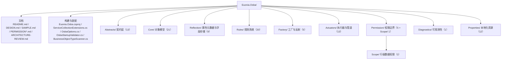

### 5.2 根目录

```mermaid
flowchart TB
    R["Euonia.Osba/"]

    R --> R1["Euonia.Osba.csproj<br/>项目文件：net9.0;net10.0，引用 Core / Modularity / Pipeline / Validation，配置 resx 生成"]
    R --> R2["ServiceCollectionExtensions.cs<br/>AddBusinessObject 装配入口：注册上下文、工厂、执行器、规则注册表与业务对象"]
    R --> R3["OsbaOptions.cs<br/>装配选项：ValidateOnStartup / StrictFactoryMethods / EnableDiagnostics / DiagnosticLevel"]
    R --> R4["OsbaStartupValidator.cs<br/>启动期反射校验：工厂签名、Inject、属性元数据、持久化方法；OsbaConfigurationException"]
    R --> R5["BusinessObjectTypeScanner.cs<br/>扫描程序集中可实例化的 IOsbaObject 类型，容错 ReflectionTypeLoadException"]
    R --> R6["README.md<br/>本文件：架构设计、使用方法、文件结构"]
    R --> R7["SAMPLE.md<br/>从零到运行的端到端全景示例"]
    R --> R8["PERMISSION.md<br/>权限体系完整使用说明"]
    R --> R9["PERMISSION-SAMPLE.md<br/>多业务场景权限示例"]
    R --> R10["PERMISSION-DESIGN.md<br/>权限接线设计决策"]
    R --> R11["ARCHITECTURE-REVIEW.md<br/>架构 / 性能 / 正确性评审报告（历史基线）"]
    R --> R12["DESIGN.md<br/>设计决策：定位、对象模型、规则、工厂、执行器、性能与兼容性"]
```

### 5.3 `Abstracts/` 契约层

```mermaid
flowchart TB
    A["Abstracts/"]

    A --> A1["IBusinessObject.cs<br/>属性存储 + INotifyPropertyChanged / INotifyPropertyChanging"]
    A --> A2["IChildGraphNode.cs<br/>可加入父子对象图的容器节点：AddParent / RemoveParent"]
    A --> A3["IEditableObject.cs<br/>可编辑对象：State、MarkAsNew / Changed / Deleted、删除时规则开关"]
    A --> A4["IHasRuleCheck.cs<br/>规则检查：IsValid、完成通知、挂起 / 恢复、GetBrokenRules"]
    A --> A13["IObjectLifecycle.cs<br/>保存 / 执行生命周期回调契约：OnSaving / OnSaved / OnExecuting / OnExecuted"]
    A --> A5["INotifyBusy.cs<br/>繁忙状态：BusyChanged、IsBusy、IsSelfBusy"]
    A --> A6["IOperableProperty.cs<br/>非泛型属性读写：GetProperty / SetProperty"]
    A --> A7["IOsbaObject.cs<br/>所有 Osba 对象的公共契约：FieldManager、ReadProperty、LoadProperty、BusinessContext"]
    A --> A8["IReadOnlyObject.cs<br/>只读对象标记契约"]
    A --> A9["ISavable.cs<br/>保存契约：Saved 事件、SaveComplete、SaveAsync；含泛型版本"]
    A --> A10["IServiceObject.cs<br/>服务对象契约：IOsbaObject + IHasRuleCheck，无变更追踪"]
    A --> A11["ITrackableObject.cs<br/>可跟踪状态：IsValid / IsChanged / IsDeleted / IsNew / IsSavable"]
    A --> A12["IUseBusinessContext.cs<br/>BusinessContext 属性契约"]
```

### 5.4 `Actuators/` 执行器与管道

```mermaid
flowchart TB
    A["Actuators/"]

    A --> A1["IActuator.cs<br/>执行器入口契约：For&lt;TTarget&gt;() 返回 ActuatorBuilder"]
    A --> A13["FetchActuator.cs<br/>读取执行器：调用工厂读取方法，不触发保存"]
    A --> A2["Actuator.cs<br/>IActuator 默认实现（internal）：解析 IObjectFactory、IPipeline、IActuatorBehavior"]
    A --> A3["ActuatorBuilder.cs<br/>持有 IObjectFactory + IPipeline，提供 Behavior 配置"]
    A --> A4["ActuatorBuilderExtensions.cs<br/>Fetch / Create / Update / Delete / Execute 扩展方法，按目标类型约束"]
    A --> A5["ActuatorBase.cs<br/>执行器模板：Handle、WithRule / BypassRule、ExecuteAsync 主流程"]
    A --> A6["EditableActuator.cs<br/>可编辑执行器基类：终结阶段调用 SaveAsync"]
    A --> A7["CreateActuator.cs<br/>创建流程：CreateAsync → Handle → 标记 New → SaveAsync（可保存时）"]
    A --> A8["UpdateActuator.cs<br/>更新流程：Fetch → Handle → 标记 Changed → SaveAsync"]
    A --> A9["DeleteActuator.cs<br/>删除流程：Fetch → 标记 Deleted → SaveAsync"]
    A --> A10["ExecuteActuator.cs<br/>服务对象流程：Create → Handle → IObjectFactory.ExecuteAsync"]
    A --> A11["IActuatorBehavior.cs<br/>管道行为契约，继承 IPipelineBehavior&lt;TTarget,TTarget&gt;"]
    A --> A12["ActuatorExtensions.cs<br/>Task&lt;TTarget&gt; 链式辅助：ReturnAsync / NextAsync"]
```

### 5.5 `Attributes/` 工厂与状态特性

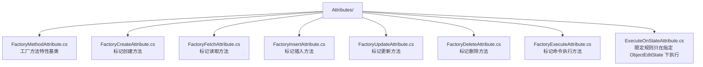

### 5.6 `Core/` 对象模型

```mermaid
flowchart TB
    C["Core/"]

    C --> C1["ObjectBase.cs<br/>公共根：属性存储、规则、上下文、权限钩子、装载作用域、父子图、Dispose"]
    C --> C2["ObjectBase`1.cs<br/>泛型属性注册：RegisterProperty 的表达式 / 名称 / 默认值重载"]
    C --> C3["BusinessObject.Generic.cs<br/>变更追踪：ChangedProperties、HasChangedProperties、AcceptChanges、泛型 Get/SetProperty"]
    C --> C4["ObservableObject.cs<br/>编辑状态机 + 繁忙状态 + IsSavable + BusyChanged"]
    C --> C5["EditableObject.cs<br/>保存流程：规则校验 → IObjectFactory.SaveAsync → MarkAsClean → Saved 事件"]
    C --> C6["ReadOnlyObject.cs<br/>只读对象：CanWriteProperty=false；LoadProperty 仅装载作用域 / 绕过时允许"]
    C --> C7["ServiceObject.cs<br/>服务对象：ExecuteAsync / CreateAsync，无变更追踪、无 SaveAsync"]
    C --> C8["BusinessContext.cs<br/>业务上下文：服务解析、UserPrincipal、实例创建、工厂转发"]
    C --> C9["BusinessContextAccessor.cs<br/>AsyncLocal 服务提供程序访问器：Current / SetCurrent / Clear"]
    C --> C10["ObjectEditState.cs<br/>编辑状态枚举：None / New / Changed / Deleted"]
    C --> C11["ValidationState.cs<br/>校验三态：NotValidated / Valid / Invalid"]
    C --> C12["ObservableList.cs<br/>可观察列表：集合 / 元素变更、繁忙通知、父图链接、批量抑制"]
    C --> C13["ObservableDictionary.cs<br/>可观察字典：项变更、繁忙通知、父图链接、批量抑制"]
    C --> C14["ObjectChangedEventArgs.cs<br/>子对象 / 集合变更事件参数（ObservableList.ChildChanged 使用）"]
    C --> C15["SavedEventArgs.cs<br/>保存事件参数：NewObject / Error / UserState"]
    C --> C16["BusyChangedEventArgs.cs<br/>繁忙状态事件参数"]
    C --> C17["BusyChangedEventHandler.cs<br/>繁忙状态事件委托"]
    C --> C18["DictionaryChangedAction.cs<br/>字典变更类型：Add / Remove / Update / Clear"]
    C --> C19["DictionaryChangedEventArgs.cs<br/>字典变更事件参数：Key / Action / OldValue / NewValue"]
    C --> C20["DictionaryChangedEventHandler.cs<br/>字典变更事件委托"]
    C --> C21["ObjectStateChangedEventArgs.cs<br/>编辑状态变化事件参数：OldState / NewState"]
```

### 5.7 `Diagnostics/` 可观测性

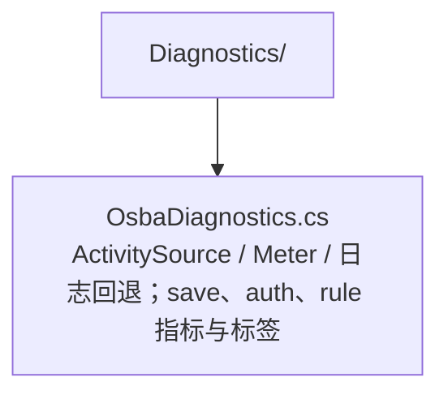

### 5.8 `Factory/` 工厂与反射

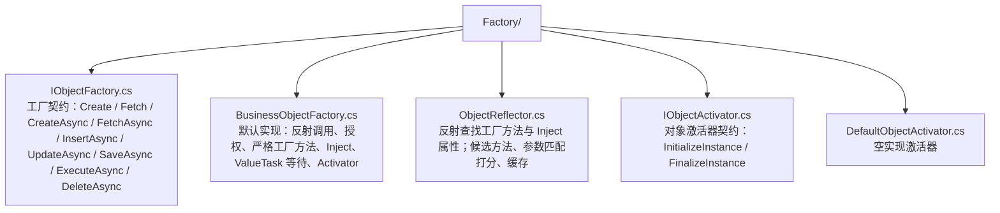

### 5.9 `Permission/` 权限边界

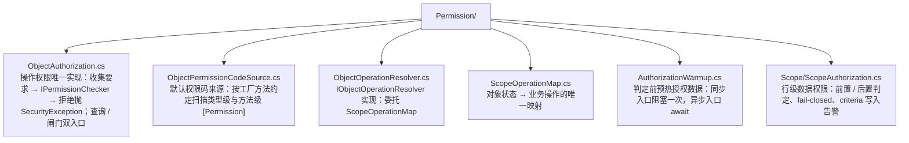

### 5.10 `Properties/` 本地化资源

```mermaid
flowchart TB
    R["Properties/"]

    R --> R1["AssemblyInfo.cs<br/>InternalsVisibleTo：向 Euonia.Osba.Tests 开放 internal"]
    R --> R2["Resources.Designer.cs<br/>生成的强类型资源访问器（不要手改）"]
    R --> R3["Resources.resx<br/>默认资源：异常消息、诊断消息等（31 个键）"]
    R --> R4["Resources.resources<br/>预生成的二进制资源（构建产物 / 历史文件）"]
    R --> R5["Resources.de.resx<br/>德语资源"]
    R --> R6["Resources.es.resx<br/>西班牙语资源"]
    R --> R7["Resources.fr.resx<br/>法语资源"]
    R --> R8["Resources.ja.resx<br/>日语资源"]
    R --> R9["Resources.ko.resx<br/>韩语资源"]
    R --> R10["Resources.zh-CN.resx<br/>简体中文资源"]
    R --> R11["Resources.zh-HK.resx<br/>繁体中文（香港）资源"]
    R --> R12["Resources.zh-TW.resx<br/>繁体中文（台湾）资源"]
```

### 5.11 `Reflection/` 属性元数据与字段存储

```mermaid
flowchart TB
    R["Reflection/"]

    R --> R1["IPropertyInfo.cs<br/>属性元数据契约：Name、Type、FriendlyName、DefaultValue、NewFieldData、IsChild"]
    R --> R2["PropertyInfo.cs<br/>PropertyInfo&lt;T&gt; 强类型实现：反射信息、默认值克隆、友好名解析"]
    R --> R3["PropertyInfoManager.cs<br/>类型级静态注册表：属性列表缓存、静态初始化、快照锁定"]
    R --> R4["PropertyInfoList.cs<br/>属性列表 + IsLocked"]
    R --> R5["PropertyComparer.cs<br/>按属性名排序的比较器"]
    R --> R6["IMemberInfo.cs<br/>成员名称契约"]
    R --> R7["IFieldData.cs<br/>字段数据契约：Value、Undo、MarkAsUnchanged；含泛型版本"]
    R --> R8["FieldData.cs<br/>FieldData&lt;T&gt;：当前值 + 环形撤销历史 + 按需 ObservableValue"]
    R --> R9["FieldDataManager.cs<br/>类型元数据缓存 + 实例字段数组 / 兜底字典 + 脏标记 / 忙碌判断"]
```

### 5.12 `Rules/` 规则系统

```mermaid
flowchart TB
    R["Rules/"]

    R --> R1["IRuleBase.cs<br/>规则契约：Name、Property、RelatedProperties、Priority、ExecuteAsync"]
    R --> R2["RuleBase.cs<br/>规则基类：URI 风格名称、优先级、相关属性"]
    R --> R3["IRuleContext.cs<br/>规则上下文契约：Target、Results、AddError / Warning / Information / Success、Complete"]
    R --> R4["RuleContext.cs<br/>规则上下文默认实现：结果收集、去重完成、空白消息兜底"]
    R --> R5["RuleResult.cs<br/>单条规则结果：Success、Description、Severity、RuleName、Properties"]
    R --> R6["RuleSeverity.cs<br/>严重级别：Error / Warning / Information / Success"]
    R --> R7["BrokenRule.cs<br/>单条违规：Property / Description / Severity"]
    R --> R8["BrokenRuleCollection.cs<br/>违规集合：按属性清理、维护 Error / Warning / Information 计数"]
    R --> R9["IRules.cs<br/>规则集合公共契约：Target"]
    R --> R10["Rules.cs<br/>规则执行核心：解析、运行、违规集合、挂起、DataAnnotations、实例 / 操作规则"]
    R --> R11["RuleManager.cs<br/>类型级规则管理器：规则列表、属性索引、对象级缓存、进程级静态兜底"]
    R --> R12["IRuleRegistry.cs<br/>容器级规则注册表契约 + RuleRegistry 默认实现"]
    R --> R13["RuleScope.cs<br/>一次操作的规则范围：附加规则、排除类型 / 名称、跳过检查"]
    R --> R14["ObjectRuleGuard.cs<br/>保存 / 执行路径的统一规则强制点，失败抛 ValidationException"]
    R --> R15["CommonRule.cs<br/>通用规则基类：消息工厂"]
    R --> R16["CommonRule.Required.cs<br/>必填规则"]
    R --> R17["CommonRule.Regular.cs<br/>正则规则（仅 string，构造期校验）"]
    R --> R18["CommonRule.Lambda.cs<br/>Lambda / Lambda&lt;T&gt; 规则"]
    R --> R19["DataAnnotationRule.cs<br/>包装 System.ComponentModel.DataAnnotations.ValidationAttribute"]
    R --> R20["RulesExtensions.cs<br/>Rules 的 Lambda 便捷扩展（同步 / 异步）"]
```

---

## 6. 设计约定与常见陷阱

### 6.1 装配

1. `AddBusinessObject(...)` 返回 `IServiceCollection`，可链式调用；内部 `TryAdd*`，不覆盖已有注册。
2. 启动期校验默认关闭；生产宿主应显式 `ValidateOnStartup = true`。
3. `AddBusinessObject` **不注册** `IObjectActivator`、`ILazyServiceProvider`、`UserPrincipal`。需要 `[Inject]` 懒加载时先由 `Euonia.Modularity` 的 `AddModularityApplication` 提供 `ILazyServiceProvider`。
4. 手动作用域：先 `BusinessContextAccessor.SetCurrent(...)`，再解析 `BusinessContext` / 工厂；用完 `Clear()`。

### 6.2 对象与属性

5. `RegisterProperty<TValue>` 是 `protected static`；表达式重载必须显式写 `TValue`。
6. 必须使用 `RegisterProperty` 的返回值；不要自己 `new PropertyInfo<T>(...)`。
7. `string` 默认值是 `string.Empty`，不是 `null`。
8. 装载用 `LoadProperty`，用户改动用 `SetProperty`；不要混用。
9. `MarkAsNew` / `MarkAsChanged` / `MarkAsDeleted` 都是 **virtual**，统一经过 `TransitionTo`；可重写 `CanTransitionTo` / `OnStateChanged`，并订阅 `StateChanged`。
10. `MarkAsDeleted(true)` 才让删除也执行对象级规则；执行器用 `WithRuleChecksOnDelete()`。
11. `ObjectBase.Rules` 是 `protected`；`Rules.RuleManager` / `Rules.BrokenRules` 是 `internal`。外部用 `IsValid` / `GetBrokenRules()` / `ValidateAsync()` / `EnsureValidAsync()`。
12. `CheckRuleOnPropertyChanged` 默认 `true`；覆写为 `false` 表示**推迟到保存时**，不是不检查。
13. 赋同一个值不算变更：不标脏、不触发规则、不发通知。
14. 未修改的属性不校验、也不应回写数据库；持久化只取 `ChangedProperties`。
15. 服务对象不是可编辑实体：没有变更追踪，属性级规则对它不适用；校验写成对象级规则。
16. 跨程序集重写工厂方法用 `protected override`。

> `Saved` / `ValidationComplete` 通过 `WeakEventManager` 暴露：用 lambda 订阅且外部没有强引用时，委托可能被 GC，事件会静默不再触发。需要稳定通知时请保留订阅委托的强引用。

### 6.3 工厂

17. `CreateAsync` / `InsertAsync` / `UpdateAsync` / `DeleteAsync` 是 `protected internal virtual`。
18. `SaveAsync` 对外只有一个重载：`Task<T> SaveAsync(bool forceUpdate = false, CancellationToken = default)`；带 `userState` 的是 `protected`。
19. 约定名大小写敏感；拼错抛 `MissingMethodException`；加 `[FactoryXxx]` 则不限名字。
20. 目标方法多出的尾部参数必须有默认值；精确长度匹配优先。
21. `IObjectFactory.Create<T>` / `CreateAsync<T>` 会自动 `MarkAsNew()`，不要重复调用。
22. 同步 `Create` / `Fetch` 在没有同步上下文时直接等待；有同步上下文时走 `AsyncContext.Run`。服务端优先用 `*Async`。
23. 只有经工厂创建的对象才会被自动注入 `[Inject]` 与 `BusinessContext`；`new` 出来的不会（`BusinessContext` 可手工设置）。
24. 服务对象走执行器时要同时提供 `[FactoryCreate]` 与 `[FactoryExecute]`。
25. criteria 写入口（`InsertAsync` / `UpdateAsync` / `DeleteAsync` / `ExecuteAsync(criteria)`）是兼容路径；受数据权限约束的类型请走 `Fetch → 判定 → Save`。

### 6.4 规则

26. `RulesExtensions.AddRule<T>(IPropertyInfo, ...)` 的 handler 收到的是**业务对象本身**，不是属性值；必须显式写 `<T>`。
27. `CommonRule.Lambda<T>` 的参数类型是 `PropertyInfo<T>`，且 handler 是同步的。
28. `CommonRule.Regular` 只支持 `string` 值；其他类型构造期抛 `NotSupportedException`。
29. `ExecuteOnStateAttribute` 标在规则类上，只对 `IEditableObject` 目标生效；不填状态视为不限制。
30. `AddRule<TRule>()` 要求公共无参构造；需要依赖时用 `AddRule<TRule>(IServiceProvider)`。
31. 类型级规则实例是共享的，绝不能把请求态存进规则字段。
32. 只有 `Error` 让对象无效；Warning / Information 不阻断保存。
33. 规则只在 `BusinessContext` 被赋值后才初始化；不设上下文则 `AddRules()` 永不执行、`IsValid` 恒 `true`。
34. `IsValid` 在首次检查之前恒为 `true`；要结论请 `ValidateAsync()`。
35. 挂起规则检查 ≠ 对象有效：挂起期间不跑规则、也不看陈旧结论。
36. `AddRule` 写入类型级共享集合；运行期加规则请在派生类内用 `AddInstanceRule`，或走执行器 `WithRule`。
37. 删除默认不跑对象级规则；`.Delete(id).WithRule(...)` 需同时 `.WithRuleChecksOnDelete()`。
38. `BypassRule<T>()` 按精确类型匹配；`BypassRuleChecks()` 只跳规则、不解除权限。
39. `ValidateAsync(cascade, ct)` 只管对象级规则且不抛异常；要抛异常用 `EnsureValidAsync()`。
40. 服务对象也会跑对象级规则，且由工厂边界在执行体之前裁决；但 criteria 低层入口不做规则判定。

### 6.5 执行器与权限

41. `Actuator` 类是 `internal`；对外注入 `IActuator` 后 `For<T>()`。
42. `ActuatorBuilderExtensions` 提供 `Fetch`；读取不保存，需要保存的修改请用 `Update`。
43. `.Execute(ct)` 的参数进 `criteria`，`.ExecuteAsync(ct)` 的才是取消令牌。
44. `IActuatorBehavior<T>` 需要注册到容器才会被自动接入管道。
45. `WithRule` 附加的规则在 `Handle` 之后执行；不在 `Handle` 里设值，规则看不到变更。
46. 越权一律 `SecurityException`；越权不会出现在 `ValidationException.Errors` 里。
47. `Create` / `CreateAsync` 不做数据范围判定；新增的判定发生在 `SaveAsync` 的工厂边界，criteria 的 `InsertAsync` 只能在写入后复核。
48. 未声明 `ScopeModel<T>` 的类型不受数据权限约束；读模型也要单独声明。
49. 忘给对象接 `BusinessContext` 不会静默放行：声明了 `[Permission]` 或 `ScopeModel<T>` 的类型会在强制点抛 `InvalidOperationException`。
50. 不要把 `Allow` / `Deny` 塞进 EF 全局查询过滤器；逐查询用 `guard.Apply(query)`。

---

## 7. 相关文档

| 文档 | 内容 |
|---|---|
| [`DESIGN.md`](DESIGN.md) | 设计决策：定位、对象模型、规则、工厂、执行器、性能与兼容性 |
| [`SAMPLE.md`](SAMPLE.md) | 从零到运行的端到端示例：对象、工厂、状态机、规则、执行器、权限 |
| [`PERMISSION.md`](PERMISSION.md) | 权限体系完整说明：声明、来源、行级策略、判定、故障排查 |
| [`PERMISSION-SAMPLE.md`](PERMISSION-SAMPLE.md) | 多种业务场景的权限示例 |
| [`PERMISSION-DESIGN.md`](PERMISSION-DESIGN.md) | 权限接线设计决策：为什么 Osba 不引用引擎、fail-closed、两条线 |
| [`ARCHITECTURE-REVIEW.md`](ARCHITECTURE-REVIEW.md) | 架构 / 性能 / 正确性评审报告（历史基线，部分问题已修复，阅读时以当前代码为准） |
| [`../Euonia.Security/README.md`](../Euonia.Security/README.md) | 策略引擎用法 |
| [`../Euonia.Security/DESIGN.md`](../Euonia.Security/DESIGN.md) | 策略引擎设计取舍 |
| [`../../README.md`](../../README.md) | 仓库总览与其他模块 |

---

## 8. 版本与许可

- 当前版本：`2026.4.6`（见仓库根 `project.props`）。
- 目标框架：`net9.0`、`net10.0`。
- 许可：GNU General Public License v3.0，见仓库根 [`LICENSE`](../../LICENSE)。

---

> 本文档描述的是**当前源码行为**。如果文档与代码不一致，以代码和测试为准；欢迎在修改行为时同步更新本文件与相关示例。
