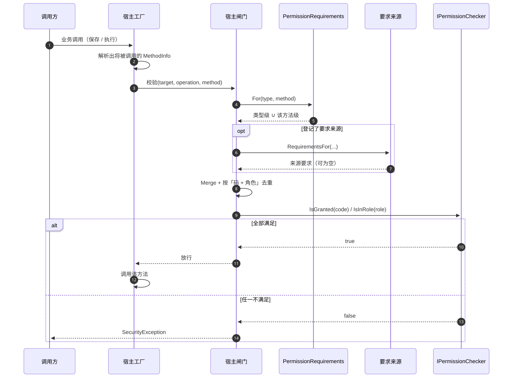

# Euonia.Security

操作权限与行级数据权限的**策略引擎**。它定义权限码、行级策略、策略编译与下推，并提供判定入口；
**不决定强制执行点在哪里**——在哪个调用点拦截由宿主决定。

- **目标框架**：`net10.0`、`net11.0`
- **根命名空间**：`Nerosoft.Euonia.Security`（`AddPermission` / `PermissionOptions` 位于 `Microsoft.Extensions.DependencyInjection`）
- **NuGet 包**：`Euonia.Security`
- **设计约束与已知边界**：[DESIGN.md](DESIGN.md)

## 安装

```bash
dotnet add package Euonia.Security
```

本包依赖 `Euonia.Core` 与 `Microsoft.Extensions.DependencyInjection.Abstractions`：
不引入 EF Core、ASP.NET Core，也不绑定任何鉴权引擎。

## 快速开始

装配分三件事：扫描范围、判定主体、授权值来源：

```csharp
services.AddPermission(permission => permission.Scan(typeof(Order).Assembly));

services.AddSingleton(new UserPrincipal(claimsPrincipal));          // 判定主体
services.AddScoped<IScopeSubjectResolver, MySubjectResolver>();   // 数据权限 / 权限码需要
```

权限码写在类型或方法上的 `[Permission("...")]` 里，数据权限模型（`ScopeModel<T>`）也在被扫描的
程序集里；新增权限码或新增操作都不需要改配置。装配细节见 [§3](#3-装配)。

## 完整示例

仓库内有可独立运行的最小工程 `docs/examples/security-console`（只引用本包，不依赖任何对象框架）：

```bash
dotnet run --project docs/examples/security-console
```

预期输出（原文）：

```text
gate: read=allowed approve=denied delete=allowed export=allowed audit=denied
visible=A-1,A-2
allows(read)=True,True,False,False
allows(order:delete)=True,False,False,True
```

关键接线（完整文件见 [docs/examples/security-console/Program.cs](../../docs/examples/security-console/Program.cs)）：

1. **装配与授权值**：`AddPermission(p => p.Scan(typeof(Order).Assembly))` + 一个 `IScopeSubjectResolver`。

```csharp
services.AddPermission(permission => permission.Scan(typeof(Order).Assembly));
services.AddScoped<IScopeSubjectResolver, DeptSubjectResolver>();   // 示例固定返回 dept=sales / owner=alice
```

2. **通用宿主闸门**：`PermissionRequirements.For(type, method)` 收集「类型级 + 这一个方法」的要求，
   再逐条交给 `IPermissionChecker`；这就是宿主接入本引擎所需的全部判定逻辑。

```csharp
var requirements = PermissionRequirements.For(resourceType, method);

return requirements.All(requirement => IsSatisfied(checker, requirement)) ? "allowed" : "denied";
```

3. **数据权限**：`ScopeModel<T>` 声明维度映射与默认策略，`Apply` 下推、`Allows` 单行判定。

```csharp
public override void Define(ScopeModelBuilder<Order> builder)
    => builder.Map(ScopeDimensions.Dept, order => order.DeptId)
              .Map(ScopeDimensions.Owner, order => order.OwnerId);

public override ScopePolicy<Order> Policy => ScopePolicy<Order>.Grant(ScopeDimensions.Dept);
```

各行的含义：

| 输出 | 含义 |
|---|---|
| `gate: read=allowed` | 类型级 `[Permission("order:read")]` 命中，用户持有该码 |
| `approve=denied` | 方法级 `[Permission("order:approve")]` 命中，用户没有该码 |
| `delete=allowed` | 方法级 `[Permission("order:delete")]` 命中 |
| `export=allowed` | 权限码 + 角色（`manager` / `auditor`）均满足 |
| `audit=denied` | 码已授予但角色不满足——角色要求同样参与判定 |
| `visible=A-1,A-2` | `Apply` 按部门维度下推，只保留 `dept=sales` 的行 |
| `allows(read)=...` | 逐行判定与 `Apply` 结论一致（同一份策略与授权数据） |
| `allows(order:delete)=...` | `OrderScope` 为 `order:delete` 单独声明「本人可删」 |

## 选项（代码配置）

本包没有 `IConfiguration` 读取点，也没有 `appsettings` 配置节：`PermissionOptions` 只在
`AddPermission(options => ...)` 回调里使用。可用的成员：`Scan`（可多次，程序集取并集）、
`Requirements`（可选的要求来源）、`NoModels`（零扫描范围的显式断言）。已废弃成员见
[已废弃 API](#已废弃-api)。

## 1. 核心原则：能预定义的进代码，不能预定义的走数据

判定语义、维度、策略组合方式都可以预定义，因此进代码；而「用户属于哪些团队、能访问哪些仓库」
这类**授权值**随时可变（团队/资源会新建删除、人员会调整），必须由使用方从应用数据实时解析。

这条原则直接决定了两件事：

- **框架不提供默认授权数据源**。把授权值固化在声明、Token 或代码字面量里，会导致
  「取消授权后旧令牌仍然有效」。因此本库只定义 `IScopeSubjectResolver` 契约，不给实现。
- **判定一律 fail-closed**。取不到授权数据时拒绝，而不是放行。

| | 操作权限（Operation Permission） | 数据权限（Data Permission） |
|---|---|---|
| 回答的问题 | 当前用户**能否执行某项操作** | 当前用户**能看到/操作哪些数据行** |
| 作用对象 | 类型 × 被调用的方法（类型级 / 方法级） | 声明了 `ScopeModel<T>` 的资源类型 |
| 判定依据 | 权限声明（或角色），一般来自用户声明 | 资源属性 × 用户从**授权数据**实时解析出的主体集合 |
| 引擎出口 | `IPermissionChecker` | `IScopeGuard` |
| 失败形态 | 断言失败 / 由调用方裁决 | 判定为不可访问 |

---

## 2. 需要由使用方提供的能力

| 能力 | 契约 | 是否必需 | 说明 |
|---|---|---|---|
| 判定主体 | `UserPrincipal` | 使用权限时必需 | 角色与认证状态取自声明 |
| 授权值 | `IScopeSubjectResolver` | 使用权限码或数据权限时必需 | 从应用数据实时解析权限码与行级授予 |
| 权限要求 | `IPermissionRequirementSource` | 可选 | 权限码来自数据库 / 配置表 / 既有鉴权系统时实现，与声明取并集 |
| 操作标识 | `IObjectOperationResolver` | 可选 | 回答「资源实例当前代表哪个操作」；缺席时由调用方显式传入标识 |

`AddPermission` 负责注册判定服务，并在首次解析 `IScopeGuard` 时校验上述依赖是否齐备。
`IPermissionChecker` 的默认实现是 `SubjectPermissionChecker`，可在 `AddPermission` 之后替换。

---

## 3. 装配

```csharp
var services = new ServiceCollection();

services.AddPermission(permission => permission.Scan(typeof(Order).Assembly));

services.AddSingleton(new UserPrincipal(claimsPrincipal));          // 判定主体
services.AddScoped<IScopeSubjectResolver, MySubjectResolver>();   // 数据权限 / 权限码需要
```

一次 `Scan` 就是完整配置：权限码写在对类型或方法上的 `[Permission]` 里，数据权限模型也在被扫描的
程序集里，因此新增权限码、新增操作都不需要改这里。`Scan` 之外只有两种声明：

| 场景 | 写法 |
|---|---|
| 权限码来自数据 | `AddPermission(p => p.Scan(…).Requirements(new MyRequirementSource()))`（§3.3） |
| 确实没有模型与声明 | `AddPermission(p => p.NoModels())`（零扫描范围的显式断言） |

**图 1：装配与契约关系**



如图 1 所示，`AddPermission` 只负责装配：它不拦截任何调用，真正的闸门在宿主自己的调用边界上。

若使用了权限，应用还必须注册 `IScopeSubjectResolver`（见 [4.2](#42-用户侧授权值从数据实时解析)）。
框架不提供默认实现，以免把授权值固化在代码或令牌里。

启动期校验在**首次解析 `IScopeGuard` 时自动执行**——解析器 / 判定主体 / 扫描范围的缺漏当场暴露：

```csharp
var provider = services.BuildServiceProvider();
_ = provider.GetRequiredService<IScopeGuard>();   // 缺少 IScopeSubjectResolver 或 UserPrincipal 时在此抛出
```

### 3.1 多个模块各自注册

`AddPermission` **可以调用多次，每次的贡献都会被合并**——每个模块在自己的 `ConfigureServices`
里声明自己的扫描范围即可：

```csharp
services.AddPermission(o => o.Scan(typeof(Order).Assembly));    // 订单模块
services.AddPermission(o => o.Scan(typeof(Report).Assembly));   // 报表模块
```

合并规则：**要求来源取并集**（内建声明来源 ∪ 各模块 `Requirements(...)` 登记的来源，按「码 + 角色」
去重），程序集取并集，最终只构建**一个** `ScopeModelRegistry` 与一个组合要求来源。同一个来源实例
重复登记是幂等的，同一个程序集被多个模块传入也只扫一次。

「某个资源实例当前代表哪个操作」由 Core 的 `IObjectOperationResolver` 回答，属于**全局**语义：
多个模块给出不同答案本身就是配置错误；需要按模块区分时，自行实现一个带分派的解析器。

每次调用同样会重建并校验注册表，因此配置错误依旧在注册处抛出。

### 3.2 权限码如何被发现

发现只读两处：**类型**上的声明（含继承链）与**将被调用的那个方法**上的声明（含 override 链），
两者取并集。宿主工厂在调用前已经解析出 `MethodInfo`，把它交给闸门，闸门再交给要求来源。
方法级隔离因此是**结构性保证**而不是约定：收集时从不遍历同类型的其它方法，`UpdateAsync` 上的码
不可能出现在 `ArchiveAsync` 的调用路径上。

**图 2：权限码从声明到判定的时序**



如图 2 所示，闸门拿到的 `MethodInfo` 与随后真正 invoke 的是同一个对象；要求收集只读这一个方法，
因此同类型下其它方法上的码不会出现在这次判定里。

```csharp
[Permission("order:read")]                       // 类型级：对该类型的所有操作生效
public class Order
{
    [Permission("order:cancel")]                 // 方法级：只在 Cancel 被调用时生效
    public void Cancel() { }

    [Permission("order:approve-2.0")]            // 码是任意字符串：冒号、点、横线都只是命名习惯
    public Task ApproveAsync(CancellationToken cancellationToken = default) => Task.CompletedTask;
}
```

- **任意码、单一维度**：没有「资源 + 操作」两段结构，`order:read` 里的冒号只是命名习惯；
  `order:approve-2.0` 这类码同样合法，且不需要在任何配置里出现。
- **多码 = AND，多角色 = OR**；码与角色各自为空表示该项不作要求，两者都为空会被启动期扫描拒绝
  （[§5.6](#56-启动期校验)）。
- **读取时规范化**：`" order:read"` 被裁剪成 `order:read`；`order:read` 与 `Order:Read` 视为同一个码
  （`ScopeSubjectSet.HoldsPermission` 按忽略大小写比较）。
- **不需要登记**：`Scan` 之外没有任何配置项参与权限码发现。

> 宿主侧可见的查询入口是 `IPermissionRequirementSource.RequirementsFor(type, method, operation)`：
> 实现忽略 `operation`，按 `method` 回答；`method` 为 `null` 时只返回类型级要求。
> 它背后的读取器是 `PermissionRequirements`（`For(type)` / `For(method)` / `For(type, method)`），
> 带缓存与去重，可以直接用于自测或诊断。

`AddPermission` 本身**不拦截任何调用**：它只注册服务、做启动期校验、提供要求来源。宿主可以在
自己的调用边界上用同一个读取器实现闸门：

```csharp
var requirements = PermissionRequirements.For(type, method);   // 类型级 ∪ 被调用的方法级
foreach (var requirement in requirements)
{
    var allowed = (string.IsNullOrEmpty(requirement.Permission) || checker.IsGranted(requirement.Permission))
                  && (requirement.Roles.Length == 0 || requirement.Roles.Any(checker.IsInRole));
    if (!allowed) throw new SecurityException($"{type.Name}.{method?.Name} 未授权");
}
```

其中 `checker` 是注入的 `IPermissionChecker`，`method` 就是这次调用将要执行的那个方法。

### 3.3 权限码来自数据时

绝大多数应用的权限码写在代码里，与代码同源、随代码评审发布——这是**推荐形态**。只有码确实在数据里
（数据库权限表、配置表、既有鉴权系统）时才需要实现一个要求来源：

```csharp
using System.Reflection;
using Nerosoft.Euonia.Security;

public sealed class DbRequirementSource(IPermissionCodeTable table) : IPermissionRequirementSource
{
    public IReadOnlyList<PermissionAttribute> RequirementsFor(Type type, MethodInfo? method, string operation)
    {
        // 数据里的码按「类型 + 方法名」取；operation 是数据权限的授权标识，不参与权限码发现
        var stored = table.Find(type, method?.Name);

        return PermissionRequirements.Merge(
            PermissionRequirements.For(type, method),                    // 仍然尊重代码里的声明
            stored.Select(code => new PermissionAttribute(code)));       // 数据里的码是增量
    }
}

services.AddPermission(p => p.Scan(typeof(Order).Assembly).Requirements(new DbRequirementSource(table)));
```

- 来源是**增量**的：与声明取并集，与其他已登记来源取并集，按「码 + 角色」去重并保持首次出现顺序。
- 同一个来源实例重复登记是幂等的。
- 实现应忽略 `operation`：方法级要求由 `method` 决定（见 [DESIGN §1.10](DESIGN.md)）。

> ⚠️ **规则不在代码里，等于把鉴权口径交给运行期数据**：把某个方法从「需要审批码」改成「无码」
> 只是数据侧的一次改动。请让来源与代码走**同一套评审与发布流程**，不要把它当成运维侧的可调开关。

---

## 4. 操作权限

### 4.1 声明权限点

`[Permission]` 可打在**类型**上（适用于该类型支持的全部操作）或**方法**上
（**仅当宿主工厂调用该方法时**生效），两者取并集；可用多次（多权限 = AND，多角色 = OR）。

```csharp
[Permission("order:read")]
[Permission("order:write", "order-admin")]   // 角色走构造参数（Roles 只读）
public class Order
{
    [Permission("order:cancel")]
    public void Cancel() { /* ... */ }

    [Permission("order:approve-2.0")]         // 任意非空字符串都是一个合法码
    public Task ApproveAsync(CancellationToken cancellationToken = default) => Task.CompletedTask;
}
```

**权限码是任意字符串、单一维度**：

- 没有「资源 + 操作」两段结构；`:`、`-`、`.` 只是命名习惯，不参与解析。
- 不得以框架保留前缀 `@` 开头（`ScopeKeys.Prefix`）。
- 首尾空白在读取时被裁剪：`" order:read"` 与 `order:read` 是同一个码。
- 忽略大小写：`order:read` 与 `Order:Read` 视为同一个码——判定（`ScopeSubjectSet.HoldsPermission`）
  与去重（`PermissionRequirements` 的合并比较器）都按忽略大小写比较。策略按**授权标识**声明，
  标识（操作名或权限码）同样忽略大小写（`ForOperation("Update", …)` 与 `BusinessOperation.Update`
  命中同一条声明）。
- **新增码零配置**：写一个新码只需加特性，`AddPermission` 一行都不用改（§3.2）。

未指定 `Permission` 时仅校验角色，未指定角色时仅校验权限；两者都未指定在判定上是「无要求」，
但**启动期声明扫描会把它当错误拒绝**（`IDS_PERMISSION_CODE_EMPTY`）——空声明几乎只可能是复制粘贴
留下的残骸（[§5.6](#56-启动期校验)）。

> **通配写在授权数据一侧**：用户持有的码可以以 `*` 结尾表示前缀通配（持有 `repo:*` 可通过
> `repo:push` 的类型级判定），声明侧通常写具体码。它只是 `IPermissionChecker.IsGranted` 的匹配语义，
> 与数据权限的维度授予无关（`*` 不参与维度查找，见 [DESIGN §1.6](DESIGN.md)）。

### 4.2 用户侧：授权值从数据实时解析

`IScopeSubjectResolver` 是本库与授权数据之间**唯一**的接口，实现由使用方提供：

```csharp
public sealed class MySubjectResolver : IScopeSubjectResolver
{
    public async ValueTask<ScopeSubjectSet> ResolveAsync(ClaimsPrincipal user, CancellationToken ct = default)
        => ScopeSubjectSet.CreateBuilder()
                          .AddCodes(await GetPermissionCodesAsync(user, ct))   // 权限码（类型级/方法级）
                          .AddSelf(userId)                                     // 本人
                          .AddGrant("order:delete", "order", await GetDeletableOrdersAsync(user, ct))
                          .Build();
}
```

`AddSelf` / `AddGrant` 对应策略里的 `Self()` / `Grant(...)` 维度；授予的**资源标识**应与
模型里 `Map` 的取值选择器同源，否则维度永不匹配。

### 4.3 判定

`IPermissionChecker` 提供按权限码/角色断言的入口。它只回答「能不能」，**不负责在哪里调用**——
本库刻意不拦截任何调用，因为拦截点属于使用方的类型体系：把调用点写进引擎会让引擎无法独立使用。
需要「越权一律同一种异常形态」时，由使用方在自己的强制点上统一裁决。

```csharp
var checker = provider.GetRequiredService<IPermissionChecker>();
var allowed = checker.IsGranted("order:cancel");   // 布尔结论，是否拦截由调用方裁决
```

### 4.4 替换判定实现

默认实现是 `SubjectPermissionChecker`——权限码由 `IScopeSubjectResolver` 从**授权数据**实时解析，
撤销改数据即可，下一次解析（通常是下一个请求）生效，**不需要重新签发令牌**。

本库**不提供**读令牌声明（`UserClaimTypes.Permission`）的判定实现：把权限码固化在令牌里，
过期前无法撤销，与上面的生效时机相悖。需要从别处取判定数据的宿主，自行实现
`IPermissionChecker`（`IsGranted` / `IsInRole` /
`EnsureResolvedAsync` 三个必需成员），在 `AddPermission` **之后**注册即可（MS DI 取最后一个描述符）：

```csharp
services.AddPermission(/* ... */);
services.AddScoped<IPermissionChecker, MyChecker>();
```

只需要容器里有 `UserPrincipal`。`AddPermission` 用 `TryAddScoped` 注册默认实现，
不会覆盖宿主已注册的 `IPermissionChecker`，因此判定实现完全由宿主选用。

---

## 5. 数据权限

### 5.1 核心不变式：单一真值来源

策略被编译成 `Allow` / `Deny` **一对**表达式，**读侧下推**与**单行判定**共用同一份编译结果。
这是刻意的：若两条路径各写一遍判定，它们迟早会漂移，而「下推放行、单行拒绝」这类不一致极难排查。

```csharp
await guard.EnsureResolvedAsync(ct);                                    // 同步读只读已解析快照，异步入口先预热（§5.5）
var visible = guard.Apply(dbContext.Orders, BusinessOperation.Read);    // 表达式下推到数据库
guard.Allows(order, BusinessOperation.Read);                            // 单行判定，与上面必然同答案
```

同一标识下，`Apply` 与 `Allows` 的区别只在于「判定的是集合还是单个对象」，不在于判定规则。

### 5.2 资源侧：模型即声明

模型与策略写在同一个声明类型里，不允许拆开——拆开后就会出现「模型写了、策略没写」的静默放行。

```csharp
public sealed class OrderScope : ScopeModel<Order>
{
    public override void Define(ScopeModelBuilder<Order> builder)
        => builder.Map(ScopeDimensions.Dept, x => x.DeptId)
                  .Map("order", x => x.Id);

    public override ScopePolicy<Order> Policy => ScopePolicy<Order>.Grant(ScopeDimensions.Dept);

    public override void Declare(ScopePolicySet<Order> policies)
        => policies.ForOperation(BusinessOperation.Delete, ScopePolicy<Order>.Grant("order"), "order:delete");
}
```

模型在程序集扫描时自动发现，并在启动期完成全部校验——配置错误一律 fail-fast，
校验项清单见 [§5.6](#56-启动期校验)。

维度取值默认取自资源行自身（`Map`）。若授权关系落在**子表**（成员表 / 关系表）里——
「我加入了哪些团队 / 家庭 / 组织」就是这种形状——用 `MapMany` 声明为集合维度，见 [§5.9](#59-子表维度关系表作为取值来源)。

### 5.3 匹配语义与允许/拒绝代数

最终结论是 `Allow && !Deny`：

- `HasAllow` 不可省。只有 `Deny` 而没有 `Allow` 时**不是**「全放行」，而是「全拒绝」——
  否则 `Deny` 会被当成摆设。
- `Deny` 一律上浮，且在嵌套 `Any` 里同样优先。`Allow.Any(x => Deny(x).Or(...))` 仍是拒绝。
- 空授权数据生成常量 `false`，不会生成空的 `IN ()`。

### 5.4 用户身份与放行规则

| 条件 | 结果 |
|---|---|
| 策略为空 / 无维度 | 不受数据权限约束（放行） |
| 用户未认证（含无用户主体来源） | 拒绝——授权数据一律视为空，不调用解析器 |
| 解析器缺席且已声明模型或权限码 | 拒绝，并抛出明确错误——绝不静默放行 |
| 资源类型未注册模型 | 不受数据权限约束（放行） |

### 5.5 缓存契约

`IScopeGuard` 按请求（Scoped）注册，授权数据与已编译策略**在一次请求内只解析/编译一次**，
读写共用同一份快照。这既保证同一请求内多处判定一致，也避免逐行查询授权数据。

**同步读只读已解析的快照，绝不隐式等待**：冷缓存时 `GetSubjects()` / `Permissions` / `Allows*` /
`GetPolicy` / `Apply` / `Explain*` 抛 `InvalidOperationException`（`IDS_SCOPE_NOT_RESOLVED`），
不会阻塞调用线程去跑解析器——在判定路径里藏一次 I/O 等待，负载下就是线程池饥饿。
异步入口负责预热：先 `await guard.EnsureResolvedAsync(ct)`（或 `await guard.GetSubjectsAsync(ct)`），
之后的同步读一律命中暖路径。这次等待由**宿主的入口**承担：异步入口 `await` 一次，
同步入口在边界上阻塞一次——引擎只负责把「还没预热」明确说出来，不替任何人做这个取舍。

因此**撤销授权的生效时机是「下一次解析」**：唯一失效入口是 `RefreshAsync()`——它把「失效」与
「立即重新解析」合成一步，在长生命周期作用域（例如后台 worker）中授权数据变化后必须调用它。
解析（含重新解析）由解析闸门串行化，因此「在途解析的结果覆盖一次撤销」这类竞态在结构上不存在。

### 5.6 启动期校验

权限模型与权限声明都在**注册期**校验：模型只校验「声明了模型」的情况，没有任何 `IScopeModel<T>`
的应用照常启动，只是全部资源都不受数据权限约束；`[Permission]` 声明则只要落在被 `Scan` 的程序集里
就会被检查（见本节的「违规的权限声明」）。

下列问题全部在启动期暴露——它们的共同性质是「看似启用了数据权限、实际没有按预期生效」：

| 诊断 | 含义与修法 |
|---|---|
| 模型无法实例化 | 程序集扫描要求模型有公共无参构造；需要构造参数的模型无法注册（§5.7） |
| 模型未声明任何维度 | `Define` 里至少调用一次 `ScopeModelBuilder<T>.Map`（取值来自子表时用 `MapMany`） |
| 集合维度的取值形状不受支持 | `MapMany` 的选择器不是「导航集合（可带 `Where` 过滤）再取字符串值」。只有这一种形状能下推为 `EXISTS`，故注册期直接拒绝（§5.9） |
| 同一维度被重复声明 | 同一个维度名被 `Map` 与 `MapMany`（或同名声明两次）声明——一个维度只能有一个取值来源 |
| 同一资源类型存在多个模型 | 一个类型只能有一个 `ScopeModel<T>`；扫描到的全部模型都参与检查 |
| 未提供策略 | `Policy` 返回 `null`。模型与策略必须写在同一个声明类型里 |
| 策略引用了未映射的维度 | 策略里的 `Grant(d)` 没有在 `Define` 中 `Map(d, …)`——这是「写了却没映射 ⇒ 静默放行」的根治点 |
| 策略结构性恒不放行 | 归约后 `Allow` 恒假，通常是 `Any` 之下全是拒绝条件（§5.3） |
| 同一个授权标识被重复声明 | 同一个标识在 `Declare` 里声明了两次（`IDS_SCOPE_POLICY_DUPLICATE_DECLARED`）——一个标识只有一个声明位（§5.8） |
| 授予键或标识名被抢占 | 两条声明与既有名字（标识或键）相撞（`IDS_SCOPE_KEY_DUPLICATE_DECLARED`）——标识与授予键共用一个命名空间，共用名字等于共用同一份行级授予（§5.8） |

所有问题**一次报全**（`ScopeModelValidationException.Diagnostics`），而不是修一个跑一次——
启动期配置错误往往同时存在多处，逐个报出等于让人反复重启。

授权数据源与用户主体是否齐备由**首次解析 `IScopeGuard` 时的启动校验**检查（
因为解析器的注册顺序不受约束）。若从未解析过守卫，首次判定时同样会以明确错误暴露。

启动校验还会拒绝**一个程序集都没扫描过**的注册：回调里一次 `p.Scan(...)` 都没有时扫描范围为空，
行级数据权限必然静默失效，而「没有任何声明」又会让上面的
`IScopeSubjectResolver` / `UserPrincipal` 检查一并短路——于是「能启动但什么都没生效」，无从察觉。
这与 §3 的「显式声明扫描范围或断言 `NoModels`」是**同一条规则：空输入不是默认值**：

```csharp
services.AddPermission(p => p.NoModels());   // 显式断言「本应用确实没有任何权限模型与 [Permission] 声明」
```

只要给过一次程序集（回调里的任意 `p.Scan(asm)`）就不需要这个断言：
**扫过但没有声明**与**从没扫过**是两回事，前者本身就是一次显式声明。

两个「空」的报错时机不同，不要混为一谈：

| 情形 | 抛出时机 | 资源键 |
|---|---|---|
| 回调什么都没表达（没有 `Scan`、`Requirements`、`NoModels`） | `AddPermission` 处 | `IDS_PERMISSION_CONFIG_EMPTY` |
| 有配置但没有扫描范围（例如只调用了已废弃的 `NoOperationCodes()`） | 首次解析 `IScopeGuard` | `IDS_PERMISSION_NO_ASSEMBLY_SCANNED` |

**违规的权限声明**（`PermissionDeclarationScanner`，注册期**一次报全**）：

| 诊断 | 触发 | 修法 |
|---|---|---|
| `IDS_PERMISSION_CODE_EMPTY` | 同一成员上 `[Permission("")]` / `[Permission(null!)]` 且没有声明任何角色 | 给出任意非空码，或删除该特性；只想校验角色就至少写一个角色 |
| `IDS_SCOPE_CODE_RESERVED_PREFIX` | 码以保留前缀 `@` 开头 | 换一个不以 `@` 开头的码（`@` 是框架保留命名空间，§5.8） |
| `IDS_PERMISSION_CODE_DUPLICATE` | 同一成员上同一个码（忽略大小写）被声明两次 | 删掉重复声明——只可能是复制粘贴错误 |

有意**不**报错的情形：同一个码出现在不同成员或不同类型上（常态，例如 `order:read` 出现在多个聚合上）；
同一成员上同码但角色不同（`[Permission("x", "a")]` 与 `[Permission("x", "b")]` 是两个合法要求）。
扫描结果按程序集缓存，同一程序集整进程只反射一次。

### 5.7 模型的注册方式

模型只从**程序集扫描**发现——在 `AddPermission` 回调里 `p.Scan(assemblies)`。扫描要求模型有公共
无参构造；需要构造参数的模型无法注册（框架不提供公开的程序化注册入口），请把参数改为运行期从
容器或静态来源取得，或拆成无参声明 + 运行期数据。

扫描进来的每个模型都走**同一套校验**（`Build` 是唯一校验入口），不存在「有的查得严、有的查得松」。
同一资源类型注册两个模型是**配置错误**（会在注册期报出），而不是「后者胜出」——后者会让作者
误以为先注册的那个生效了。

### 5.8 授权标识与策略键的解析

**授权标识**是判定入口收的那个字符串，要么是**操作名**（`read`、`approve`），要么是**权限码**
（`order:delete`）。模型为哪个名字声明过策略，就用哪个名字寻址；标识不受调用方状态直接影响
（[DESIGN §1.7](DESIGN.md)）：资源状态的改变只是改变了实际执行的操作，而每条标识各自应用自己的策略。

**权限码 ≠ 授权标识**，两者只是共用同一个字符串命名空间，**没有映射关系**：

| | 权限码 | 授权标识 |
|---|---|---|
| 回答 | 当前用户**能不能**做（布尔） | 数据权限用**哪条策略、哪个授予键** |
| 载体 | `[Permission("...")]`、`IPermissionChecker.IsGranted` | `ScopePolicySet.For` / `ForOperation`、`IScopeGuard` 各入口 |
| 关系 | 码不推导操作，操作也不推导码；不要求同名 | 同名不是错误，只是同一个名字（见本节末尾） |

`[Permission("order:delete")]` 与 `ForOperation(BusinessOperation.Delete, …, "order:delete")` 可以同时存在：
前者决定「能不能删」，后者决定「能删哪些行」。`BusinessOperation` 只是 `read` / `create` / `update` /
`delete` / `execute` 的默认词汇表，宿主可定义任意标识（审批流里的 `approve`、`push`）——引擎不预设
操作词汇，操作集由宿主的对象模型决定。
两条线如何分工、又在哪一点上相交，如图 3 所示。

**图 3：权限码与数据权限授权标识的分轨**



如图 3 所示，左轨只回答布尔问题，右轨只负责寻址与行级求值；两个字符串同名时只是共用同一份行级授予，
并不表示存在从码到标识的推导关系。

**模型侧**：在 `Declare` 里二选一，两种写法共用同一个标识命名空间：

| 写法 | 标识与授予键 | 适用形态 |
|---|---|---|
| `ForOperation(operation, policy, scopeKey = null)` | 标识是**操作名**；授予键默认取操作名自身，显式给出时通常写字面权限码（如 `"order:delete"`） | 宿主框架能把「目标当前代表哪个操作」说出来（对象状态、命令对象），行级授予写在操作对应的权限码下 |
| `For(code, policy)` | 标识与授予键都是这个**权限码**（等价于 `ForOperation(code, policy, code)`） | 调用方本来就按权限码寻址（`Apply(query, RepositoryPermissions.View)`、`AllowsObject(row, RepositoryPermissions.Delete)`），或领域动作没有对应的宿主操作名 |

授予键默认**取标识自身**（`ForOperation` 省略第三个参数时即操作名自身），而不是派生成带保留前缀的
`@` 键：保留前缀下写不进授予（`ScopeSubjectSetBuilder.AddGrant` 拒绝保留键），派生只会让这条策略的
授予永远取不到；以自身为键则没有这个缺口。未声明的标识回落到模型必填的默认策略 `Policy`。
两种写法都拒绝保留前缀 `@`——`@` 下只有框架自己的名字。

**判定侧**，标识按以下顺序确定：

| 顺序 | 来源 | 说明 |
|---|---|---|
| 1 | 调用方显式传入的标识 | `guard.Allows(entity, BusinessOperation.Delete)` 这类入口；非空即直接采用 |
| 2 | `IObjectOperationResolver`（Core，宿主框架实现） | 由使用方回答「这个资源实例当前代表哪个操作」。缺席或解析不出时跳过本步 |
| 3 | 无标识 | 按模型默认策略判定，键取 `ScopeKeys.Default`（`@default`）。`Apply` / `GetPolicy` 不传标识时同理，因为查询没有「当前操作」这一上下文（§5.1） |

模型注册项按固定次序把标识解析成「策略 + 授予键」：
**① 声明的标识**（`For` 声明的码、`ForOperation` 声明的操作名）——命中该条声明的策略与键；
**② 声明的授予键**——键与标识共用一个命名空间，因此为 `read` 声明策略、键写 `repository:view` 之后，
用 `repository:view` 来寻址同样命中那一条；**③ 谁都没声明**——策略为 `null`（回落到默认策略），
键取标识自身（保留命名空间内或空白则落到 `@default`）。

**一个名字只能有一条策略**：标识撞标识（`IDS_SCOPE_POLICY_DUPLICATE_DECLARED`），
键与任何已有名字（另一个键或某个标识）相撞、标识撞上已有的键（`IDS_SCOPE_KEY_DUPLICATE_DECLARED`），
都在 `Declare` 处直接失败——两个东西抢同一个名字，要么是笔误，要么就是把两条策略的行权限
悄悄绑在了一起。

因此「权限码与操作名同名」本身**不冲突**：它就是同一个名字，在这个名字上只能有一条策略
（`For("order:delete", …)` 等价于 `ForOperation("order:delete", …)`）。真正会报错的是为同一个名字
写两条声明，或者让它的授予键去抢另一个已有名字。

> 键只决定「用户在该标识下被授予的维度值从哪取」（`ScopeSubjectSetBuilder.AddGrant(key, dimension, …)`
> 写在哪个键下），不决定策略——策略直接挂在标识上；标识没有授予时覆盖式回落到 `@default`。
> 权限码的 `*` 前缀通配只用于「是否持有该权限码」的布尔判定，**不参与**维度取值的解析
> （[DESIGN §1.6](DESIGN.md)）。

---

### 5.9 子表维度（关系表作为取值来源）

**问题**：「我加入了哪些团队 / 家庭 / 组织」这类权限，关系存在**子表**里
（`team_member(team_id, user_id, status)`），资源却是父行（`team`）。维度取值只能取自资源行自身时，
唯一的办法是让解析器把关系**反向展开**成一堆 id（[DESIGN §2.1](DESIGN.md)）：关系表与授权数据要互相同步、
每次解析多一次反查与一个 `IN (...)`，而且关系的属性（`status`、`expires_at`）无法参与行级判定。

**做法**：用 `MapMany` 把子表声明成一个**集合维度**——维度取值是「子表里的一组值」：

```csharp
public sealed class TeamScope : ScopeModel<Team>
{
    public override void Define(ScopeModelBuilder<Team> builder)
        => builder.Map(ScopeDimensions.Owner, t => t.LeaderId)                    // 行内的列：单值维度
                  .MapMany(ScopeDimensions.Member,                                // 子表：集合维度
                           t => t.Members.Where(m => m.Status == "active")
                                         .Select(m => m.UserId));

    public override ScopePolicy<Team> Policy
        => ScopePolicy<Team>.Any(ScopePolicy<Team>.Grant(ScopeDimensions.Member),
                                 ScopePolicy<Team>.Grant(ScopeDimensions.Owner));
}
```

解析器侧与其它维度没有区别——授予的是「子表里应当出现的值」，通常就是**当前用户的标识**：

```csharp
builder.Add(ScopeDimensions.Member, userId);      // 「我是这个团队的成员」
```

> `owner` 维度已被行内的列占用时（如上例的 `LeaderId`），成员关系必须另立维度名——
> 同一个维度只能声明一次。授予的值标识的是**子表里的那个值**，不是资源标识。

判定与查询：

```csharp
await guard.EnsureResolvedAsync(ct);
guard.Allows(team, BusinessOperation.Read);            // 单行判定：要求 team.Members 已加载（见下方边界）
guard.Apply(db.Teams, BusinessOperation.Read);         // 下推：交给数据库做 EXISTS 相关子查询
```

生成的 SQL 就是这个形状（真实提供程序实测，非示意）：

```sql
SELECT "t"."id", "t"."name" FROM "team" AS "t"
WHERE EXISTS (
    SELECT 1 FROM "team_member" AS "m"
    WHERE "t"."id" = "m"."team_id" AND "m"."status" = 'active' AND "m"."user_id" = 'dev')
```

**语义与单值维度是同一套**：`Grant(d)` 一律是「资源在该维度上的取值集合 ∩ 用户被授予的集合 ≠ ∅」
（单值只是集合的退化情形），因此 `Self()` / `Any` / `All` / `Deny` / 策略键 / 审计全部照旧，
`Explain` 里该叶子会带上 `[]` 标记（`Grant(member[])`）以便与行内列区分。
子表属性写在选择器里，由数据库**实时**求值——成员关系一改，下一次查询即生效，
不需要等授权数据刷新（对比 [§5.5](#55-缓存契约) 的解析快照）。

**边界**（每条都对应一类真实事故）：

| 边界 | 说明 |
|---|---|
| 单行判定要求子集合已加载 | **仅当该策略引用了子表维度**：`Allows` / `AllowsObject` / `Filter` / `Explain` 在内存中求值同一棵表达式，实例上子集合为 `null` 时**抛 `InvalidOperationException`**（指明维度与三条修法），绝不静默拒绝。写侧因此有个天然出路——把写侧策略写成只按行内列判定（如 `Grant(owner)`），它就不要求对象图完整。 |
| 初始化为空集合 ⇒ 静默拒绝 | 实体若把集合初始化成 `= []`，「未加载」与「确实没有成员」无法区分，表现为拒绝且无报错。这是**有意接受的边界**（[DESIGN §2.5](DESIGN.md)），要么去掉初始化器让它报错，要么就只走下推路径。 |
| `Apply` 必须作用在实体查询上 | 先投影成 DTO / 读模型再过滤时集合已被物化，无法翻译。读模型要参与下推，请只声明行内的列维度。 |
| 只支持存在量词 | 「子行**全部**命中」这类全称量词不支持——判定语义始终是集合成员判断。 |
| 值类型仍是 `string` | 与单值维度一致（[DESIGN §2.4](DESIGN.md)）；子表列是 `Guid`/`long` 时请提供字符串投影。 |
| 子表的写入口要单独设防 | 子表维度把「谁属于这个资源」的判定权交给业务数据，因此成员表的增删改必须由**操作权限**把守。 |

**取值形状只有一种**，其余在**注册期**被拒绝：

```csharp
x => x.Members.Select(m => m.UserId)                        // ✅
x => x.Members.Where(m => m.Status == "active").Select(m => m.UserId)   // ✅ 子表属性参与判定
x => x.MemberIds                                            // ✅ 元素本身就是字符串
x => x.Tags.Concat(x.OtherTags)                             // ❌ 注册期报错：形状不受支持
```

理由：可下推的只有「导航集合 + 过滤 + 元素谓词」这一种形状。与其让它在查询时被提供程序
抛出翻译失败，不如在启动时说清楚——这也是本库一贯的 fail-fast 取舍。

**与「解析器反向展开」怎么选**（[DESIGN §2.1](DESIGN.md)）：

| 关系在哪 | 用什么 |
|---|---|
| 与查询同库、关系行可枚举（成员表这类） | `MapMany`——`EXISTS` 下推，实时、无需同步、无需反向展开 |
| 关系在别处（跨库 / 外部服务），或需要「授组 id 而非行 id」的收窄 | 解析器反向展开为扁平集合（§2.1），框架只看到 `IN (...)` |
| 行数巨大且关系极稀疏 | 逃生舱 `Where(x => aclQuery.Contains(x.Id))`，自行评估成本 |

---

## 6. 核心类型与关键成员速查

### 授权数据（使用方实现）

| 成员 | 用途 |
|---|---|
| `IScopeSubjectResolver` | 实时解析当前用户的权限码与行级授予（入参为 `ClaimsPrincipal`） |
| `ScopeSubjectSet` | 授权数据快照（不可变） |
| `ScopeSubjectSetBuilder` | 构造授权数据：`AddCodes` / `AddSelf` / `AddGrant` |

### 资源声明（使用方编写）

| 成员 | 用途 |
|---|---|
| `ScopeModel<T>` | 数据权限模型基类，模型与策略写在一起 |
| `ScopeModelBuilder<T>` | 声明维度取值（`Map` 行内列 / `MapMany` 子表）与分类属性 |
| `PermissionOptions` | `AddPermission` 回调的配置入口：`Scan` / `Requirements` / `NoModels`（已废弃成员见 [已废弃 API](#已废弃-api)） |
| `ScopePolicy<T>` | 策略组合：`Grant` / `Where` / `Deny` / `Self` / `Any` / `All` |
| `ScopePolicySet<T>` | 按授权标识声明行级策略（`For` / `ForOperation`，可指定授予键） |
| `ScopeDimensions` | 预置维度（`Owner` / `Dept` / `Member` / …） |
| `ScopeKeys` | 框架保留命名空间（`@default`）与名字/键的校验、回落（§5.8） |
| `PermissionAttribute` | 声明权限要求（类型级或方法级；权限码是任意非空字符串，§4.1） |

### 判定入口

| 成员 | 用途 |
|---|---|
| `IScopeGuard` | 数据权限判定与下推（按请求缓存） |
| `IScopeGuard.Apply` | 把数据权限下推为 `IQueryable` 过滤条件 |
| `IScopeGuard.Allows` / `AllowsObject` | 单行判定 |
| `IScopeGuard.Explain` / `ExplainObject` | 审计：给出命中路径与拒绝原因 |
| `IPermissionChecker` | 操作权限与角色断言 |
| `ScopeDecision` | 判定结论与命中路径 |

### 扩展点

| 成员 | 用途 |
|---|---|
| `IPermissionRequirementSource`（Core） | 提供「某类型 + 将被调用的方法要求哪些权限码与角色」；权限码来自数据时的扩展点（§3.3） |
| `PermissionRequirements`（Core） | 读声明（类型级 + 方法级）的实现：`For(type, method)` / `Merge` / `Adapt`，带缓存、裁剪与去重（§3.2） |
| `IPermissionChecker`（Core） | 操作权限判定的唯一声明；实现 `IsGranted`/`IsInRole`/`EnsureResolvedAsync` 三个必需成员，异步判定入口有默认实现 |
| `IObjectScopeAuthorizer`（Core） | 行级数据权限的落地契约（宿主框架在对象边界调用）；引擎提供基于 `IScopeGuard` 的实现，可按需替换 |
| `IObjectOperationResolver`（Core） | 「资源实例当前代表哪个操作」；由宿主框架实现，引擎直接消费它来推断资源当前的操作（§5.8 的第 2 步） |
| `OperationConventions` | 按特性名推导候选方法名的通用工具（宿主工厂查找使用） |

---

## 已废弃 API

以下成员保留但已标记 `[Obsolete]`（编译警告 CS0618，不是错误），仅为兼容既有配置：

| 已废弃成员 | 现状 | 替代 |
|---|---|---|
| `PermissionOptions.OnAttributeOrName` / `OnMethod` | 保留签名；作为一份要求来源参与并集 | 删除调用（声明直接生效） |
| `PermissionOptions.Source(IPermissionCodeSource)` | 保留签名；来源经 `PermissionRequirements.Adapt` 参与并集 | `Requirements(IPermissionRequirementSource)` |
| `PermissionOptions.NoOperationCodes()` | 空操作，仅算一次显式配置 | 删除调用 |
| `IPermissionCodeSource`（Core） | 兼容契约，引擎不再消费 | `IPermissionRequirementSource` / `PermissionRequirements` |

---

## 7. 故障排查

### 启动期异常（都是**有意**的 fail-fast）

| 现象 | 原因 |
|---|---|
| 「名称 'x' 已被 'y' 占用」 / 「标识 'x' 的策略被重复声明」 | 两条声明占用了同一个名字（标识或键，任意方向）——共用名字等于共用同一份行级授予；按码声明请用 `For`，或为每个操作指定各自的键（§5.8） |
| 「策略引用了未映射的维度」 | 策略引用的维度没有在 `Define` 里 `Map`——这是「写了却没映射 ⇒ 静默放行」的根治点 |
| 「模型未声明任何维度」 | `Define` 里没有调用 `Map`；维度是策略的取值来源，缺了它策略无从表达 |
| 「策略结构性恒不放行」 | 归约后 `Allow` 恒假，通常是 `Any` 之下全是拒绝条件——先确认这是本意还是漏写了允许条件 |
| 「权限模型无法实例化」 | 程序集扫描要求模型有公共无参构造；需要构造参数的模型请改为无参声明 + 运行期依赖（§5.7） |
| 「集合维度的取值形状不受支持」 | `MapMany` 只接受「导航集合（可带 `Where` 过滤）再取字符串值」这一种形状，其余无法下推为 `EXISTS`（§5.9） |
| 「维度 'x' 在类型 'Y' 的权限模型中重复声明」 | `Map` 与 `MapMany` 声明了同一个维度名——一个维度只能有一个取值来源 |
| 「未注册 IScopeSubjectResolver」 | 声明了模型或权限码却没接授权数据源 |
| 「同一资源类型存在多个模型」 | 一个类型只能有一个模型（扫描到的全部模型都参与检查） |
| 「未注册 UserPrincipal」 | 判定主体取自 `UserPrincipal`；不注册则取用 `IScopeGuard` 直接失败 |
| 「权限模型注册期校验失败，共 N 处问题」 | 这是**汇总**异常，`Diagnostics` 列出了全部问题，按序号逐条修 |
| 「权限配置是空的」（回调什么都没表达） | 至少 `p.Scan(asm)` 一个程序集；确实没有任何权限模型与 `[Permission]` 声明时断言 `p.NoModels()`；码来自数据时用 `p.Requirements(source)`（§3、§5.6） |
| 「权限码为空」`IDS_PERMISSION_CODE_EMPTY` | `[Permission("")]` / `[Permission(null!)]` 且没有角色。给出任意非空码，或删除该特性；只想校验角色就至少写一个角色（§5.6） |
| 「不允许使用保留前缀」`IDS_SCOPE_CODE_RESERVED_PREFIX` | 权限码（或数据权限的授权标识）以 `@` 开头——`@` 是框架保留命名空间，改名即可（§5.8） |
| 「权限码被重复声明」`IDS_PERMISSION_CODE_DUPLICATE` | 同一成员上同一个码声明了两次（忽略大小写）——删掉重复声明；同码不同角色是合法的（§5.6） |
| 「方法级 `[Permission]` 不生效」 | 该声明只在**宿主工厂调用这个 `MethodInfo`** 时生效：调用没有经过工厂（业务方法内部自己调方法、直接 `new` 后执行方法、反射调用），闸门就不会跑。要么把调用收到工厂边界，要么在业务代码里显式 `IsGranted`（§3.2、§9） |

完整的模型级校验项清单（含每一条的修法）见 [§5.6](#56-启动期校验)。

### 判定结果不符合预期

1. 先看 `guard.Explain(entity, identifier)`：它会给出命中的维度与最终结论。
2. 再确认**授权值的形状**与维度选择器同源：授予的 `AddGrant(key, "order", ids)` 中的 `ids`
   与 `Map("order", x => x.Id)` 取到的必须是同一套值；`key` 必须是该标识解析出的授予键（§5.8）。
3. 再确认用的是**同一个标识**：策略按授权标识选取，`Declare` 里没有声明过的标识会回落到
   默认策略。若策略按操作声明、调用点却传权限码，用声明时给出的授予键即可寻址，
   或把声明改成 `For(code, …)`（§5.8）。
4. 同步判定前先确认已预热（`await guard.EnsureResolvedAsync(ct)`）：冷缓存下同步读会抛
   `InvalidOperationException`（`IDS_SCOPE_NOT_RESOLVED`），而不是隐式等待（§5.5）。
5. 若结论来自**子表维度**（审计里显示 `Grant(member[])`，§5.9）：先核对授予的值与子表列里的值
   是不是同一套——最常见的是把**资源标识**授予了成员维度（父子的方向搞反了，结果是恒不放行）；
   再确认单行判定时子集合已加载（未加载会抛错而不是给出结论）。

### 下推相关问题

- `Apply` 必须下推为**表达式**（`Where` 带 `Expression`），而不是先物化再过滤——
  后者会把全表拉进内存。可以用 `ToQueryString()` 确认 SQL 里确实带了过滤条件。
- 策略表达式里若引用了无法翻译的成员，EF 会抛异常；此时考虑改用 `Apply` 之后再做其他过滤，
  或调整维度选择器为可翻译形式。
- 子表维度（§5.9）产生的条件是**相关子查询**（`EXISTS`），因此 `Apply` 必须作用在实体查询上、
  且在投影之前：投影成 DTO 之后集合已被物化，无法再翻译。
- 上下文要求：`IScopeGuard` 依赖当前 `UserPrincipal`。在后台任务里没有请求作用域时，
  需自行提供 `UserPrincipal`，并在判定前 `await guard.EnsureResolvedAsync(ct)` 预热、数据变化后
  调用 `RefreshAsync()`。

---

## 8. 性能注意事项

- 授权数据每请求只解析一次，但**下推到数据库的过滤条件是每次调用重建的**：
  同一请求内多次 `Apply` 会重复构造表达式树，热点路径上建议缓存 `IQueryable`。
- 已编译策略按（资源类型，解析出的授予键）缓存，因此不同标识不会互相顶掉，同义的名字
  （操作名与其授予键）命中同一条编译结果。
- `RefreshAsync()` 会失效并立即重新解析（同时丢弃已编译策略）；授权数据频繁变化时应把变更频率
  与刷新频率一并考虑。
- 策略表达式的复杂度直接决定 SQL 的复杂度：嵌套 `Any` 会被翻译成相关子查询，
  层数越深越慢。
- 子表维度（§5.9）的 `EXISTS` 子查询按子表的过滤列取数，请在子表上建
  `(父标识, 值)` 组合索引（例如 `(team_id, user_id)`），否则每行都要扫一遍子表。
- 单行判定（`Allows` / `AllowsObject`）在子表维度上多了一次加载探测；
  大批量对象应改用 `Apply` 下推，而不是逐行判定。
- 权限声明按程序集静态缓存（`PermissionDeclarationScanner`），整进程只反射一次；判定路径只读
  `PermissionRequirements` 的类型 / 方法两处缓存，**缓存不重建、没有 per-call 反射**。类型级与方法级同时
  存在时，每次判定仍会为并集 `Merge` 分配一次数组；宿主登记了要求来源时，宿主闸门还会再合并一次。
  这是表达并集所需，不是重复反射；高频路径上不要反复手工调用 `For`。

---

## 9. 注意事项 / 限制

- **不提供默认授权数据源**：`IScopeSubjectResolver` 只有契约，没有实现；未注册而使用了权限时，首次解析 `IScopeGuard` 的启动校验会直接失败（§2、§5.6）。
- **判定一律 fail-closed**：取不到授权数据、维度未映射、策略结构性恒不放行都按拒绝处理，不存在「配置缺失时放行」的回退（§1、§5.3）。
- **不决定强制执行点**：本包不会给 Minimal API、MVC 过滤器或 EF 查询自动挂上判定；调用方必须在自己的边界显式调用 `IPermissionChecker` / `IScopeGuard.Allows*` / `IScopeGuard.Apply`（§1、§5.1）。
- **`IScopeGuard` 依赖当前 `UserPrincipal`**：后台任务或非请求线程需要自建作用域并提供判定主体；同步判定前要先 `await guard.EnsureResolvedAsync(ct)`，冷缓存下同步读会抛 `IDS_SCOPE_NOT_RESOLVED`（§5.5、§7）。
- **授权值是缓存而非快照**：已编译策略按（资源类型，授予键）缓存，授权数据变更后必须调用 `RefreshAsync()`，否则旧结论会继续生效（§8）。
- **启动期校验是有意的 fail-fast**：模型缺维度、标识/名称重复、扫描范围为空等都在注册或首次解析时抛异常，不要用 try/catch 吞掉（§5.6、§7）。
- **方法级权限码只在宿主工厂边界执行**：`[Permission]` 打在方法上时，只有**工厂把将要 invoke 的
  `MethodInfo` 交给闸门**那一次才生效（宿主工厂就是这样的边界）。业务方法内部
  自己调用另一个方法、直接 `new` 后执行、或反射调用都不会经过闸门；需要在那里分支时用
  `BusinessContext.GetService<IPermissionChecker>().IsGranted("order:update")`（§3.3、§7）。
- **不提供多租户隔离**：租户维度如何进入授权值完全由 `IScopeSubjectResolver` 与维度选择器决定，本包不认识租户概念。

查询、显式码判定与闸门的判定范围不同，如图 4 所示。

**图 4：查询、显式码判定与闸门的判定范围**



如图 4 所示，三者不是同一个东西：宿主提供的**查询入口**没有方法上下文，只能回答类型级与来源要求，
且不抛异常；`IPermissionChecker.IsGranted(code)` 只判定**指定的那个码**，不收集任何声明，适合业务方法
内部自选分支；方法级要求只在宿主闸门里生效。把前两者当安全边界都会低估要求——真正的拦截始终在闸门
（§3.2、§7）。

## 相关包

- [`Euonia.Core`](../Euonia.Core/README.md) —— `UserPrincipal`、`IPermissionChecker`、`IObjectScopeAuthorizer` 等契约
- [`Euonia.Telemetry.Otel`](../Euonia.Telemetry.Otel/README.md) —— 采集本包的 `Nerosoft.Euonia.Security` ActivitySource 与 Meter
- [`Euonia.Tenancy`](../Euonia.Tenancy/README.md) —— 多租户上下文（租户维度由使用方自行接入授权值）

## 常见问题与故障排查

### 同步判定抛「授权数据尚未解析」

**原因**：`IDS_SCOPE_NOT_RESOLVED` —— 当前作用域还没解析授权数据，同步读不会隐式等待（`Source/Euonia.Security/Properties/Resources.resx:159`、§5.5）。
**解决**：在任何同步判定前 `await guard.EnsureResolvedAsync(ct)`；后台任务先建作用域、注册 `UserPrincipal`，再预热。

### 启动抛「权限配置是空的」

**原因**：`AddPermission` 回调里既没有 `Scan`，也没有 `Requirements` / `NoModels`，等于没有表达任何意图（`IDS_PERMISSION_CONFIG_EMPTY`、§3）。
**解决**：`p.Scan(asm)` 至少扫描一个程序集；确实没有模型与 `[Permission]` 声明时断言 `p.NoModels()`；码来自数据时用 `p.Requirements(source)`。

### 启动抛「权限码为空」/「权限码被重复声明」

**原因**：被扫描的程序集里有违规声明——`[Permission("")]` 且没有角色（`IDS_PERMISSION_CODE_EMPTY`），或同一成员上同一个码声明了两次（`IDS_PERMISSION_CODE_DUPLICATE`）。多条诊断会一次报全（§5.6）。
**解决**：给出任意非空码（或删掉该特性、补一个角色）；删掉重复声明。同码不同角色、同码出现在不同成员上都不算重复。

### 方法级 `[Permission]` 没有生效

**原因**：声明只在宿主工厂调用**这个** `MethodInfo` 时被检查。若这次执行没有经过工厂边界（业务方法内部自调、直接 `new`、反射调用），闸门不会运行（§3.2）。
**解决**：把调用收到工厂边界；或在业务代码里用 `IPermissionChecker.IsGranted("order:update")` 显式判定。

### 启动抛「名称 'x' 已被 'y' 占用」/「标识 'x' 的策略被重复声明」

**原因**：两个声明占用了同一个名字（标识或授予键，任意方向），共用名字等于共用同一份行级授予（§5.8）。
**解决**：按权限码声明改用 `For(code, ...)`，或为每个操作指定各自的键；名字冲突要在 `Define` 里消歧，不要靠注册顺序。

### `Apply` 之后 SQL 里没有过滤条件

**原因**：在投影成 DTO 之后才 `Apply`，集合已物化，表达式无法翻译；或对 `IEnumerable` 调用而不是 `IQueryable`（§7「下推相关问题」）。
**解决**：把 `guard.Apply(query)` 作用在实体 `IQueryable` 上、投影之前，用 `ToQueryString()` 确认 WHERE 已下推。

### 判定结果恒为拒绝

**原因**：维度未映射、授予值与维度选择器取值不同源，或子表维度方向反了（把资源标识授予了成员维度）。
**解决**：先 `guard.Explain(entity, identifier)` 看命中维度；核对 `AddGrant(key, "order", ids)` 与 `Map("order", x => x.Id)` 是否同一套值；子表维度确认父→子方向与已加载集合。

## 最佳实践

- **声明即配置**：权限码写在 `[Permission]` 上，`AddPermission` 只需要 `Scan`。
- **扫到即校验**：把声明所在程序集都 `Scan` 进来，启动期才能把空码、保留前缀、同成员重复码一次报全（§5.6）。
- **启动即预热**：在应用启动早期解析一次 `IScopeGuard`（`provider.GetRequiredService<IScopeGuard>()`），把缺 `IScopeSubjectResolver` / `UserPrincipal` 的问题挡在启动阶段。
- **下推优先于逐行判定**：列表查询用 `Apply`，只有单条详情才用 `Allows` / `AllowsObject`。
- **为子表维度建索引**：`MapMany` 产生的 `EXISTS` 子查询按过滤列取数，建议在 `(父标识, 值)` 上建组合索引。
- **授权数据变更后刷新**：调用 `RefreshAsync()` 失效已编译策略，否则旧结论会继续生效。

## 版本与兼容

| 项 | 值 |
|---|---|
| 目标框架 | `net10.0`、`net11.0` |
| 包版本 | `2026.5.0`（仓库根 `project.props`） |
| 依赖 | `Euonia.Core`、`Microsoft.Extensions.DependencyInjection.Abstractions` |

- **不依赖 EF Core**：下推只生成表达式树，SQL 翻译由宿主的 ORM 完成；换 ORM 只需保证表达式可翻译。
- **命名空间**：全部类型位于 `Nerosoft.Euonia.Security`（`Scope/` 目录不另立子命名空间），DI 扩展在 `Microsoft.Extensions.DependencyInjection`。
- **不提供默认 `IScopeSubjectResolver`** 是设计承诺而非遗漏，升级不会补一个默认实现；若该边界变更，会以主版本说明。
- `IScopeGuard` / `IPermissionChecker` 按作用域注册（`IObjectScopeAuthorizer` 为单例，`Source/Euonia.Security/ServiceCollectionExtensions.cs:116-136`）；跨作用域缓存判定结果不在支持范围。

## 许可证

本项目依据仓库根目录的 [GNU General Public License v3.0](../../LICENSE) 发布。
