# Euonia.Security API 参考

> 本页是 API 参考；教程见 [TUTORIAL.md](TUTORIAL.md)。
> 完整公开类型与成员签名见 [API-FULL.md](API-FULL.md)。

操作权限与行级数据权限的策略引擎：预定义判定语义，授权值由使用方从数据实时解析；读侧下推与单行判定共用同一份编译结果。本页是 API 速查；设计取舍见 [项目 README](../../../Source/Euonia.Security/README.md)。

- **NuGet 包**：`Euonia.Security`
- **目标框架**：`net10.0`、`net11.0`
- **根命名空间**：`Nerosoft.Euonia.Security`（`AddPermission` / `PermissionOptions` 在 `Microsoft.Extensions.DependencyInjection`）
- **依赖**：`Euonia.Core`、`Microsoft.Extensions.DependencyInjection.Abstractions`（不依赖 EF Core）
- **完整参考**：[Source/Euonia.Security/README.md](../../../Source/Euonia.Security/README.md)

## API 参考

| 类型/成员 | 说明 | 关键参数/默认值 |
|---|---|---|
| `AddPermission(Action<PermissionOptions>)` | 唯一注册入口，注册期完成模型扫描与校验 | 可多次调用，贡献取并集 |
| `PermissionOptions.Scan(params Assembly[])` | 追加扫描程序集（用于发现 `ScopeModel<T>` 与做启动期 `[Permission]` 声明校验；**权限码的发现与 `Scan` 无关**） | 可多次，程序集取并集；绝大多数应用**唯一需要的成员** |
| `PermissionOptions.Requirements(IPermissionRequirementSource)` | 权限码来自数据（数据库 / 配置表 / 既有鉴权系统）时登记要求来源 | 增量，与声明取并集；同实例幂等 |
| `PermissionOptions.NoModels()` | 断言「本应用没有任何权限模型与 `[Permission]` 声明」 | 仅零扫描范围时用；与 `Scan` 互斥 |
| `IPermissionRequirementSource.RequirementsFor(Type, MethodInfo?, string)` | 按「类型 + 将被调用的方法」回答权限要求 | 实现忽略 `operation`；`method` 为 null 时只回类型级 |
| `PermissionRequirements.For(Type)` / `For(MethodInfo)` / `For(Type, MethodInfo?)` | 读声明（类型级 / 方法级 / 并集），带缓存与去重 | 判定路径零反射；可直接用于诊断 |
| `PermissionRequirements.Merge(params IEnumerable<PermissionAttribute>[])` / `Adapt(IPermissionCodeSource)` | 合并去重（保序）/ 把兼容契约来源适配成要求来源 | 合并按「码 + 角色」去重；`Adapt` 对同一实例返回同一适配器 |
| `PermissionAttribute(string permission)` / `PermissionAttribute(string permission, params string[] roles)` | 声明权限码与角色：类型级 = 对该类型所有操作生效，方法级 = 只在该方法被工厂调用时生效 | 码是任意非空字符串，不以 `@` 开头，首尾空白被裁剪 |
| `ScopeModel<T>` | 资源模型：`Define` / `Policy` / `Declare` | 必须公共无参构造 |
| `ScopeModelBuilder<T>.Map(string, Expression<Func<T,string>>)` | 维度取值来自资源行 | 至少声明一个维度 |
| `ScopeModelBuilder<T>.MapMany(string, Expression<Func<T,IEnumerable<string>>>)` | 子表维度（下推为 `EXISTS`） | 仅接受「导航集合再取字符串」 |
| `ScopePolicy<T>.Grant(string dimension)` / `Self()` | 授予维度 / 本人 | `Self()` 等价于 `Grant(owner)` |
| `ScopePolicy<T>.Any` / `All` / `Deny` / `Where` | 策略代数 | 结论为 `Allow && !Deny` |
| `ScopePolicySet<T>.ForOperation(string, ScopePolicy<T>, string? scopeKey)` | 按操作声明策略 | `For(code, ...)` 按权限码声明 |
| `IScopeGuard` | `Apply` / `Allows` / `AllowsObject` / `Explain` / `EnsureResolvedAsync` / `RefreshAsync` / `GetSubjects` | Scoped，一次请求解析一次 |
| `IPermissionChecker` | `IsGranted(string)` / `IsInRole(string)` / `EnsureResolvedAsync(ct)` | 默认实现 `SubjectPermissionChecker` |
| `IScopeSubjectResolver.ResolveAsync(ClaimsPrincipal?, ct)` | 授权值唯一来源 | 返回 `ValueTask<ScopeSubjectSet>` |
| `ScopeSubjectSet.CreateBuilder()` | `AddSelf` / `Add` / `AddGrant` / `AddCodes` / `Build` | 维度名大小写不敏感 |
| `ScopeDimensions` | 内置维度名常量 | `Owner`、`Dept`、`Team`、`Member`、`Region`、`Project` |

接入前先看清契约归属：Core 与 Security 各自定义契约，Security 另有引擎实现，授权数据由宿主接上——如图 1 所示。

**图 1：Core 契约、Security 契约与实现、宿主职责**

如图 1 所示，宿主必须提供的只有 `UserPrincipal` 与 `IScopeSubjectResolver`；`IPermissionRequirementSource`
只在权限码来自数据时才需要实现，而 `PermissionRequirements` 是引擎内建、无需宿主实现的读取器。
图中的「引擎内建组合来源」是 `internal` 实现，仅用于说明装配关系，宿主不应直接引用。

本包**没有配置节**（不读取 `IConfiguration`）：`PermissionOptions` 全部在 `AddPermission` 回调里以代码声明，不需要 `appsettings` 与环境变量。

### 已废弃成员（仅兼容，勿用于新代码）

| 已废弃成员 | 现状 | 替代 |
|---|---|---|
| `PermissionOptions.OnAttributeOrName` / `OnMethod` | 保留签名，作为一份要求来源参与并集 | 删除调用（声明直接生效） |
| `PermissionOptions.Source(IPermissionCodeSource)` | 保留签名，来源经 `Adapt` 参与并集 | `Requirements(IPermissionRequirementSource)` |
| `PermissionOptions.NoOperationCodes()` | 空操作，仅算一次显式配置 | 删除调用 |
| `IPermissionCodeSource`（Core） | 兼容契约，引擎不再消费 | `IPermissionRequirementSource` / `PermissionRequirements` |

## 相关文档

- [教程](TUTORIAL.md)
- [可运行示例](../../examples/security-console/) —— `dotnet run --project docs/examples/security-console`
- [项目 README](../../../Source/Euonia.Security/README.md) —— 策略代数、下推、启动期校验与故障排查
- [Euonia.Core 用户手册](../Euonia.Core/API.md) —— `UserPrincipal` / `IPermissionChecker` / `[Permission]` 契约
- [Euonia.Endpoint.Http 用户手册](../Euonia.Endpoint.Http/API.md) —— 在 HTTP 边界调用判定
- [仓库根 README](../../../README.md)
