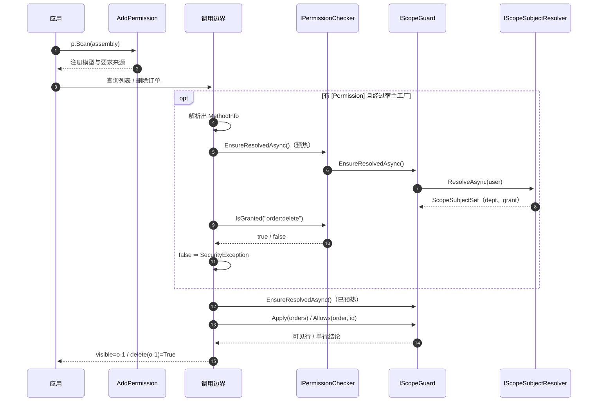

# Euonia.Security 教程

> 本页是教程；API 参考见 [API.md](API.md)，完整成员见 [API-FULL.md](API-FULL.md)。

操作权限与行级数据权限的策略引擎：预定义判定语义，授权值由使用方从数据实时解析；读侧下推与单行判定共用同一份编译结果。本页围绕仓库内的可运行示例，走一遍装配、判定与数据权限。

- **NuGet 包**：`Euonia.Security`
- **目标框架**：`net10.0`、`net11.0`
- **根命名空间**：`Nerosoft.Euonia.Security`（`AddPermission` / `PermissionOptions` 在 `Microsoft.Extensions.DependencyInjection`）
- **依赖**：`Euonia.Core`、`Microsoft.Extensions.DependencyInjection.Abstractions`（不依赖 EF Core）
- **完整参考**：[Source/Euonia.Security/README.md](../../../Source/Euonia.Security/README.md)

## 场景

示例工程 [docs/examples/security-console](../../examples/security-console/) 同时演示两条线：

- **操作权限**：`[Permission]` 写在类型或方法上，宿主闸门在调用前收集要求并判定；
- **数据（行级）权限**：`ScopeModel<Order>` 按部门与负责人声明行级策略，`Apply` 下推、`Allows` 单行判定。

数据是内存数组（4 条订单），不连接数据库；`Apply` 只生成表达式，`AsQueryable()` 即可验证形状。

## 1. 安装

在新项目里引用本包：

```bash
dotnet add package Euonia.Security
```

示例工程已经准备好，无需安装，直接运行即可（见下一节）。若要自己从零搭，最小工程文件见
[SecurityConsole.csproj](../../examples/security-console/SecurityConsole.csproj)：只引用 `Euonia.Security` 与
`Microsoft.Extensions.DependencyInjection`。

## 2. 完整 Program.cs

完整文件：[docs/examples/security-console/Program.cs](../../examples/security-console/Program.cs)。

<details>
<summary>展开完整 Program.cs</summary>

```csharp
// ---------------------------------------------------------------------------
// Euonia.Security 最小可运行示例：操作权限 + 数据（行级）权限
//
// 运行：
//   dotnet run --project docs/examples/security-console
//
// 预期输出（每行含义见 README.md）：
//   gate: read=allowed approve=denied delete=allowed export=allowed audit=denied
//   visible=A-1,A-2
//   allows(read)=True,True,False,False
//   allows(order:delete)=True,False,False,True
//
// 本例只做装配与判定，不连接数据库；IQueryable 是内存集合，用于演示 Apply 的下推形状。
// ---------------------------------------------------------------------------

using System.Reflection;
using System.Security.Claims;
using Microsoft.Extensions.DependencyInjection;
using Nerosoft.Euonia.Security;

// 1) 注册引擎：扫描本程序集即可发现 [Permission] 声明与 OrderScope 模型。
var services = new ServiceCollection();
services.AddPermission(permission => permission.Scan(typeof(Order).Assembly));

// 2) 授权值来自应用数据：这个解析器就是「当前用户被授予了什么」的唯一来源。
services.AddScoped<IScopeSubjectResolver, DeptSubjectResolver>();

// 3) 当前用户（角色仍来自声明；权限码不放进令牌，由解析器实时给出）。
services.AddSingleton(CreateUser("alice"));

await using var provider = services.BuildServiceProvider();
using var scope = provider.CreateScope();
var app = scope.ServiceProvider;

// 同步判定只读「已解析的快照」，因此宿主入口先预热一次（异步入口的职责）。
await app.GetRequiredService<IScopeGuard>().EnsureResolvedAsync();

var checker = app.GetRequiredService<IPermissionChecker>();

// 4) 操作权限：通用宿主闸门——收集「类型 + 将被调用的方法」上的要求，逐条交给 IPermissionChecker。
//    [Permission("order:read")] 在类型上：对该类型的所有方法生效；
//    [Permission("order:approve")] 等方法级声明：只在对应方法被调用时生效。
Console.WriteLine(
    $"gate: read={Verdict(checker, typeof(Order), nameof(Order.Read))} " +
    $"approve={Verdict(checker, typeof(Order), nameof(Order.Approve))} " +
    $"delete={Verdict(checker, typeof(Order), nameof(Order.Delete))} " +
    $"export={Verdict(checker, typeof(Order), nameof(Order.Export))} " +
    $"audit={Verdict(checker, typeof(Order), nameof(Order.Audit))}");

// 5) 数据权限：OrderScope 把 DeptId 映射到部门维度，默认策略为「本部门可见」；
//    order:delete 另外声明为「本人可删」。解析器授予 dept=sales 与 owner=alice。
var guard = app.GetRequiredService<IScopeGuard>();

var orders = new[]
{
    new Order { Id = "A-1", DeptId = "sales", OwnerId = "alice" },
    new Order { Id = "A-2", DeptId = "sales", OwnerId = "bob" },
    new Order { Id = "B-1", DeptId = "finance", OwnerId = "bob" },
    new Order { Id = "B-2", DeptId = "finance", OwnerId = "alice" }
};

// 读侧下推：只有 sales 部门的行可见。
var visible = guard.Apply(orders.AsQueryable(), "read").Select(order => order.Id).ToArray();
Console.WriteLine($"visible={string.Join(",", visible)}");

// 单行判定：与 Apply 共用同一份策略与授权数据。
Console.WriteLine($"allows(read)={string.Join(",", orders.Select(order => guard.Allows(order, "read")))}");

// 同一类型、不同标识可以有不同行范围：order:delete 只要求「本人」。
Console.WriteLine($"allows(order:delete)={string.Join(",", orders.Select(order => guard.Allows(order, "order:delete")))}");

// 通用宿主闸门：类型级与方法级要求取并集，角色要求满足任意一个即可。
// 这里的 Verdict 就是宿主框架接入本引擎所需的全部判定逻辑。
static string Verdict(IPermissionChecker checker, Type resourceType, string methodName)
{
    var method = resourceType.GetMethod(methodName, BindingFlags.Instance | BindingFlags.Public | BindingFlags.NonPublic)
                 ?? throw new InvalidOperationException($"method '{methodName}' not found on {resourceType.Name}");

    var requirements = PermissionRequirements.For(resourceType, method);

    return requirements.All(requirement => IsSatisfied(checker, requirement)) ? "allowed" : "denied";
}

static bool IsSatisfied(IPermissionChecker checker, PermissionAttribute requirement)
{
    var rolesSatisfied = requirement.Roles.Length == 0 || requirement.Roles.Any(checker.IsInRole);
    var codeSatisfied = string.IsNullOrEmpty(requirement.Permission) || checker.IsGranted(requirement.Permission);

    return rolesSatisfied && codeSatisfied;
}

static UserPrincipal CreateUser(string userId)
{
    var identity = new ClaimsIdentity(
        [new Claim(UserClaimTypes.Subject, userId), new Claim(UserClaimTypes.Role, "manager")],
        authenticationType: "Bearer",
        nameType: ClaimTypes.Name,
        roleType: UserClaimTypes.Role);

    return new UserPrincipal(new ClaimsPrincipal(identity));
}

/// <summary>
/// 业务对象：类型级要求 <c>order:read</c> 对该类型的所有方法生效。
/// </summary>
[Permission("order:read")]
public sealed class Order
{
    /// <summary>订单标识。</summary>
    public string Id { get; init; } = string.Empty;

    /// <summary>所属部门标识（映射到部门维度）。</summary>
    public string DeptId { get; init; } = string.Empty;

    /// <summary>负责人标识（映射到所有者维度）。</summary>
    public string OwnerId { get; init; } = string.Empty;

    /// <summary>读取入口：没有方法级声明，只受类型级 <c>order:read</c> 约束。</summary>
    public void Read()
    {
    }

    /// <summary>审批入口：方法级要求 <c>order:approve</c>。</summary>
    [Permission("order:approve")]
    public void Approve()
    {
    }

    /// <summary>删除入口：方法级要求 <c>order:delete</c>。</summary>
    [Permission("order:delete")]
    public void Delete()
    {
    }

    /// <summary>导出入口：权限码 + 角色，满足任意一个角色即可。</summary>
    [Permission("order:export", "manager", "auditor")]
    public void Export()
    {
    }

    /// <summary>审计入口：权限码已授予，但角色不满足（用户是 manager，不是 auditor）。</summary>
    [Permission("order:audit", "auditor")]
    public void Audit()
    {
    }
}

/// <summary>
/// 订单的数据权限模型：部门维度用于默认策略，所有者维度用于 <c>order:delete</c>。
/// </summary>
public sealed class OrderScope : ScopeModel<Order>
{
    /// <inheritdoc />
    public override void Define(ScopeModelBuilder<Order> builder)
    {
        builder.Map(ScopeDimensions.Dept, order => order.DeptId)
               .Map(ScopeDimensions.Owner, order => order.OwnerId);
    }

    /// <inheritdoc />
    public override ScopePolicy<Order> Policy => ScopePolicy<Order>.Grant(ScopeDimensions.Dept);

    /// <inheritdoc />
    public override void Declare(ScopePolicySet<Order> policies)
    {
        // 同一个用户、同一个类型，不同标识可以有不同行范围
        policies.For("order:delete", ScopePolicy<Order>.Grant(ScopeDimensions.Owner));
    }
}

/// <summary>
/// 授权值来源：本例固定授予 <c>order:read</c>、<c>order:delete</c>，部门 <c>sales</c>，本人 <c>alice</c>。
/// 真实应用在这里查询用户、角色、组织与授权表。
/// </summary>
public sealed class DeptSubjectResolver : IScopeSubjectResolver
{
    /// <inheritdoc />
    public ValueTask<ScopeSubjectSet> ResolveAsync(ClaimsPrincipal? user, CancellationToken cancellationToken = default)
    {
        var subjects = ScopeSubjectSet.CreateBuilder()
                                       .AddCode("order:read")
                                       .AddCode("order:delete")
                                       .AddCode("order:export")
                                       .AddCode("order:audit")
                                       .Add(ScopeDimensions.Dept, "sales")
                                       .AddSelf("alice")
                                       .Build();

        return ValueTask.FromResult(subjects);
    }
}
```

</details>

## 3. 运行

```bash
dotnet run --project docs/examples/security-console
```

需要 .NET 11 SDK；首次运行会还原依赖。预期输出（原文）：

```text
gate: read=allowed approve=denied delete=allowed export=allowed audit=denied
visible=A-1,A-2
allows(read)=True,True,False,False
allows(order:delete)=True,False,False,True
```

## 4. 输出解释

| 输出 | 含义 |
|---|---|
| `gate: read=allowed` | 类型级 `[Permission("order:read")]` 命中，用户持有 `order:read` |
| `approve=denied` | 方法级 `[Permission("order:approve")]` 命中，用户没有该码 |
| `delete=allowed` | 方法级 `[Permission("order:delete")]` 命中 |
| `export=allowed` | 权限码 + 角色（`manager` / `auditor`）均满足 |
| `audit=denied` | 码已授予但角色 `auditor` 不满足——角色要求同样参与判定 |
| `visible=A-1,A-2` | `Apply` 按部门维度下推，只保留 `dept=sales` 的行 |
| `allows(read)=...` | 逐行判定与 `Apply` 结论一致（同一份策略与授权数据） |
| `allows(order:delete)=...` | `OrderScope` 为 `order:delete` 单独声明「本人可删」，与默认部门策略不同 |

## 5. 关键接线

### 5.1 装配与授权值

`AddPermission` 只做三件事：注册判定服务、发现数据权限模型、做启动期校验。权限码写在对类型或方法上的
`[Permission]` 里，因此新增权限码或新增操作都不需要改配置。

```csharp
var services = new ServiceCollection();
services.AddPermission(permission => permission.Scan(typeof(Order).Assembly));
services.AddScoped<IScopeSubjectResolver, DeptSubjectResolver>();   // 授权值来源
services.AddSingleton(CreateUser("alice"));                          // 判定主体
```

### 5.2 宿主闸门

闸门是宿主自己的代码：它在调用某个方法前拿到该方法的 `MethodInfo`，用 `PermissionRequirements` 收集
「类型级 + 这一个方法」的要求，再逐条交给 `IPermissionChecker`。

```csharp
var requirements = PermissionRequirements.For(resourceType, method);

return requirements.All(requirement => IsSatisfied(checker, requirement)) ? "allowed" : "denied";
```

方法级声明只在该方法被调用时生效；同类型下的其它方法不受影响。

### 5.3 数据权限

`ScopeModel<T>` 把资源字段映射为维度，并声明默认策略；`Declare` 可按授权标识覆盖某条策略。

```csharp
public override void Define(ScopeModelBuilder<Order> builder)
    => builder.Map(ScopeDimensions.Dept, order => order.DeptId)
              .Map(ScopeDimensions.Owner, order => order.OwnerId);

public override ScopePolicy<Order> Policy => ScopePolicy<Order>.Grant(ScopeDimensions.Dept);

public override void Declare(ScopePolicySet<Order> policies)
    => policies.For("order:delete", ScopePolicy<Order>.Grant(ScopeDimensions.Owner));
```

判定：`guard.Apply(query)` 下推为查询条件，`guard.Allows(entity, identifier)` 单行求值，两者共用同一份
编译结果。

```csharp
var visible = guard.Apply(orders.AsQueryable(), "read").Select(order => order.Id).ToArray();
var canDelete = guard.Allows(orders[0], "order:delete");
```

> 同步判定只读已解析的快照：进入判定前先 `await guard.EnsureResolvedAsync()`；后台任务或非请求线程
> 需要自建作用域并提供 `UserPrincipal`。

## 6. 端到端时序

把上面的步骤串成一次请求，如图 1 所示。

**图 1：订单场景的端到端时序**



如图 1 所示，判定与拒绝是分离的：`IPermissionChecker` 只返回布尔，拒绝由调用边界（闸门）抛出
`SecurityException`。判定前必须先预热，行级 `Apply` / `Allows` 同理。

## 常见失败点

- **「未注册 `IScopeSubjectResolver`」**：声明了模型或权限码却没接授权数据源；注册必须在解析守卫前完成。
- **「权限配置是空的」**：`AddPermission` 回调什么都没表达；至少 `p.Scan(asm)`，确实没有模型与声明时断言 `p.NoModels()`。
- **「权限码为空」/「权限码被重复声明」**：`[Permission("")]` 且没有角色，或同一成员上同一个码写了两遍。
- **方法级 `[Permission]` 不生效**：声明只在该方法被宿主闸门调用时检查；内部自调、直接 `new`、反射调用都会绕过。
- **「策略引用了未映射的维度」**：策略里的 `Grant(d)` 必须在 `Define` 里 `Map(d, ...)`。
- **同步判定抛 `IDS_SCOPE_NOT_RESOLVED`**：先 `await guard.EnsureResolvedAsync(ct)`，同步读不会隐式等待。
- **`Apply` 后 SQL 没有 WHERE**：在投影成 DTO 之后才调用，或对 `IEnumerable` 而非 `IQueryable` 调用。

## 相关文档

- [API 参考](API.md)
- [项目 README](../../../Source/Euonia.Security/README.md) —— 策略代数、下推、启动期校验与故障排查
- [Euonia.Core 用户手册](../Euonia.Core/TUTORIAL.md) —— `UserPrincipal` / `IPermissionChecker` / `[Permission]` 契约
- [Euonia.Endpoint.Http 用户手册](../Euonia.Endpoint.Http/TUTORIAL.md) —— 在 HTTP 边界调用判定
- [仓库根 README](../../../README.md)
